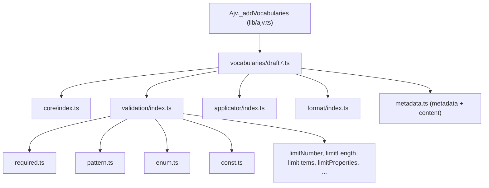

# ajv-architecture-001: Where validation keywords are registered

**Answer:** `lib/vocabularies/validation/index.ts`

## How a strong engineer would navigate there

Follow registration from the class downward, one import at a time.

1. `lib/ajv.ts` defines `class Ajv extends AjvCore` and overrides one method, `_addVocabularies`:

```ts
// lib/ajv.ts:12-16
_addVocabularies(): void {
  super._addVocabularies()
  draft7Vocabularies.forEach((v) => this.addVocabulary(v))
  if (this.opts.discriminator) this.addKeyword(discriminator)
}
```

2. `draft7Vocabularies` is imported from `./vocabularies/draft7`. That file is a list of lists:

```ts
// lib/vocabularies/draft7.ts:8-15
const draft7Vocabularies: Vocabulary[] = [
  coreVocabulary,
  validationVocabulary,
  getApplicatorVocabulary(),
  formatVocabulary,
  metadataVocabulary,
  contentVocabulary,
]
```

3. `validationVocabulary` is imported from `./validation`, which resolves to `lib/vocabularies/validation/index.ts`. That file has the single list the prompt describes:

```ts
// lib/vocabularies/validation/index.ts:13-31
const validation: Vocabulary = [
  // number
  limitNumber,
  multipleOf,
  // string
  limitLength,
  pattern,
  // object
  limitProperties,
  required,
  // array
  limitItems,
  uniqueItems,
  // any
  {keyword: "type", schemaType: ["string", "array"]},
  {keyword: "nullable", schemaType: "boolean"},
  constKeyword,
  enumKeyword,
]
```

`required`, `pattern`, `enum` (as `enumKeyword`) and `const` (as `constKeyword`) all appear, next to the length, item and property-count limits. You are in the right place.

## The registration tree



`AjvCore.addVocabulary` (`lib/core.ts:584`) is just `for (const def of definitions) this.addKeyword(def)`. A vocabulary is an array of keyword definitions, and each element becomes one `addKeyword` call.

Note that a single definition can cover several keywords. `limitLength.ts` registers `["maxLength", "minLength"]`, and `limitNumber.ts` registers `Object.keys(KWDs)`. So the list has 12 entries but registers more keywords than that. The `type` and `nullable` entries are bare `{keyword, schemaType}` objects with no code. They register the names so the schema is accepted, while the actual type checks are generated elsewhere, in `lib/compile/validate/dataType.ts`.

## Why other files are wrong

- **`lib/vocabularies/validation/required.ts`, `pattern.ts`, `enum.ts`, `const.ts`** each export one keyword definition with its `code` function. The prompt asks for the list, not an implementation.
- **`lib/vocabularies/draft7.ts`** combines whole vocabularies. It never names `required` or `pattern`.
- **`lib/vocabularies/draft2020.ts`** is the same idea for the 2020-12 draft class (`lib/2020.ts`). It also reuses `validationVocabulary` and lists no individual keywords. It isn't used by the default `Ajv` class.
- **`lib/vocabularies/next.ts`** lists `dependentRequired`, `dependentSchemas` and `limitContains`. These newer keywords live in the `validation/` and `applicator/` folders but are registered by this separate list, only for the newer drafts.
- **`lib/vocabularies/applicator/index.ts`** registers subschema keywords such as `properties`, `items` and `allOf`, not `required` or `enum`.
- **`lib/vocabularies/jtd/index.ts`** has its own `enum` entry, but it is the JSON Type Definition vocabulary used by `lib/jtd.ts`, not by the default `Ajv` class. It has no `required`, `pattern` or `const`.
- **`lib/core.ts`** has the generic `addVocabulary` and `addKeyword` methods but no list of built-in keywords. Its own `_addVocabularies` registers only `$async`.
- **`lib/ajv.ts`** starts the registration but imports the list from `draft7.ts`. It is also not under `lib/vocabularies/`.

## Design note

Splitting keywords into vocabularies mirrors how the JSON Schema spec itself groups them (core, validation, applicator, format, meta-data, content). It also makes the different Ajv classes cheap to build: `Ajv` (draft-07), `Ajv2019` and `Ajv2020` each compose a different list of the same vocabulary modules, and the keyword implementations are shared.

## Takeaways

- Plugin-style registries usually have three layers: the class that triggers registration, a list of groups, and per-group lists. The per-group `index.ts` is where you add or remove a single item.
- An `index.ts` that imports many sibling files and exports one array is a strong sign you've found a registry.
