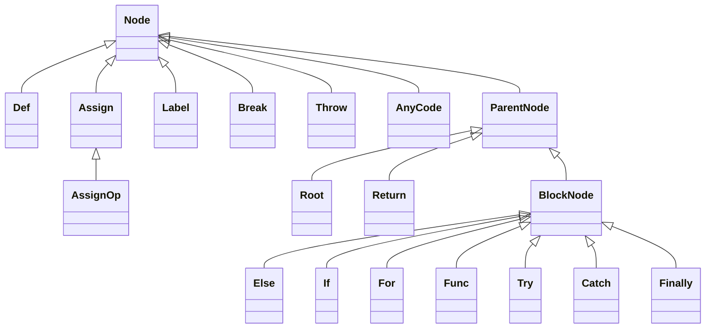

# ajv-architecture-002: Block nodes in the code generator

**Answer:**

- `lib/compile/codegen/index.ts#Else`
- `lib/compile/codegen/index.ts#If`
- `lib/compile/codegen/index.ts#For`
- `lib/compile/codegen/index.ts#Func`
- `lib/compile/codegen/index.ts#Try`
- `lib/compile/codegen/index.ts#Catch`
- `lib/compile/codegen/index.ts#Finally`

## How a strong engineer would find them

The question is about direct subclasses, so the exact text `extends BlockNode` is what to search for. Searching `lib/compile/codegen/index.ts` for it gives exactly seven hits:

```text
220  class Else extends BlockNode
224  class If extends BlockNode
277  abstract class For extends BlockNode
348  class Func extends BlockNode
372  class Try extends BlockNode
409  class Catch extends BlockNode
420  class Finally extends BlockNode
```

Then check the near misses with a broader search for `class ` in the same file, to make sure nothing reaches `BlockNode` by another route that the prompt still counts. Nothing does.

## The full hierarchy



`For` has three subclasses of its own, `ForLoop`, `ForRange` and `ForIter` (lines 281, 301, 323). They are left out of the diagram to keep it readable, and they are exactly the "extends another subclass of `BlockNode`" case the prompt excludes.

## What `BlockNode` actually adds

`ParentNode` is any node with children. It renders them by concatenation and handles optimization passes. `BlockNode` adds exactly one thing, the curly braces:

```ts
// lib/compile/codegen/index.ts:212-216
abstract class BlockNode extends ParentNode {
  render(opts: CGOptions): string {
    return "{" + opts._n + super.render(opts) + "}" + opts._n
  }
}
```

Each subclass then prepends its own header. `If` renders `if(${this.condition})` before the braces, `Func` renders `function name(args)`, `Catch` renders `catch(err)`, and so on. That is why `Root` and `Return` are *not* block nodes: the root of the generated code has no braces around it, and `return` is followed by an expression, not a block (`"return " + super.render(opts)`, line 368).

## Why other classes are wrong

- **`ForLoop`, `ForRange`, `ForIter`** extend `For`, which extends `BlockNode`. They are grandchildren, which the prompt excludes.
- **`Root`** (line 218) and **`Return`** (line 364) extend `ParentNode`. They are siblings of `BlockNode`, not children.
- **`BlockNode`** itself is the base class, not a subclass of itself.
- **`ParentNode`** and **`Node`** are further up the hierarchy.
- **`Def`, `Assign`, `Label`, `Break`, `Throw`, `AnyCode`** are leaf nodes that extend `Node` directly. **`AssignOp`** extends `Assign`.
- **`CodeGen`** (line 454) is the builder class that creates and nests these nodes. It extends nothing.
- **Classes in `code.ts` and `scope.ts`** (`_CodeOrName`, `Name`, `_Code`, `Scope`, `ValueScope`, `ValueScopeName`, `ValueError`) model code fragments and variable scopes, not tree nodes. They are also in other files.

## Why the code generator looks like this

Ajv compiles each schema into JavaScript source and then into a function. Rather than concatenate strings directly, it builds a small syntax tree, which lets it run passes such as `optimizeNodes` (drop empty blocks, collapse constant `if` conditions) and `optimizeNames` (remove unused variables) before rendering. The class hierarchy mirrors JavaScript syntax: statements without bodies are leaves, constructs with `{ ... }` bodies are block nodes, and a few odd ones (`Root`, `Return`) hold children without braces.

## Takeaways

- For "direct subclass" questions, search for the literal `extends X`. Then list the indirect ones separately so you can rule them out on purpose.
- When a base class is very small, read what it overrides. That one method usually explains why some siblings were left out of it.
