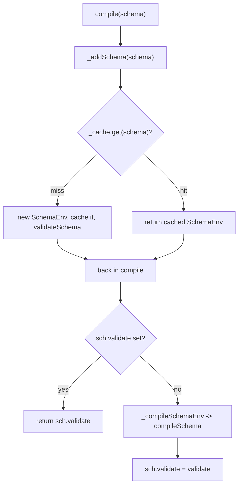

# ajv-architecture-003: Compiling the same schema twice

**Answer:** option d. `compileSchema` does not run again, and the second call returns the validation function stored on the cached schema entry from the first call.

## The two methods to read

`Ajv.compile` is two lines:

```ts
// lib/core.ts:388-391
compile<T = unknown>(schema: AnySchema, _meta?: boolean): AnyValidateFunction<T> {
  const sch = this._addSchema(schema, _meta)
  return (sch.validate || this._compileSchemaEnv(sch)) as AnyValidateFunction<T>
}
```

So the answer depends on two questions. Does `_addSchema` hand back the same `SchemaEnv` the second time? And is `sch.validate` already set on it?

`_addSchema` (line 699) checks a cache keyed by the schema object before doing anything else:

```ts
// lib/core.ts:714-720
let sch = this._cache.get(schema)
if (sch !== undefined) return sch

baseId = normalizeId(id || baseId)
const localRefs = getSchemaRefs.call(this, schema, baseId)
sch = new SchemaEnv({schema, schemaId, meta, baseId, localRefs})
this._cache.set(sch.schema, sch)
```

`_cache` is declared as `Map<AnySchema, SchemaEnv>` (line 288), so the key is the schema object's identity. The prompt says the same reference is passed both times, so the second `get` hits.

And `compileSchema` in `lib/compile/index.ts` stores its result on that entry before returning: `sch.validate = validate` (line 192).

## First call vs second call

| Step | First `compile(schema)` | Second `compile(schema)` |
|---|---|---|
| `_cache.get(schema)` | miss | hit, returns the same `SchemaEnv` |
| New `SchemaEnv`, `getSchemaRefs` | yes | skipped |
| `this.refs[baseId] = sch` | yes | skipped |
| `validateSchema(schema, true)` (default option on) | yes | skipped |
| `sch.validate` in `compile` | `undefined` | the function from call 1 |
| `_compileSchemaEnv` → `compileSchema` | runs | not called (`\|\|` short-circuits) |
| Return value | new function `f` | the same `f` |



So `ajv.compile(schema) === ajv.compile(schema)` is `true` for the same object.

## Why the other options are wrong

- **a, a second, separate function.** That would need either a cache miss or `sch.validate` to be empty. Neither happens: the cache returns the same `SchemaEnv`, and `compileSchema` set `sch.validate` on it the first time. (`compileSchema` also has its own guard, `getCompilingSchema`, for schemas that are mid-compilation, but it is never reached here.)
- **b, the cached function wrapped in a new function.** `compile` returns `sch.validate` as is, with only a TypeScript `as` cast, which has no runtime effect. Nothing creates a wrapper.
- **c, throws because the key already exists.** The "already exists" error comes from `_checkUnique` (line 730-734), and it can't fire here for two reasons. First, the cache hit returns before line 723, where `_checkUnique` would be called. Second, even on the first call it is guarded by `if (baseId)`. With no `$id`, `normalizeId` leaves `baseId` empty, so `_checkUnique` is never called for this schema at all. That error is what `addSchema` with a duplicate key or `$id` produces, not `compile`.

## A trap worth noticing

The cache is keyed by **reference**, not by content. If you build a structurally identical schema object each time (for example inside a request handler: `ajv.compile({type: "string"})`), every call misses the cache. Ajv then compiles a new function each time, and each new `SchemaEnv` stays in `_cache`. This is a common cause of slow Ajv usage and growing memory. The fix is to compile once at module load, or to give the schema an `$id` and use `addSchema` plus `getSchema`.

## Takeaways

- When a method looks like `return cached || compute()`, find where `cached` is written. Here it is the last step of `compileSchema`, one file away.
- Check what a `Map` cache uses as its key. Object keys mean identity, and that decides whether "the same schema" counts as the same.
