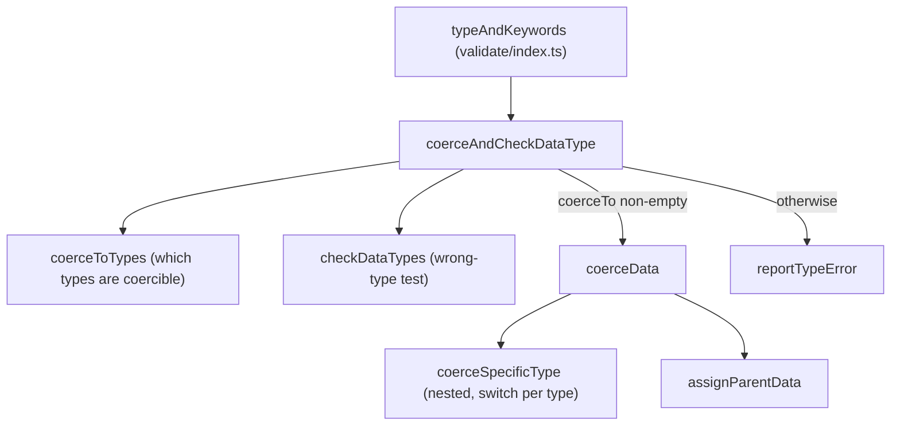

# ajv-find-001: Per-type coercion rules

**Answer:** `lib/compile/validate/dataType.ts#coerceData`

## How a strong engineer would navigate there

1. Search `lib/compile/validate/` for the option name, `coerceTypes`. Every hit is in `dataType.ts`: in `coerceAndCheckDataType` (line 42), `coerceToTypes` (lines 57-59) and `coerceData` (lines 67 and 77).
2. Find the entry point. `typeAndKeywords` in `lib/compile/validate/index.ts:160` calls `coerceAndCheckDataType(it, types)`. That function is small:

```ts
// lib/compile/validate/dataType.ts:46-51
if (checkTypes) {
  const wrongType = checkDataTypes(types, data, opts.strictNumbers, DataType.Wrong)
  gen.if(wrongType, () => {
    if (coerceTo.length) coerceData(it, types, coerceTo)
    else reportTypeError(it)
  })
}
```

It decides, and then delegates. The prompt excludes "the function that merely decides whether to coerce and calls it", so jump into `coerceData`.

3. The hint says the rules are a `switch` over the type name. `coerceData` (line 63) contains a nested helper, `coerceSpecificType` (line 90), whose body is exactly that `switch`. Because the prompt says "directly or in a nested helper", and the nested helper isn't a top-level symbol, the answer is the enclosing top-level function, `coerceData`.

## The call structure



## What the rules look like

The nested helper emits one `else if` branch per target type into the generated code. Two of the cases the prompt mentions:

```ts
// lib/compile/validate/dataType.ts:115-121
case "boolean":
  gen
    .elseIf(_`${data} === "false" || ${data} === 0 || ${data} === null`)
    .assign(coerced, false)
    .elseIf(_`${data} === "true" || ${data} === 1`)
    .assign(coerced, true)
  return
```

```ts
// lib/compile/validate/dataType.ts:92-98
case "string":
  gen
    .elseIf(_`${dataType} == "number" || ${dataType} == "boolean"`)
    .assign(coerced, _`"" + ${data}`)
    .elseIf(_`${data} === null`)
    .assign(coerced, _`""`)
  return
```

The full set of rules:

| Target type | Converts from | Result |
|---|---|---|
| `string` | number or boolean; `null` | `"" + data`; `""` |
| `number` | boolean, `null`, or a numeric string | `+data` |
| `integer` | same as number, plus `!(data % 1)` | `+data` |
| `boolean` | `"false"`, `0`, `null`; `"true"`, `1` | `false`; `true` |
| `null` | `""`, `0`, `false` | `null` |
| `array` | string, number, boolean or `null` (only with `coerceTypes: "array"`) | `[data]` |

The surrounding code in `coerceData` declares `dataType` and `coerced` variables (lines 65-66), opens an `if (coerced !== undefined)` with an empty body and chains the per-type `else if`s after it (lines 75-80), ends with an `else` that reports the type error, and finally writes `coerced` back to `data` and to the parent object (lines 85-88).

## Why other candidates are wrong

- **`coerceAndCheckDataType`** (line 40) decides whether a type check is needed and whether to coerce, then calls `coerceData` or `reportTypeError`. It contains no conversion rules. The prompt excludes it.
- **`coerceToTypes`** (line 57) filters the schema's types down to the coercible ones using the `COERCIBLE` set. It decides *which* types can be targets, not *how* to convert.
- **`COERCIBLE`** (line 56) is a constant set of type names, not a function.
- **`assignParentData`** (line 138) writes the coerced value back into the parent object after conversion. It has no per-type logic.
- **`checkDataType` / `checkDataTypes`** (line 145 onward) generate type *tests* such as `typeof data == "string"`. They are used to detect the wrong type, not to convert it.
- **`reportTypeError`** emits the error when no rule applies.
- **`typeAndKeywords`** in `validate/index.ts` is the caller further up. It does no coercion itself.
- **`coerceSpecificType`** holds the `switch`, but it is a nested function inside `coerceData`, not a top-level function. The prompt asks for the top-level function that contains the rules.

## Design note

Ajv doesn't coerce at validation time by interpreting the schema. It *generates* the coercion code once, at compile time, and only for the types listed in the schema. A schema with `type: "number"` gets only the `number` branch. The `gen.if(...).elseIf(...)` chain is Ajv's code generator API (see `lib/compile/codegen/index.ts`), which is why the rules read like JavaScript written inside template literals.

## Takeaways

- Searching for an option name is a fast way into a feature. Then work out which hit decides and which hit does the work.
- Nested helper functions are often where the real logic lives. When a puzzle asks for the top-level symbol, select the enclosing function.
