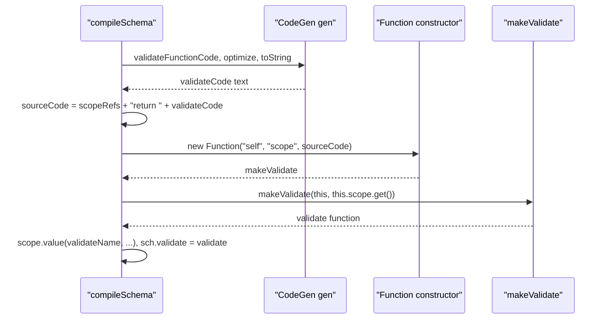

# ajv-find-002: Source text becomes a function

**Answer:** lines 171-172 of `lib/compile/index.ts`: `const makeValidate = new Function(...)` and `const validate: AnyValidateFunction = makeValidate(this, this.scope.get())`.

## How a strong engineer would navigate there

1. Open `compileSchema` in `lib/compile/index.ts` (line 111). Skim for the point where code generation finishes. `validateFunctionCode(schemaCxt)` on line 163 fills the `CodeGen`, then `gen.optimize(...)` and `gen.toString()` produce text.
2. Turning text into a callable function in JavaScript means `new Function` or `eval`. Search the file for `new Function`. There is exactly one hit, on line 171.
3. The next line calls the result. Those are the two statements.

## The lines in context

```ts
// lib/compile/index.ts:163-173
validateFunctionCode(schemaCxt)
gen.optimize(this.opts.code.optimize)
// gen.optimize(1)
const validateCode = gen.toString()
sourceCode = `${gen.scopeRefs(N.scope)}return ${validateCode}`
// console.log((codeSize += sourceCode.length), (nodeCount += gen.nodeCount))
if (this.opts.code.process) sourceCode = this.opts.code.process(sourceCode, sch)
// console.log("\n\n\n *** \n", sourceCode)
const makeValidate = new Function(`${N.self}`, `${N.scope}`, sourceCode)
const validate: AnyValidateFunction = makeValidate(this, this.scope.get())
this.scope.value(validateName, {ref: validate})
```

Select lines 171 and 172. The selection must cover both lines and stay within 163-185.

## Why two steps instead of one

The generated code is not the validation function itself. It is the *body of a factory* that returns the validation function (the source shown below is illustrative):

```text
new Function("self", "scope", sourceCode)
             |        |        |
             |        |        "const schema0 = scope.schema[0]; ... return function validate0(data, ...) {...}"
             |        the scope store (schemas, regexps, formats, other validators)
             the Ajv instance
```

`N.self` and `N.scope` are `Name` objects for the strings `"self"` and `"scope"` (`lib/compile/names.ts:18-19`). The first part of `sourceCode`, from `gen.scopeRefs(N.scope)`, declares local constants that read values out of `scope`, such as the schema object or compiled regular expressions. Then `return <validateCode>` returns the actual function.

Calling `makeValidate(this, this.scope.get())` runs that prologue once and hands back a closure over those constants. That is how the generated validator can use non-serializable values (regexps, user format functions, other compiled validators) without them being written into the source text.



## Why other selections are wrong

- **Line 163** (`validateFunctionCode(schemaCxt)`) builds the code tree. Nothing is executable yet.
- **Lines 166-167** turn the tree into text and add the scope prologue. They produce a string, not a function.
- **Line 169** (`opts.code.process`) is an optional user hook that rewrites the source string, for example to format it. It doesn't create anything.
- **Line 173** (`this.scope.value(validateName, {ref: validate})`) registers the finished function in the scope so other schemas (and recursive `$ref`s) can call it. It runs after the function exists.
- **Lines 175-192** set `errors`, `schema`, `schemaEnv`, `source` and `evaluated` on the function, then store it as `sch.validate`. That decorates the result rather than creating it.
- **Only line 171** leaves line 172 uncovered. Line 171 gives you a factory, not the validation function.
- **`new Function` in `lib/compile/jtd/parse.ts:69` or `lib/compile/jtd/serialize.ts:65`** uses the same pattern for JTD parsers and serializers, but those are different files and not part of `compileSchema`.
- **The whole `try` block** (lines 161-193) is wider than the allowed window.

## Design note

`new Function` runs the text in the global scope, not the surrounding closure, so the generated code can only see what is passed in explicitly. That is why `self` and `scope` are parameters. It also explains why Ajv needs `unsafe-eval` under a strict Content Security Policy, and why `lib/standalone/` exists: with `code.source` enabled it writes the same generated code out as a module, so it can be shipped pre-compiled.

## Takeaways

- To find where a code generator becomes runnable, search for `new Function` or `eval`. It is usually a single, well-guarded spot.
- "Factory that returns the function" is a common trick for injecting runtime values into generated code without serializing them.
