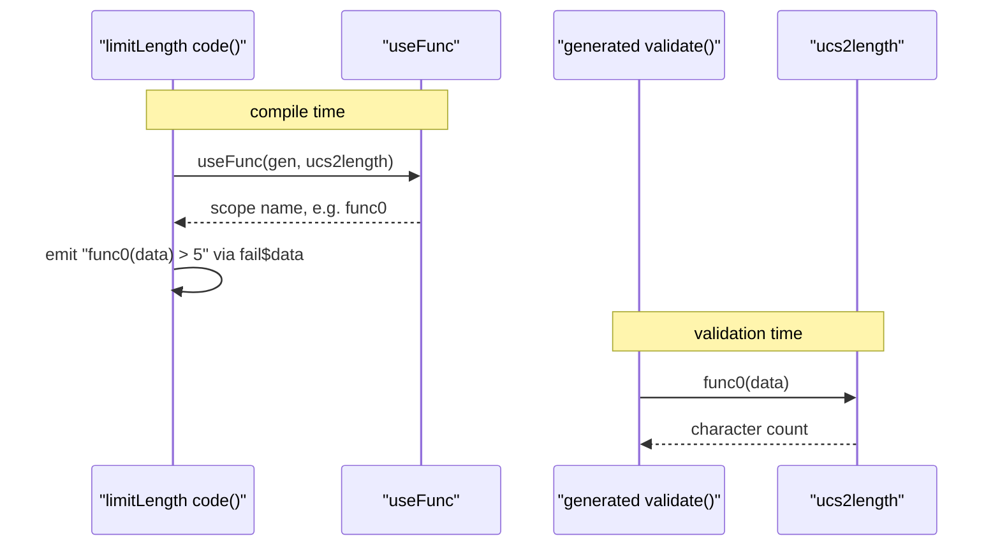

# ajv-find-003: Counting characters for maxLength

**Answer:** `lib/runtime/ucs2length.ts#ucs2length`

## How a strong engineer would navigate there

1. Open `lib/vocabularies/validation/limitLength.ts`. It is short. The interesting part is the keyword's `code` function:

```ts
// lib/vocabularies/validation/limitLength.ts:21-27
code(cxt: KeywordCxt) {
  const {keyword, data, schemaCode, it} = cxt
  const op = keyword === "maxLength" ? operators.GT : operators.LT
  const len =
    it.opts.unicode === false ? _`${data}.length` : _`${useFunc(cxt.gen, ucs2length)}(${data})`
  cxt.fail$data(_`${len} ${op} ${schemaCode}`)
},
```

2. With default options `unicode` is not `false`, so the generated length expression is a call: `<name>(data)`. The name comes from `useFunc(cxt.gen, ucs2length)`.
3. `ucs2length` is an import at the top of the file: `import ucs2length from "../../runtime/ucs2length"` (line 5). Jump to it. That is the function the generated code will call.

## Compile time vs validation time

This puzzle hinges on separating two moments:



`limitLength.ts` and `useFunc` run once, while Ajv compiles the schema. They produce code. `ucs2length` runs every time the compiled validator checks a string. The prompt asks for the one that counts at validation time.

## What the helper does

```ts
// lib/runtime/ucs2length.ts:3-18
export default function ucs2length(str: string): number {
  const len = str.length
  let length = 0
  let pos = 0
  let value: number
  while (pos < len) {
    length++
    value = str.charCodeAt(pos++)
    if (value >= 0xd800 && value <= 0xdbff && pos < len) {
      // high surrogate, and there is a next character
      value = str.charCodeAt(pos)
      if ((value & 0xfc00) === 0xdc00) pos++ // low surrogate
    }
  }
  return length
}
```

JavaScript strings are sequences of UTF-16 code units, and `.length` counts code units. A character outside the Basic Multilingual Plane, such as most emoji, is stored as two units: a high surrogate (`0xD800`-`0xDBFF`) followed by a low surrogate (`0xDC00`-`0xDFFF`). The loop counts one character per unit, but skips the low half of a valid surrogate pair. So for the single character U+1F600 (written `"\u{1F600}"`), `.length` is 2 while `ucs2length` returns 1.

JSON Schema defines `maxLength` and `minLength` in terms of characters, which is why counting code points is the default. The option description in `lib/core.ts:213` says the same: `"minLength"/"maxLength" account for unicode characters by default.`

The last line of the file, `ucs2length.code = 'require("ajv/dist/runtime/ucs2length").default'`, is what lets `useFunc` describe the function as source code. Standalone code generation uses that string to `require` the helper instead of embedding a reference.

## Why other candidates are wrong

- **`useFunc`** (`lib/compile/util.ts:173`) is the function that "makes it available to the generated code", which the prompt excludes. It calls `gen.scopeValue("func", {ref: f, code: ...})` and returns a `Name`. It never sees the string being validated.
- **The keyword definition's `code` method** in `limitLength.ts` builds the comparison expression at compile time. It doesn't count anything.
- **`cxt.fail$data`** emits the failure branch (and handles `$data` references). It is generic keyword plumbing.
- **`String.prototype.length`** is what the generated code uses only when `unicode: false`. It isn't a function in the snapshot, and the prompt rules that path out.
- **Other runtime helpers** in `lib/runtime/` (`equal`, `quote`, `timestamp`, `uri`, `re2`, `parseJson`) are loaded through the same `useFunc` mechanism by other keywords, but they don't count characters.

## Takeaways

- In code generators, distinguish the code that *writes* the check from the code that *runs* the check. Ajv puts the second kind in `lib/runtime/`, which is a useful folder to know.
- When a prompt says "counts characters", watch for the UTF-16 versus code-point distinction. It is a common source of subtle string bugs in JavaScript.
