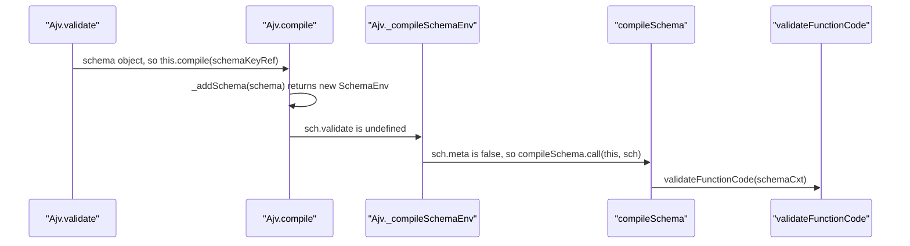

# ajv-trace-001: From validate to code generation

**Answer (in order):**

1. `lib/core.ts#Ajv.validate`
2. `lib/core.ts#Ajv.compile`
3. `lib/core.ts#Ajv._compileSchemaEnv`
4. `lib/compile/index.ts#compileSchema`
5. `lib/compile/validate/index.ts#validateFunctionCode`

## The call sequence



## Step by step

**`Ajv.validate` → `Ajv.compile`.** `validate` (`lib/core.ts:355`, the implementation after a stack of overloads) branches on the type of its first argument:

```ts
// lib/core.ts:360-365
if (typeof schemaKeyRef == "string") {
  v = this.getSchema<T>(schemaKeyRef)
  if (!v) throw new Error(`no schema with key or ref "${schemaKeyRef}"`)
} else {
  v = this.compile<T>(schemaKeyRef)
}
```

The prompt says a schema object, so the `else` branch runs.

**`Ajv.compile` → `Ajv._compileSchemaEnv`.**

```ts
// lib/core.ts:389-390
const sch = this._addSchema(schema, _meta)
return (sch.validate || this._compileSchemaEnv(sch)) as AnyValidateFunction<T>
```

The schema has never been compiled, so `_addSchema` creates a fresh `SchemaEnv` with no `validate` yet. The `||` falls through to `_compileSchemaEnv`.

**`Ajv._compileSchemaEnv` → `compileSchema`.**

```ts
// lib/core.ts:736-738
private _compileSchemaEnv(sch: SchemaEnv): AnyValidateFunction {
  if (sch.meta) this._compileMetaSchema(sch)
  else compileSchema.call(this, sch)
```

The schema is not a meta-schema, so `sch.meta` is falsy. `compileSchema.call(this, sch)` is still a direct call to `compileSchema`. `.call` just supplies `this`, because `compileSchema` is declared with a `this: Ajv` parameter.

**`compileSchema` → `validateFunctionCode`.** `compileSchema` (`lib/compile/index.ts:111`) builds a `CodeGen` and a `schemaCxt`, then calls `validateFunctionCode(schemaCxt)` on line 163. That is the function exported from `lib/compile/validate/index.ts` (line 38) that starts generating code for the root schema. The trace ends here.

## Why other sequences are wrong

- **Going through `getSchema`.** `validate → getSchema → _compileSchemaEnv → compileSchema → validateFunctionCode` is the same length and also valid code, but `getSchema` is only called when the first argument is a string key. The prompt fixes it to a schema object.
- **Including `_addSchema`.** `compile` calls it, but the next link, `_compileSchemaEnv`, is called by `compile`, not by `_addSchema`. `_addSchema` registers the schema and returns.
- **Following meta-schema validation.** With the default `validateSchema` option, `_addSchema` calls `this.validateSchema(schema, true)` (line 726), which calls `this.validate($schema, schema)` with the meta-schema's string id. That leads through `getSchema`, `_compileSchemaEnv` and, for the meta-schema, `_compileMetaSchema` before reaching `compileSchema`. It compiles the meta-schema, not the schema passed to `validate`. The prompt says to ignore it.
- **Including `_compileMetaSchema`.** It also calls `compileSchema`, but only when `sch.meta` is true. Ordinary schemas skip it.
- **Ending at `validateFunction`, `topSchemaObjCode` or `checkKeywords`.** These are internal (non-exported) helpers called from `validateFunctionCode` (lines 40-46). They come after the end condition.
- **Ending at `compileSchema`.** It is in `lib/compile/index.ts`, not `lib/compile/validate/index.ts`, and it doesn't generate the validation code itself. It delegates.
- **Leaving out `Ajv.validate`.** The prompt says to include the start function.

## Background

The chain shows Ajv's layering. `lib/core.ts` handles the public API, schema registration and caching. `lib/compile/index.ts` owns one compilation: it sets up the code generator, then turns the resulting text into a function with `new Function`. `lib/compile/validate/` walks the schema and its keywords to generate the body. Calling `validate` with a schema object is a convenience that compiles on first use. The same `compile` path also returns the cached function on later calls, because `sch.validate` is set by then.

## Takeaways

- Overloaded TypeScript methods can hide the real implementation under a dozen signatures. Scroll to the one with a body.
- `fn.call(this, ...)` is still a direct call to `fn`. Don't skip it when building a call chain.
- When a prompt says "ignore X along the way", expect X to create a tempting detour, and note exactly where it branches off.
