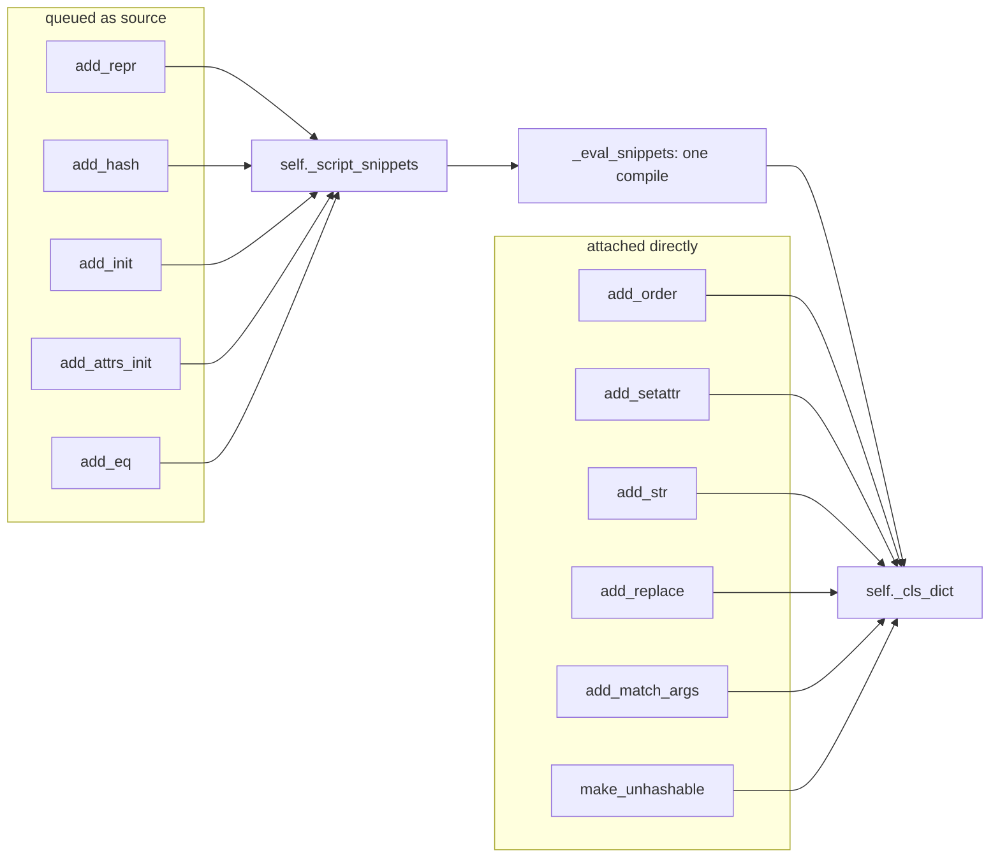

# attrs-architecture-002: Methods compiled in one pass

**Answer:** `_ClassBuilder.add_repr`, `_ClassBuilder.add_hash`, `_ClassBuilder.add_init`, `_ClassBuilder.add_attrs_init` and `_ClassBuilder.add_eq`, all in `src/attr/_make.py`.

## How a strong engineer gets there

1. **Find the single pass.** `_ClassBuilder.build_class` (line 800) starts with `self._eval_snippets()`. That method (line 782) joins every entry of `self._script_snippets`, compiles the result once with `_linecache_and_compile`, and then runs each entry's hook to attach the compiled function to the class dictionary.
2. **Find what fills the queue.** Search the file for `_script_snippets`. Apart from the slot declaration (line 670), the initialization (line 765) and the reads in `_eval_snippets` (lines 786-797), there are exactly five appends:

   | Line | Method | Generated source from |
   |---|---|---|
   | 1010 | `add_repr` | `_make_repr_script` |
   | 1081 | `add_hash` | `_make_hash_script` |
   | 1106 | `add_init` | `_make_init_script(..., attrs_init=False)` |
   | 1146 | `add_attrs_init` | `_make_init_script(..., attrs_init=True)` |
   | 1158 | `add_eq` | `_make_eq_script` |

   Each one has the same shape. For example:

   ```python
   # src/attr/_make.py, lines 1150-1158
   def add_eq(self):
       cd = self._cls_dict

       script, globs = _make_eq_script(self._attrs)

       def _attach_eq(cls_dict, globs):
           cls_dict["__eq__"] = self._add_method_dunders(globs["__eq__"])

       self._script_snippets.append((script, globs, _attach_eq))
   ```

   The tuple is `(source, globals the source needs, hook that attaches the result)`.

## Structure



## Why the decoys are wrong

- **`add_order`** puts `__lt__`, `__le__`, `__gt__` and `__ge__` into `_cls_dict` directly. They are closures returned by `_make_order` (line 1779), not generated source.
- **`add_setattr`** defines `__setattr__` as a nested function and stores it directly.
- **`add_str`**, **`add_replace`** and **`add_match_args`** store a closure, or a tuple of names, straight into `_cls_dict`.
- **`add_eq` is also partly direct.** It stores `__ne__` (a module-level function) straight into the dictionary, but it still queues the generated `__eq__`, so it belongs in the set.
- **`make_unhashable`** sets `__hash__` to `None` and generates nothing.
- **`_eval_snippets` and `build_class`** consume the queue rather than adding to it.
- **`_add_hash`, `_add_eq` and `_add_repr` (module level, around lines 1716-1922)** generate source too, but they are functions, not `_ClassBuilder` methods, and they compile immediately. attrs uses them on its own internal classes, such as `Attribute` and `Factory`.

## Background: what decides "generate source" versus "closure"

The methods that are generated as source are the ones called most often, and the ones whose bodies depend on the list of fields: constructing, comparing, hashing and printing instances. Generating `self.x == other.x and self.y == other.y` as real code avoids a loop over fields on every call. Rarer methods, or ones that are easy to write generically, such as ordering and `__setattr__` with hooks, stay as ordinary closures. Compiling all queued snippets in one script keeps the cost of class creation down. That matters because attrs runs at import time for every decorated class.

## Takeaways

- To understand a builder, find the one place it finalizes (`build_class`), then search for every writer of the state it consumes.
- Find references on a private attribute like `_script_snippets` is often the fastest way to enumerate a design's participants.
