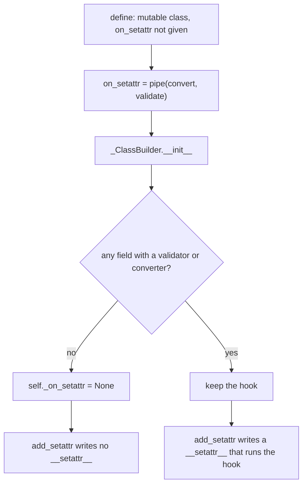

# attrs-find-002: Skipping a hook nobody needs

**Answer:** `src/attr/_make.py`, lines 745-756, the `if` statement at the end of the `elif self._on_setattr in (...)` branch of `_ClassBuilder.__init__`.

```python
# src/attr/_make.py, lines 745-756
if (
    (
        self._on_setattr == _DEFAULT_ON_SETATTR
        and not (has_validator or has_converter)
    )
    or (self._on_setattr == setters.validate and not has_validator)
    or (self._on_setattr == setters.convert and not has_converter)
):
    # If class-level on_setattr is set to convert + validate, but
    # there's no field to convert or validate, pretend like there's
    # no on_setattr.
    self._on_setattr = None
```

## How a strong engineer gets there

1. **Where does the hook come from?** In `define.wrap` (`src/attr/_next_gen.py`, lines 399-400), a mutable class with no explicit `on_setattr` gets `_DEFAULT_ON_SETATTR`, which `_make.py` defines at line 57 as `setters.pipe(setters.convert, setters.validate)`.
2. **Where is it stored?** `_ClassBuilder.__init__` copies it to `self._on_setattr`. Search the method for `_on_setattr`.
3. **Where can it be turned off?** The only assignment of `None` is line 756. Read upwards from there:
   - Line 731: the branch only runs for the three "built-in" hooks: the default pipe, `setters.validate` and `setters.convert`. A custom hook is never dropped, because attrs can't know what it does.
   - Lines 736-744: a loop over the fields sets `has_validator` and `has_converter`, stopping early once both are found.
   - Lines 745-756: the decision. The default hook is dropped when no field has a validator *or* converter. `validate` alone is dropped when no field has a validator, and `convert` alone when no field has a converter.

## Why it matters

`self._on_setattr` feeds `_ClassBuilder.add_setattr`. With no hook left on any field, `add_setattr` finds no attributes to wrap and returns without writing a `__setattr__`, so instances use plain `object.__setattr__`. The default "convert and validate on assignment" behaviour then costs nothing for the many classes that have no validators or converters.



## Why nearby code is wrong

- **Lines 726-730 (`if props.is_frozen:`)** install `_frozen_setattrs`. That is the frozen case, where on_setattr hooks don't apply at all.
- **Lines 736-744 (the field loop)** gather the facts the decision needs, but they don't make it. The prompt asks for the `if` statement through the line that switches the hook off.
- **`_ClassBuilder.add_setattr`** (line 1174) is the consumer of the decision, not the place where it is made.

## Takeaways

- To find where a value gets disabled, search for the assignment to `None` (or `False`), then read the condition guarding it.
- Libraries with "safe by default" behaviour often have a matching "skip it when it can't matter" optimisation nearby. When you see a default that sounds expensive, look for one.
