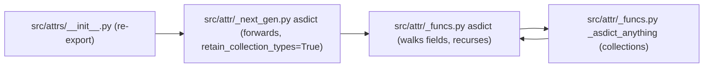

# attrs-find-003: Where asdict really recurses

**Answer:** `src/attr/_funcs.py`

## How a strong engineer gets there

attrs ships two import names, `attr` (the classic API) and `attrs` (the newer one), and the newer package is mostly a thin layer. Follow the imports.

1. **`src/attrs/__init__.py`** defines nothing itself. It re-exports:

   ```python
   # src/attrs/__init__.py, line 26
   from attr._next_gen import asdict, astuple, inspect
   ```

2. **`src/attr/_next_gen.py`** has a real `asdict` function (line 627), but its body is a single call that only fixes one default:

   ```python
   # src/attr/_next_gen.py, lines 634-640
   return _asdict(
       inst=inst,
       recurse=recurse,
       filter=filter,
       value_serializer=value_serializer,
       retain_collection_types=True,
   )
   ```

   and `_asdict` is imported at the top of the file with `from ._funcs import asdict as _asdict`.

3. **`src/attr/_funcs.py`** defines `asdict` at line 26. Its body loops over `fields(inst.__class__)` and, for a value whose class is an attrs class, calls itself:

   ```python
   # src/attr/_funcs.py, lines 92-93
   elif has(value_type):
       rv[a.name] = asdict(
   ```

   For collections it hands each element to `_asdict_anything`, defined in the same file, which calls `asdict` again for attrs instances.



## Why the other files are wrong

- **`src/attrs/__init__.py`** only re-exports the name.
- **`src/attr/_next_gen.py`** forwards the call with different defaults. That is exactly what the prompt excludes.
- **`src/attr/__init__.py`** re-exports `asdict` from `._funcs` for the classic `attr.asdict` API. It defines nothing.
- **`src/attr/_make.py`** defines `fields`, which `asdict` uses to list the attributes, but the recursive conversion isn't there.

## Background

The two `asdict`s differ only in `retain_collection_types`. The classic `attr.asdict` turns every collection into a `list` by default, while `attrs.asdict` keeps tuples as tuples and sets as sets. Rather than duplicate the algorithm, the newer API wraps it and changes the default. That's a common way to evolve an API without breaking existing users.

## Takeaways

- When a package's `__init__.py` is all imports, it's a facade. Keep following the imports until you reach a body that does real work.
- A function that just calls another with a fixed keyword argument is a wrapper. It's worth noting what it changes, but the behavior lives in the callee.
