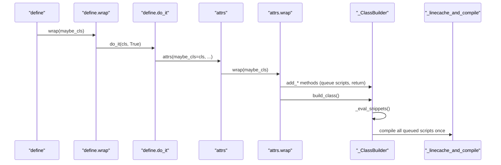

# attrs-trace-001: From @define to compiled methods

**Answer:** `define` -> `define.wrap` -> `define.do_it` -> `attrs` -> `attrs.wrap` -> `_ClassBuilder.build_class` -> `_ClassBuilder._eval_snippets` -> `_linecache_and_compile`

## How a strong engineer gets there

Work out the end first, then walk forward from the start.

**The end.** Search `src/attr/_make.py` for `linecache`. `_linecache_and_compile` (line 231) adds a fake `linecache` entry for the script, so debuggers can show the generated source, and then calls `_compile_and_eval`, which runs `compile` and `eval`. Find references on it to see who reaches it: `_ClassBuilder._eval_snippets` and `_make_cached_property_getattr`. The prompt's class has no `cached_property`, so only the first one matters.

**The start.** Now walk forward from `define`.

1. **`define`** (`src/attr/_next_gen.py`, line 23). Used bare, Python calls `define(C)`, so `maybe_cls` is the class:

   ```python
   # src/attr/_next_gen.py, lines 424-427
   if maybe_cls is None:
       return wrap

   return wrap(maybe_cls)
   ```

2. **`define.wrap`** (line 389) sets up the default on_setattr hook and checks frozen bases. Then, because `auto_attribs` defaults to `None`, it tries annotation-based fields first:

   ```python
   # src/attr/_next_gen.py, lines 414-420
   if auto_attribs is not None:
       return do_it(cls, auto_attribs)

   try:
       return do_it(cls, True)
   except UnannotatedAttributeError:
       return do_it(cls, False)
   ```

   All fields are annotated, so `do_it(cls, True)` succeeds and the fallback never runs.

3. **`define.do_it`** (line 362) is a single `return attrs(maybe_cls=cls, ...)` that passes the new-style defaults through to the classic decorator.

4. **`attrs`** (`src/attr/_make.py`, line 1353) normalizes `eq`, `order` and `hash`, then has the same "called with or without parentheses" ending as `define` (lines 1613-1616). `maybe_cls` is set, so it calls `wrap(maybe_cls)`.

5. **`attrs.wrap`** (line 1478) decides the class properties, constructs a `_ClassBuilder`, calls a series of `add_*` methods, and finishes with:

   ```python
   # src/attr/_make.py, line 1609
   return builder.build_class()
   ```

6. **`_ClassBuilder.build_class`** (line 800) starts with `self._eval_snippets()` (line 806), before it creates the slotted class.

7. **`_ClassBuilder._eval_snippets`** (line 782) joins every queued script into one and compiles it with a single call:

   ```python
   # src/attr/_make.py, lines 786-795
   script = "\n".join([snippet[0] for snippet in self._script_snippets])
   globs = {}
   for _, snippet_globs, _ in self._script_snippets:
       globs.update(snippet_globs)

   locs = _linecache_and_compile(
       script,
       _generate_unique_filename(self._cls, "methods"),
       globs,
   )
   ```

8. **`_linecache_and_compile`** is the end.

## Sequence diagram



## Why plausible wrong answers are wrong

- **Putting an `add_*` method on the stack** (for example `_ClassBuilder.add_init`). Those methods only build source text and queue it. They return before anything is compiled. The hint points at this trap.
- **Including `_ClassBuilder.__init__`.** It runs when `attrs.wrap` constructs the builder, and it returns before `build_class` is called. The prompt also skips constructors.
- **Ending at `_compile_and_eval`.** That function compiles and evaluates, but it never touches `linecache`. It is called *by* the end function.
- **Going through `_ClassBuilder._create_slots_class`.** `define` defaults to `slots=True`, so this does run, but only after `_eval_snippets` has returned. It reaches `_make_cached_property_getattr` (and so a second `_linecache_and_compile` call) only when the class has a `cached_property`, which the prompt rules out.
- **Skipping `define.do_it` or `attrs.wrap`.** Both are real frames. The nested functions exist so that the decorator works with and without parentheses, and every call goes through them.
- **Starting at `define.wrap`.** The prompt starts at `define`, which calls `wrap(maybe_cls)` itself because the decorator is used without parentheses.

## Background: why queue, then compile once

attrs generates `__init__`, `__repr__`, `__eq__` and `__hash__` as Python source because generated code is as fast as hand-written code. No loop over fields runs at call time. Compiling each method separately would cost one `compile` per method per class, at import time. Queuing the snippets and compiling them as one script in `_eval_snippets` keeps class creation cheap, and the `linecache` entry means tracebacks and `pdb` can still show the generated code.

## Takeaways

- For a long trace, find the end first and run find references on it. Here that cut the search from the whole builder down to two callers.
- Decorators that work both bare and with arguments always have a "`maybe_cls is None`" fork and a nested `wrap`. Expect the extra frames.
- "Call stack at the moment X" means only active frames. Code that prepared data and returned, like the `add_*` methods, is not on it.
