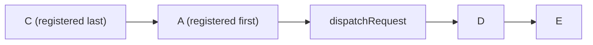

# axios-architecture-001: Interceptor running order

**Answer:** d, `C, A, dispatchRequest, D, E`

Request interceptors run in *reverse* order of registration, B is skipped by its `runWhen`, and response interceptors run in registration order.

## Following the code

**1. Which interceptors are kept.** `_request` walks the request interceptors in registration order (A, B, C). A `runWhen` that returns `false` makes it skip the interceptor before it's added to the chain:

```js
// lib/core/Axios.js:222-238
this.interceptors.request.forEach(function unshiftRequestInterceptors(interceptor) {
  if (typeof interceptor.runWhen === 'function' && interceptor.runWhen(config) === false) {
    return;
  }

  synchronousRequestInterceptors = synchronousRequestInterceptors && interceptor.synchronous;

  const transitional = config.transitional || transitionalDefaults;
  const legacyInterceptorReqResOrdering =
    transitional && transitional.legacyInterceptorReqResOrdering;

  if (legacyInterceptorReqResOrdering) {
    requestInterceptorChain.unshift(interceptor.fulfilled, interceptor.rejected);
  } else {
    requestInterceptorChain.push(interceptor.fulfilled, interceptor.rejected);
  }
});
```

**2. Which branch runs.** The default instance is `createInstance(defaults)`, and `defaults.transitional` is `lib/defaults/transitional.js`, where:

```js
// lib/defaults/transitional.js:7
legacyInterceptorReqResOrdering: true,
```

`mergeConfig` deep-merges `transitional` into the request config, so the flag is `true` and every kept interceptor is **unshifted**, added at the front:

```text
A  -> unshift -> [A]
B  -> skipped (runWhen returns false)
C  -> unshift -> [C, A]
```

**3. Response interceptors are always pushed** (lines 240-243), so they stay in order: `[D, E]`.

**4. Assembling the chain.** `use()` without options sets `synchronous: false`, so `synchronousRequestInterceptors` becomes `false` and `_request` builds one promise chain:

```js
// lib/core/Axios.js:249-259
if (!synchronousRequestInterceptors) {
  const chain = [dispatchRequest.bind(this), undefined];
  chain.unshift(...requestInterceptorChain);
  chain.push(...responseInterceptorChain);
  len = chain.length;

  promise = Promise.resolve(config);

  while (i < len) {
    promise = promise.then(chain[i++], chain[i++]);
  }
```

The chain is `[C, A, dispatchRequest, D, E]`, with each followed by its rejection handler, and each `then` runs after the previous one. If every interceptor were synchronous, the other branch (lines 264-310) would run the request interceptors in a loop and then call `dispatchRequest` directly, in the same order.



## Why the other options are wrong

- **a, `A, C, dispatchRequest, D, E`:** this is what happens with `transitional: { legacyInterceptorReqResOrdering: false }`, which pushes request interceptors instead. The default is `true`.
- **b, `C, B, A, ...`:** this ignores `runWhen`. B's check runs at chain-building time and returns `false`, so B never enters the chain.
- **c and e:** response interceptors are reversed in these, but `pushResponseInterceptors` always uses `push`, whatever the transitional flag says.

## Why axios behaves this way

Reversed request interceptors are long-standing axios behaviour: each new request interceptor wraps the ones added before it, a bit like decorators. Changing that would break existing apps, so the new registration-order behaviour sits behind a `transitional` flag that defaults to the old ordering. The flag is read from the merged `config` *per request*, so one call can opt in with `transitional: { legacyInterceptorReqResOrdering: false }` without changing the instance.

## Takeaways

- Before you trust a list's order, check every `unshift` and `push`, and any flag that switches between them.
- Flags in a "transitional" or "compat" object are where a library keeps old behaviour. Always check their default values.
