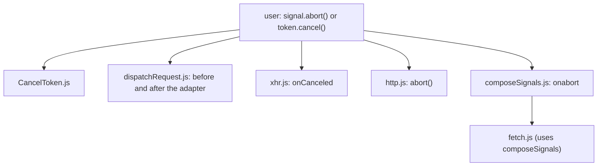

# axios-architecture-002: Where cancellation errors are born

**Answer:**

- `lib/adapters/http.js`
- `lib/adapters/xhr.js`
- `lib/cancel/CancelToken.js`
- `lib/core/dispatchRequest.js`
- `lib/helpers/composeSignals.js`

## How a strong engineer gets there

1. Open `lib/cancel/CanceledError.js` and run Find All References on the class.
2. Throw out the references that aren't constructions:
   - every `import CanceledError from ...` line,
   - `lib/axios.js`, which only exposes the class (`axios.CanceledError = CanceledError;` and the `axios.Cancel` alias),
   - the class's own file.
3. Six files import the class. Five of them contain `new CanceledError(`.

## Each construction site

| File | Line | When it fires |
|---|---|---|
| `lib/core/dispatchRequest.js` | 24 | `throwIfCancellationRequested` finds `config.signal.aborted` before dispatch, or after the adapter settles. |
| `lib/cancel/CancelToken.js` | 60 | The legacy `CancelToken`'s `cancel()` callback stores the error as `token.reason`. |
| `lib/adapters/xhr.js` | 284 | `onCanceled` in the browser adapter, when a token or signal fires mid-request (unless it already received an error with no `type`). |
| `lib/adapters/http.js` | 743, 1560 | The Node adapter's `abort()` helper, and a request body stream closing early ("Request stream has been aborted"). |
| `lib/helpers/composeSignals.js` | 24 | When a combined `AbortController` aborts for a reason that isn't already an `AxiosError`. |

## The trap: fetch.js

`lib/adapters/fetch.js` also handles cancellation, but it never imports `CanceledError`. It passes the request's `signal` (and `timeout`) to `composeSignals` (line 241), and the `CanceledError` is built there. A guess that "every adapter constructs one" gets fetch wrong.

## Why the other candidates are wrong

- **`lib/axios.js`:** it imports `CanceledError` to put it on the public `axios` object. That's a re-export, not a construction.
- **`lib/cancel/CanceledError.js`:** it defines the class and never calls `new` on it.
- **`lib/cancel/isCancel.js`:** it only checks the `__CANCEL__` flag that the constructor sets.
- **`lib/adapters/fetch.js`:** see above.
- **`lib/core/AxiosError.js`:** the base class. `AxiosError.ERR_CANCELED` is a code constant, and the file never builds a `CanceledError`.

## Design notes

Cancellation comes from several independent sources: the user's `AbortSignal`, the legacy `CancelToken`, transport-level aborts, and timeouts combined into one signal. Each source builds its own `CanceledError` close to where it detects the abort, so the error can carry the right `config` and `request`. Everything downstream relies only on `__CANCEL__` and `isCancel`, never on where the error came from.

## Takeaways

- When Find All References lists a class, sort the hits into imports, re-exports, type checks and constructions. The prompt usually wants one of those groups.
- An adapter that doesn't do something itself may hand it to a helper. Check the helpers each adapter imports before you rule a file out.
