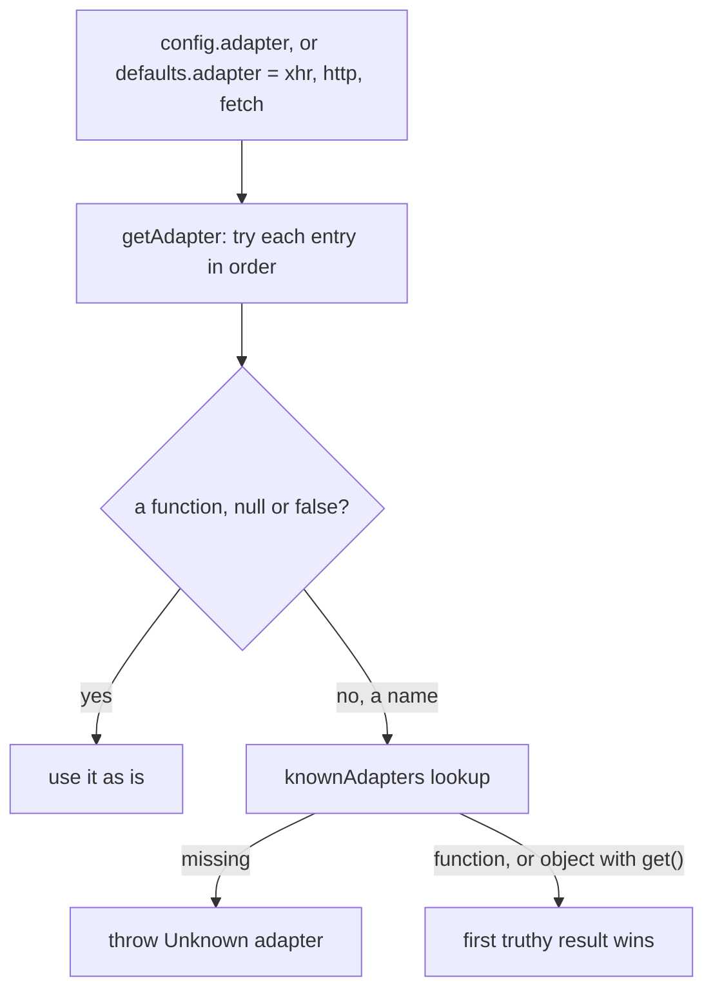

# axios-architecture-003: Naming a new adapter

**Answer:** `lib/adapters/adapters.js`

## How a strong engineer gets there

1. Find where the `adapter` option is used. In `dispatchRequest` it's handed straight to a helper:

   ```js
   // lib/core/dispatchRequest.js:83
   const adapter = adapters.getAdapter(config.adapter || defaults.adapter, config);
   ```

2. Go to the definition of `adapters` (the import at the top of the file) to reach `lib/adapters/adapters.js`. The name table is at the top:

   ```js
   // lib/adapters/adapters.js:16-22
   const knownAdapters = {
     http: httpAdapter,
     xhr: xhrAdapter,
     fetch: {
       get: fetchAdapter.getFetch,
     },
   };
   ```

3. `getAdapter` looks names up in that table, lower-cased, and throws for a name that isn't there:

   ```js
   // lib/adapters/adapters.js:80-86
   if (!isResolvedHandle(nameOrAdapter)) {
     adapter = knownAdapters[(id = String(nameOrAdapter)).toLowerCase()];

     if (adapter === undefined) {
       throw new AxiosError(`Unknown adapter '${id}'`);
     }
   }
   ```

So a new name has to go into `knownAdapters`.

## How adapter resolution works



The table holds two kinds of entry. `http` and `xhr` are adapter functions, or `false` when the environment can't support them (`isXHRAdapterSupported && function ...` in `xhr.js`). `fetch` is an object with a `get(config)` method, so whether fetch is usable is decided per request. `getAdapter` breaks out of the loop at the first adapter that's usable, and records why each rejected one was refused for its error message.

## Why the other candidates are wrong

| Candidate | Why |
|---|---|
| `lib/defaults/index.js` | It sets the default *preference order*, `adapter: ['xhr', 'http', 'fetch']`. The prompt excludes it. Adding a name there without a table entry would make every request fail as an unknown adapter. |
| `lib/core/dispatchRequest.js` | It calls `adapters.getAdapter` but doesn't know any names itself. |
| `lib/adapters/http.js`, `xhr.js`, `fetch.js` | These are adapter implementations. A new adapter's code could live in a file like these, but its name is registered in the table. |
| `lib/platform/` | It describes the environment (browser, Node, standard browser env) that the adapters check. It holds no adapters. |

## Design notes

Passing a function as `config.adapter` skips the table altogether (`isResolvedHandle` returns `true` for functions), so that's how users plug in their own adapter. The table is for names that ship with axios. Keeping environment detection inside each adapter module, as a `false` export or a `get()` that may return `false`, means `getAdapter` can work through the same default list in every runtime and pick the first one that works.

## Takeaways

- To find where a string option is resolved, follow the option from where it's used to the lookup. The table next to the lookup is the place to register a new name.
- Keep apart the list of *available* options (the registry) and the list of *preferred* options (the defaults). They often live in different files.
