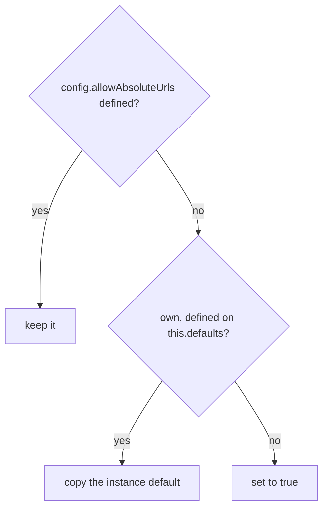

# axios-find-001: Filling in allowAbsoluteUrls

**Answer:** `lib/core/Axios.js`, lines 173-182 (any selection that covers them and stays within lines 170-191):

```js
// lib/core/Axios.js:172-182
// Set config.allowAbsoluteUrls
if (config.allowAbsoluteUrls !== undefined) {
  // do nothing
} else if (
  utils.hasOwnProp(this.defaults, 'allowAbsoluteUrls') &&
  this.defaults.allowAbsoluteUrls !== undefined
) {
  config.allowAbsoluteUrls = this.defaults.allowAbsoluteUrls;
} else {
  config.allowAbsoluteUrls = true;
}
```

## How a strong engineer gets there

1. Open `lib/core/Axios.js` and go to `_request`. It's a long method, but it runs in clear stages: normalize the arguments, `mergeConfig`, validate `transitional`, normalize `paramsSerializer`, **settle `allowAbsoluteUrls`**, check option spellings, lower-case the method, flatten headers, build the interceptor chains.
2. Search the file for `allowAbsoluteUrls`. It appears in only two places: this block, and `getUri`, which only *reads* `config.allowAbsoluteUrls` and passes it to `buildFullPath`.
3. The block has the three-way shape the prompt describes. The request's own value wins, then an own, defined `allowAbsoluteUrls` on `this.defaults`, then the hard-coded `true`.

## Why the block exists

`mergeConfig` has run by this point, so you might expect the default to have been merged in already. But `allowAbsoluteUrls` isn't in the `mergeMap` table in `lib/core/mergeConfig.js`, and the global `defaults` object in `lib/defaults/index.js` doesn't define it. Without this block it would often be `undefined` when it reaches the code that uses it:

```js
// lib/core/buildFullPath.js:68-76
export default function buildFullPath(baseURL, requestedURL, allowAbsoluteUrls, config) {
  assertValidHttpProtocolURL(requestedURL, config);
  let isRelativeUrl = !isAbsoluteURL(requestedURL);
  if (baseURL && (isRelativeUrl || allowAbsoluteUrls === false)) {
    assertValidHttpProtocolURL(baseURL, config);
    return combineURLs(baseURL, requestedURL);
  }
  return requestedURL;
}
```

`buildFullPath` compares strictly against `false`, so `undefined` would happen to behave like `true`. Even so, the block makes the merged config carry an explicit `true` for adapters and interceptors to read. `utils.hasOwnProp` on `this.defaults` also means a value inherited from a polluted `Object.prototype` can't sneak in as the instance default.



## Plausible wrong selections

- **`getUri` (lines 313-317):** it uses `config.allowAbsoluteUrls`, but it never fills it in. `getUri` doesn't go through `_request`, so it passes whatever `mergeConfig` produced.
- **Lines 184-191, the `validator.assertOptions(config, { baseUrl: ..., withXsrfToken: ... })` call:** right below the block, but it only warns about misspelled option names.
- **Just the final `else` (lines 180-182):** that's only the hard-coded fallback. The prompt asks for the whole statement, and the anchor needs lines 173-182.
- **`buildFullPath` in `lib/core/buildFullPath.js`:** the consumer, not the code that sets the value, and it's in a different file from the one the prompt names.

## Takeaways

- In a long method that runs in stages, search the file for the field name to find the one stage that writes it.
- If a defaults object doesn't mention a key, look for an "else hard-code it" further down the request path.
