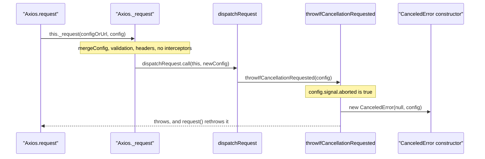

# axios-trace-001: A request that was aborted before it started

**Answer (in order):**

1. `lib/core/Axios.js#Axios.request`
2. `lib/core/Axios.js#Axios._request`
3. `lib/core/dispatchRequest.js#dispatchRequest`
4. `lib/core/dispatchRequest.js#throwIfCancellationRequested`
5. `lib/cancel/CanceledError.js#CanceledError.<constructor>`

## The flow



## Step by step

1. **`Axios.request` to `_request`.** `request` is only a wrapper that patches the stack trace of any error. All the work is delegated:

   ```js
   // lib/core/Axios.js:72-74
   async request(configOrUrl, config) {
     try {
       return await this._request(configOrUrl, config);
   ```

2. **`_request` to `dispatchRequest`.** `_request` merges the config, validates options, flattens headers and builds the interceptor chains. With no request interceptors, `synchronousRequestInterceptors` stays `true` (it starts `true` and nothing sets it to `false`), so the promise-chain branch is skipped and dispatch is called directly:

   ```js
   // lib/core/Axios.js:295-301
   if (!promise) {
     try {
       promise = dispatchRequest.call(this, newConfig);
     } catch (error) {
       promise = Promise.reject(error);
     }
   }
   ```

3. **`dispatchRequest` to `throwIfCancellationRequested`.** The first thing dispatch does after flattening the config is check for cancellation, before it transforms data or picks an adapter:

   ```js
   // lib/core/dispatchRequest.js:66-72
   export default function dispatchRequest(_config) {
     // Interceptors may replace the merged config with an ordinary object. Flatten
     // it at the dispatch boundary so shared prototype members cannot become
     // request behavior, while preserving intentional template/class members.
     const config = utils.toSafeFlatObject(_config);

     throwIfCancellationRequested(config);
   ```

4. **`throwIfCancellationRequested` to the `CanceledError` constructor.** There's no `cancelToken`, so the first `if` is skipped, and the aborted signal triggers the second:

   ```js
   // lib/core/dispatchRequest.js:18-26
   function throwIfCancellationRequested(config) {
     if (config.cancelToken) {
       config.cancelToken.throwIfRequested();
     }

     if (config.signal && config.signal.aborted) {
       throw new CanceledError(null, config);
     }
   }
   ```

   `new CanceledError` points at `CanceledError.<constructor>` (lib/cancel/CanceledError.js:15-19). It calls `super` with the message `'canceled'` and code `ERR_CANCELED`, and sets `__CANCEL__`, which is what `axios.isCancel` checks.

## What the error does next

The throw happens inside `dispatchRequest`, which `_request` called synchronously in a `try`, so it becomes `promise = Promise.reject(error)`. Any response interceptors would still be attached to that rejected promise, and `Axios.request` rethrows the error after adding the caller's stack frames. No adapter is ever chosen, so no network request is made.

## Why other answers are wrong

- **Skipping `_request`:** `request` never calls `dispatchRequest` itself. Every path goes through `_request`.
- **Ending at `AxiosError.<constructor>`:** `CanceledError` extends `AxiosError`, but `super(...)` isn't a call to a separate function in this sequence, and the prompt asks for the constructor of the class that is thrown.
- **Going through `getAdapter` or an adapter:** the adapters also build `CanceledError`s when a signal fires mid-request, but `dispatchRequest` throws before `adapters.getAdapter` runs (line 83). An already-aborted signal never reaches the adapter.
- **Including `mergeConfig`, `AxiosHeaders.concat` or `InterceptorManager.forEach`:** `_request` calls them, but they return normally and don't lead to the constructor.
- **Including `utils.toSafeFlatObject`:** a utility call that returns normally. It isn't on the path to the error.
- **Starting from `axios.get`:** the method aliases are anonymous functions assigned in a loop (lib/core/Axios.js:321-332) and have no symbols. The prompt starts at `Axios.request`.

## Design notes

Cancellation is checked at both ends of the adapter call. `dispatchRequest` checks before dispatching, which is this trace, and again in `onAdapterResolution` and `onAdapterRejection` after the adapter settles, so a request canceled while it was in flight still rejects even if the adapter finished. Supporting both a `cancelToken` and an `AbortSignal` in one helper keeps the legacy and modern cancellation APIs on the same path.

## Takeaways

- Wrapper methods like `request` and `_request` are common in libraries that care about stack traces. Expect the public method to be a thin shell.
- Check for early-exit guards at the start of a function before following the long path through it. They're often what a runtime condition in a prompt is about.
