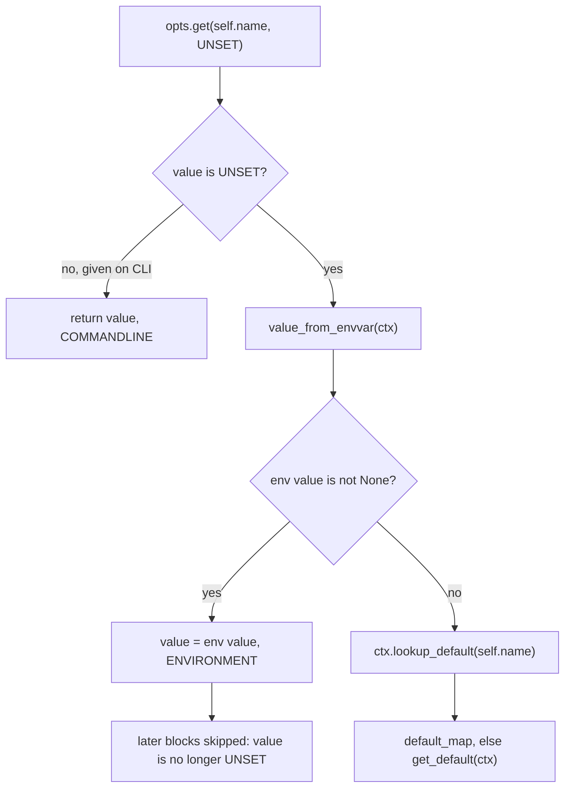

# click-architecture-001: Precedence of fallback value sources

**Answer:** option `a`, the value of the environment variable.

## How to navigate there

`src/click/core.py` has two `consume_value` methods: `Parameter.consume_value` at line 2680 and `Option.consume_value` at line 3820. The prompt asks for the base-class one, so go to line 2680. It is a single linear function, and the hint describes its shape: a series of blocks, each guarded by "is the value still unset?".

```python
# src/click/core.py:2694-2726 (condensed: comments and the multi-value split removed)
        value = opts.get(self.name, UNSET)
        source = (
            ParameterSource.COMMANDLINE
            if value is not UNSET
            else ParameterSource.DEFAULT
        )

        if value is UNSET:
            envvar_value = self.value_from_envvar(ctx)
            if envvar_value is not None:
                value = envvar_value
                source = ParameterSource.ENVIRONMENT

        if value is UNSET:
            default_map_value = ctx.lookup_default(self.name)
            if default_map_value is not None or ctx._default_map_has(self.name):
                value = default_map_value
                source = ParameterSource.DEFAULT_MAP

        if value is UNSET:
            default_value = self.get_default(ctx)
            if default_value is not UNSET:
                value = default_value
                source = ParameterSource.DEFAULT

        return value, source
```

## Apply the prompt's scenario



1. Not given on the command line, so `opts.get(self.name, UNSET)` returns `UNSET`.
2. First block (lines 2703-2707): the environment variable is set, so `value_from_envvar` returns its value. `value` is no longer `UNSET`.
3. Second block (line 2709): `if value is UNSET:` is false, so the `default_map` is never even consulted.
4. Third block (line 2720): also false, so the parameter's own default is never looked up.

The method returns the environment variable's value, with `ParameterSource.ENVIRONMENT`.

## The precedence, as a table

| Rank | Source | Where it's read | `ParameterSource` |
|---|---|---|---|
| 1 | command line | `opts.get(self.name, UNSET)`, line 2694 | `COMMANDLINE` |
| 2 | environment variable | `self.value_from_envvar(ctx)`, line 2704 | `ENVIRONMENT` |
| 3 | `ctx.default_map` | `ctx.lookup_default(self.name)`, line 2710 | `DEFAULT_MAP` |
| 4 | the parameter's default | `self.get_default(ctx)`, line 2721 | `DEFAULT` |

The `ParameterSource` enum (line 199) lists its members in the same order, after `PROMPT`: `PROMPT`, `COMMANDLINE`, `ENVIRONMENT`, `DEFAULT_MAP`, `DEFAULT` (lines 226-234). Since 8.3.3 it is an `IntEnum` ordered "from most explicit to least explicit", so code can write `source < ParameterSource.DEFAULT_MAP` to mean "explicitly provided". `handle_parse_result` does exactly that for deprecation warnings (line 2963). The code is still the authority: the enum's order matches because the method checks sources in that order.

## Two details that make "set" precise

- **An empty environment variable doesn't count.** `resolve_envvar_value` (line 2868) returns `None` for an empty string (`if rv: return rv`, lines 2899-2900), and `consume_value` only takes the env value if it is not `None`. So `MYAPP_PORT=""` falls through to the default map. The prompt says the variable is set, meaning it has a value.
- **A `default_map` entry can be `None` on purpose.** The second block checks `default_map_value is not None or ctx._default_map_has(self.name)`. `_default_map_has` (line 791) distinguishes "key present with value `None`" from "key absent". That lets a config file override a parameter's default to `None`, but only when the environment variable didn't supply a value.

## Why the other options are wrong

- **b (the `default_map` entry).** It is consulted only if the value is still `UNSET` after the environment check. A set environment variable fills `value` first, so the `default_map` block's guard is false.
- **c (raises because the sources conflict).** Nothing compares the sources. The guards make them a fallback chain: whoever fills `value` first wins and the rest are skipped. The only exceptions in this path would come from type conversion later, in `process_value`.
- **d (the parameter's own default).** It is the last resort, used only when the command line, the environment and the `default_map` all gave nothing.

## Why the prompt excludes `Option.consume_value`

`Option.consume_value` (line 3820) starts with `value, source = super().consume_value(ctx, opts)`, so it inherits the precedence above. It then adds option-only behaviour: resolving flags given without a value (`FLAG_NEEDS_VALUE`) and **prompting**. It may prompt when the value is `UNSET` or came from `DEFAULT_MAP` or `DEFAULT` (`source >= ParameterSource.DEFAULT_MAP`, line 3866), but not when it came from the environment. With an environment variable set, the answer for an `Option` is the same. Asking about the base method keeps the question free of prompt configuration.

## Takeaways

- A sequence of `if value is UNSET:` blocks is a priority list. The first block that assigns wins, and you can read the precedence straight from the order of the blocks.
- Use a sentinel (`UNSET`) rather than `None` when `None` is a legitimate value. Click needs both: `None` can come from a `default_map`, and `UNSET` means "nothing yet".
- When a subclass override calls `super()` first, the base method defines the core rule, and the override can only add to it afterwards.
