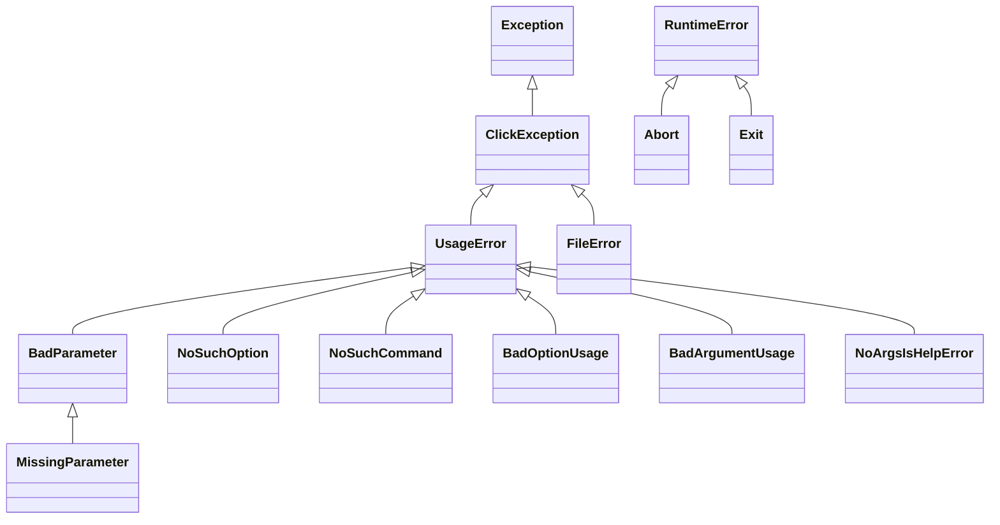

# click-architecture-002: Control-flow exceptions outside ClickException

**Answer:** `src/click/exceptions.py#Abort`, `src/click/exceptions.py#Exit`

## The hierarchy

`src/click/exceptions.py` defines 13 exception classes. Eleven of them are `ClickException` or below it. Two hang off `RuntimeError` instead:



## How to navigate there

1. Open `src/click/exceptions.py` and list the `class` lines with their bases:

   | Class | Line | Base |
   |---|---|---|
   | `ClickException` | 35 | `Exception` |
   | `UsageError` | 68 | `ClickException` |
   | `BadParameter` | 114 | `UsageError` |
   | `MissingParameter` | 159 | `BadParameter` |
   | `NoSuchOption` | 232 | `UsageError` |
   | `NoSuchCommand` | 268 | `UsageError` |
   | `BadOptionUsage` | 304 | `UsageError` |
   | `BadArgumentUsage` | 323 | `UsageError` |
   | `NoArgsIsHelpError` | 332 | `UsageError` |
   | `FileError` | 342 | `ClickException` |
   | **`Abort`** | 362 | **`RuntimeError`** |
   | **`Exit`** | 366 | **`RuntimeError`** |

2. Follow each chain up to its root. Everything resolves to `ClickException` except the last two, which go straight to the built-in `RuntimeError`.
3. Confirm with the hint: `Command.main` handles these two in their own `except` clauses.

```python
# src/click/exceptions.py:362-378
class Abort(RuntimeError):
    """An internal signalling exception that signals Click to abort."""


class Exit(RuntimeError):
    """An exception that indicates that the application should exit with some
    status code.

    :param code: the status code to exit with.
    """

    __slots__ = ("exit_code",)

    exit_code: t.Final[int]

    def __init__(self, code: int = 0) -> None:
        self.exit_code = code
```

## Why they are outside `ClickException`

A `ClickException` is an **error with a message for the user**. It has `message`, `format_message()` and a `show()` method that prints `Error: ...` to stderr (lines 57-65), and an `exit_code` that defaults to 1.

`Abort` and `Exit` are **signals**. They carry no message to show:

- `Exit` means "stop now with this status code". `Context.exit` closes the context and raises it (`src/click/core.py:856-857`). A normal successful run ends this way too: `Command.main` calls `ctx.exit()` after `invoke` returns (line 1602), which raises `Exit(0)`.
- `Abort` means "the user canceled". `Context.abort` raises it (line 847), and so do the prompt helpers in `src/click/termui.py` when input is interrupted (line 245) or a confirmation is declined with `abort=True` (line 344).

If they were `ClickException` subclasses, the `except ClickException` handler would call `show()` and print `Error: ` for a successful exit. Keeping them separate lets `Command.main` treat each kind differently:

```python
# src/click/core.py:1603-1633 (comments removed)
            except Exit as e:
                if not standalone_mode:
                    return e.exit_code

                exit_code = e.exit_code
            except Abort:
                if not standalone_mode:
                    raise

                report = _echo_aborted
            except (EOFError, KeyboardInterrupt) as e:
                echo(file=sys.stderr)

                if not standalone_mode:
                    raise Abort() from e

                report = _echo_aborted
            except ClickException as e:
                if not standalone_mode:
                    raise

                report, exit_code = e.show, e.exit_code
```

| Exception | What `main` reports (standalone mode) | Exit code |
|---|---|---|
| `Exit` | nothing | `e.exit_code` (often 0) |
| `Abort` | `Aborted!` via `_echo_aborted` (line 103) | 1 (the default `exit_code` on line 1587) |
| `ClickException` | `e.show()`, i.e. `Error: <message>` | `e.exit_code` (1, or 2 for `UsageError`) |

Note also that `Ctrl+C` (`KeyboardInterrupt`) and `EOFError` are converted to `Abort` when not in standalone mode (line 1626). `Abort` is Click's standard name for "the user stopped this".

## Why the other candidates are wrong

- **`ClickException`.** The prompt excludes it explicitly. It is the root of the other branch.
- **`FileError`.** It looks unlike the usage errors (it is about opening a file and overrides `format_message`), but its header is `class FileError(ClickException):` (line 342).
- **`UsageError`.** It derives directly from `ClickException`. It is the parent of most other classes here, but not a separate root.
- **`NoArgsIsHelpError` and `NoSuchCommand`.** Both are `UsageError` subclasses (lines 268 and 332), so they are indirectly `ClickException`s. `NoArgsIsHelpError` is arguably control flow (it shows help), but by inheritance it is a usage error.
- **`MissingParameter`.** Two levels down, via `BadParameter` and `UsageError`.
- **`RuntimeError` / `Exception`.** Built-in bases. They are not defined in the file.

## Takeaways

- To find "the odd ones out" in an exception hierarchy, list each class with its base and follow the chains to their roots. Odd ones usually have a different root, here `RuntimeError`.
- A library often separates *error* exceptions (shown to the user) from *signal* exceptions (used for control flow, like exit or cancel). The top-level handler is where you can see the difference most clearly.
- Find the `try`/`except` ladder at the program's entry point. Its order and the way each branch treats its exception explain the purpose of each class better than the docstrings do.
