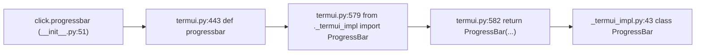

# click-find-003: Where the progress bar is implemented

**Answer:** `src/click/_termui_impl.py`

## How to navigate there

The hint gives the method: read the return statement of the public function and follow the name it calls.



1. **Find the real `progressbar`.** `src/click/termui.py` has three definitions of it. The first two (lines 402-419 and 422-440) are `@t.overload` stubs that end in `...`: they only exist for type checkers. The implementation starts at line 443.
2. **Read past the docstring to the end.** The function body is just an import, one line of colour handling and a constructor call:

   ```python
   # src/click/termui.py:579-582
       from ._termui_impl import ProgressBar

       color = resolve_color_default(color)
       return ProgressBar(
   ```

   It passes every argument straight through (lines 583-598) and returns the object.
3. **Follow the import.** `ProgressBar` comes from `._termui_impl`. "Go to definition" lands on `class ProgressBar(t.Generic[V]):` at `src/click/_termui_impl.py:43`.
4. **Confirm it renders and updates.** The class has the methods the prompt describes: `render_progress` (line 250) draws the line on the terminal, `update` (line 318) and `make_step` (line 296) advance it, `finish` (line 344) and `render_finish` (line 142) end it, and `__enter__`/`__exit__`/`__iter__` make it usable as `with click.progressbar(items) as bar: for item in bar: ...`.

## Why the import is inside the function

This is the detail that makes the puzzle slightly tricky. `termui.py` also imports `ProgressBar` at the top, but only for type checking:

```python
# src/click/termui.py:27-28
if t.TYPE_CHECKING:
    from ._termui_impl import ProgressBar
```

That import never runs at runtime. It only lets the overload signatures say `-> ProgressBar[int]`. The real import happens on line 579, when `progressbar()` is actually called. The module docstring of `_termui_impl.py` explains why: infrequently used functionality is kept there and imported only when needed, to keep Click's import time down. The same file also holds the pager (`_pipepager`, `_tempfilepager`), the `Editor` class behind `click.edit`, `open_url` behind `click.launch`, and the platform-specific `getchar`/`raw_terminal`.

## Why the other files are wrong

- **`src/click/termui.py`.** It defines the public `progressbar` function, the one the prompt starts from, but it only constructs and returns the object. The class isn't defined here. The `TYPE_CHECKING` import makes the name appear at the top of the file, which can make it look local.
- **`src/click/__init__.py`.** It re-exports the function (`from .termui import progressbar as progressbar`, line 51) so that `click.progressbar` works. It defines nothing.
- **`src/click/_compat.py`.** `ProgressBar` imports helpers from it (`isatty`, `term_len`, `strip_ansi` and others, `_termui_impl.py` lines 22-28), but they are low-level terminal utilities, not the progress bar.
- **`src/click/utils.py`.** Provides `echo`, which `render_progress` uses to write the line (for example line 293). Again a helper, not the class.
- **`src/click/_winconsole.py`.** Windows console stream support. It has no progress-bar code.

## Takeaways

- In typed Python, a function can have several `@overload` stubs before its real body. Skip the stubs, whose bodies are `...`, and read the last definition.
- An import inside `if t.TYPE_CHECKING:` is for type hints only. To see where a name really comes from at runtime, look for the import that executes, which is sometimes inside a function.
- Libraries often split a thin public API module (`termui.py`) from a heavier implementation module (`_termui_impl.py`, with a leading underscore for "private"). When you look for "where X is implemented", check for that kind of `_impl` file.
