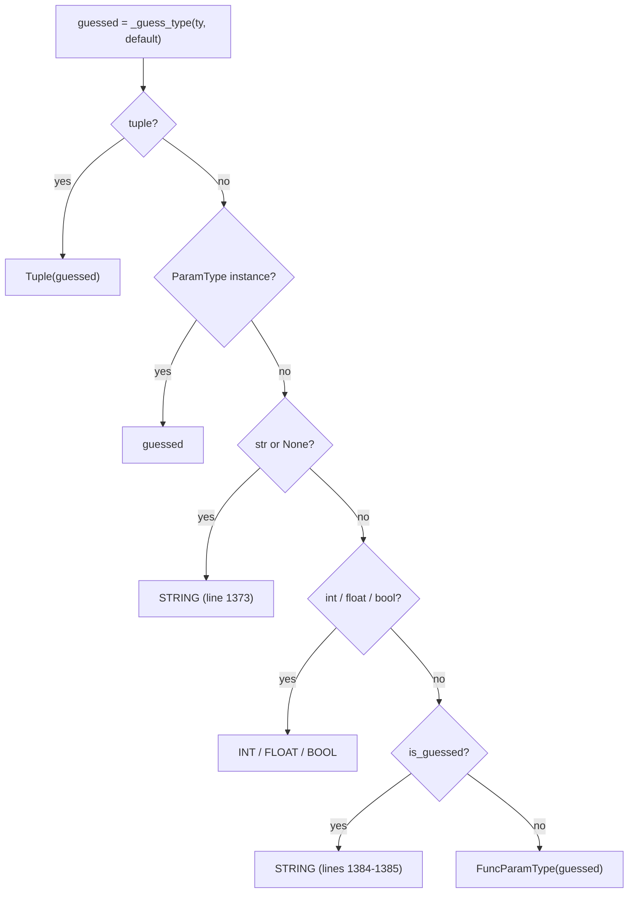

# click-find-004: Falling back to a string for an inferred type

**Answer:** `src/click/types.py` lines 1384-1385, `if is_guessed:` followed by `return STRING`, inside `convert_type`.

```python
# src/click/types.py:1384-1385
    if is_guessed:
        return STRING
```

Both lines must be selected, and the selection must stay within lines 1383-1386. The window is tight on purpose: it rules out the earlier `return STRING` on line 1373.

## How to navigate there

1. Open `src/click/types.py` and jump to `convert_type`. As with many functions in Click, there are `@t.overload` stubs first (lines 1346-1355). The real body starts at line 1356.
2. The hint asks how the function records whether its type was passed in or guessed. That is the first two statements:

   ```python
   # src/click/types.py:1363-1364
       guessed = _guess_type(ty, default)
       is_guessed = guessed is not ty
   ```

   `_guess_type` (line 1311) returns `ty` unchanged if it was given (lines 1321-1322). Otherwise it derives a type from `default`. So `guessed is not ty` is `True` exactly when the type came from the default.
3. Find where `is_guessed` is used. It appears only once more, on line 1384.

## The decision ladder

`convert_type` is a list of early returns. Reading them in order shows why line 1384 only handles the "unknown inferred type" case:



By the time line 1384 runs, the type is not a tuple, not a `ParamType`, not `str` or `None`, and not one of the three numeric/boolean built-ins. So `if is_guessed:` catches exactly what the prompt describes: an inferred type that isn't a built-in Click knows.

## Example

```text
@click.option("--when", default=datetime.date(2024, 1, 1))     # no type=
```

`Parameter.__init__` calls `types.convert_type(type, default)` (`src/click/core.py:2439`) with `type=None`. `_guess_type` returns `type(default)`, which is `datetime.date`, so `is_guessed` is `True`. None of the earlier branches match, so line 1385 returns `STRING`.

If instead you write `type=MyConverter` explicitly, `is_guessed` is `False` and the function reaches `return FuncParamType(guessed)` (line 1397). `FuncParamType.convert` then calls `self.func(value)` on the command-line string.

## Why guessed and explicit types are treated differently

Passing `type=SomeCallable` is a deliberate statement that "this callable turns a string into my value", so Click wraps it in `FuncParamType`. Inferring a type from a default is only a guess. Calling the type of an arbitrary default object with a command-line string is not guaranteed to work (`datetime.date("2024-05-01")` raises `TypeError`, for example). Falling back to `STRING` is the safe choice for guesses. For explicit types, Click trusts the caller.

## Why the nearby code is wrong

- **Lines 1372-1373** (`if guessed is str or guessed is None: return STRING`). Also returns `STRING`, but for a different case: the type is `str` itself, or nothing could be inferred (no type and a `None` or empty default). The comment in `_guess_type` about falling "through to STRING" (lines 1330-1331) refers to this branch.
- **Lines 1375-1382** (the `int`, `float`, `bool` branches). These handle the built-in types the prompt excludes.
- **Lines 1387-1395** (the `if __debug__:` block). It checks for a common mistake, passing a `ParamType` class instead of an instance, and raises `AssertionError`. It doesn't return a type.
- **Line 1397** (`return FuncParamType(guessed)`). The fallback for an explicit, unrecognised type, which is the opposite of the prompt's case.
- **Lines 1363-1364.** They compute `is_guessed`, but the prompt asks for the `if` statement and body that returns the string type.

## Takeaways

- A flag like `is_guessed = guessed is not ty` uses an identity check to remember where a value came from. When a function has such a flag, find every place it is read: each one is a branch where the origin matters.
- For a ladder of early returns, the meaning of a late branch depends on everything before it. Read the conditions in order to know what can still reach it.
- When two branches return the same value (`STRING` here), the prompt's wording ("inferred from the default", "not one of the built-in types") is what separates them. Check each condition against it.
