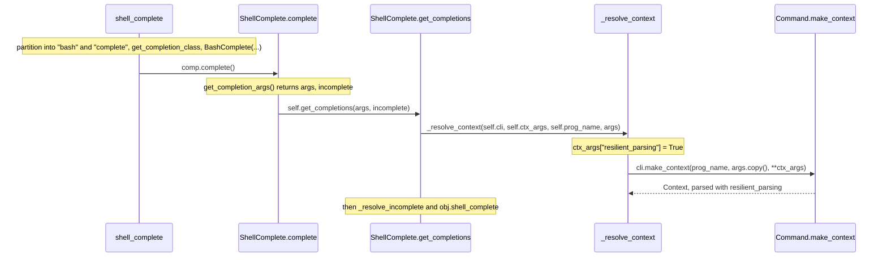

# click-trace-001: From shell completion request to a parsed context

**Answer:** `src/click/shell_completion.py#shell_complete` -> `src/click/shell_completion.py#ShellComplete.complete` -> `src/click/shell_completion.py#ShellComplete.get_completions` -> `src/click/shell_completion.py#_resolve_context` -> `src/click/core.py#Command.make_context`

## The call sequence



## Step by step

1. **`shell_complete`** (`src/click/shell_completion.py:19`). It splits the instruction, then dispatches on the instruction half:

   ```python
   # src/click/shell_completion.py:38-53
       shell, _, instruction = instruction.partition("_")
       comp_cls = get_completion_class(shell)

       if comp_cls is None:
           return 1

       comp = comp_cls(cli, ctx_args, prog_name, complete_var)

       # Write bytes, otherwise Windows text stdout translates LF to CRLF and breaks.
       if instruction == "source":
           echo(comp.source().encode(), nl=False)
           return 0

       if instruction == "complete":
           echo(comp.complete().encode())
           return 0
   ```

   `"bash_complete".partition("_")` gives `("bash", "_", "complete")`. `get_completion_class("bash")` returns `BashComplete`, and `comp_cls(...)` is a constructor, so it's skipped. The `"complete"` branch calls `comp.complete()`. The `echo` around it is excluded by the prompt.

2. **`ShellComplete.complete`** (line 376). `BashComplete` (line 389) overrides `_check_version`, `source`, `get_completion_args` and `format_completion`, but not `complete`. So `comp.complete()` runs the base-class method:

   ```python
   # src/click/shell_completion.py:383-386
           args, incomplete = self.get_completion_args()
           completions = self.get_completions(args, incomplete)
           out = [self.format_completion(item) for item in completions]
           return "\n".join(out)
   ```

   Three calls. Only `get_completions` leads toward building a context.

3. **`ShellComplete.get_completions`** (line 354). Not overridden by `BashComplete` either:

   ```python
   # src/click/shell_completion.py:364-366
           ctx = _resolve_context(self.cli, self.ctx_args, self.prog_name, args)
           obj, incomplete = _resolve_incomplete(ctx, args, incomplete)
           return obj.shell_complete(ctx, incomplete)
   ```

4. **`_resolve_context`** (line 696). It switches on resilient parsing, then makes the top-level context:

   ```python
   # src/click/shell_completion.py:710-711
       ctx_args["resilient_parsing"] = True
       with cli.make_context(prog_name, args.copy(), **ctx_args) as ctx:
   ```

5. **`Command.make_context`** (`src/click/core.py:1359`). It creates the `Context` (`self.context_class(...)`, line 1390) and calls `self.parse_args(ctx, args)` (line 1393). That is the end point the prompt names.

## How to navigate it quickly

- Start at `shell_complete` and pick the branch for `"complete"`. The hint says it's the second one.
- `comp` is an instance of a subclass, so for each method call on it check whether `BashComplete` overrides it. It doesn't override `complete` or `get_completions`, so both steps are `ShellComplete` methods.
- Search `shell_completion.py` for `make_context`. There are three hits, all inside `_resolve_context` (lines 711, 724, 738). The first one, on `cli`, is the one reached first.

## Why the other candidates are wrong

- **`get_completion_class`** (line 593). Called by `shell_complete`, but it only returns a class from a registry. It doesn't lead onward.
- **`BashComplete.complete` / `BashComplete.get_completions`.** These methods don't exist. Choosing `BashComplete` IDs for steps 2 and 3 would name symbols that aren't defined. The inherited `ShellComplete` methods are what run.
- **`BashComplete.get_completion_args`** (line 432). Called first in `complete`, but it reads the `COMP_WORDS`/`COMP_CWORD` environment variables and returns. It is a sibling of `get_completions`, not a step before it. The same applies to `format_completion`, which runs after.
- **`ShellComplete.source`.** The `"source"` instruction branch, which prints the shell script to install. Not the `"complete"` branch.
- **`_resolve_incomplete` and `Command.shell_complete`** (`core.py:1448`). Called by `get_completions` *after* `_resolve_context` returns. They use the context instead of creating it.
- **`Group.resolve_command` and the nested `cmd.make_context(...)`** (lines 719-745). These only run for subcommands, after the first `cli.make_context` call. The prompt ends at the first `Command.make_context`.
- **`Command.parse_args`.** Called by `make_context`, so it is after the end point.
- **`Command.main` / `Command._main_shell_completion`.** These call `shell_complete` (`core.py:1680`), but they come *before* the start of the trace.

## Background: why resilient parsing?

`_resolve_context` reuses the normal parsing code (`make_context`, then `parse_args`) to find out which command and parameters the user has typed so far. But a partial command line is usually invalid: required options are missing, a value is half-typed. Setting `resilient_parsing = True` tells the context to skip errors, prompts and callbacks. You can see the flag checked throughout `core.py`, for example in the extra-arguments check in `Command.parse_args` and in `Group.resolve_command`. That way completion never crashes or prompts while the user presses Tab.

## Takeaways

- When a call goes through an instance of a subclass, check which methods the subclass overrides before deciding which symbol runs. A trace names the definition that actually executes.
- In a method that makes several calls in a row (`complete` here), only one usually leads toward the end condition. The others are siblings, not steps.
- Look for "mode" flags like `resilient_parsing`. They show how a library reuses its main code path for a secondary feature.
