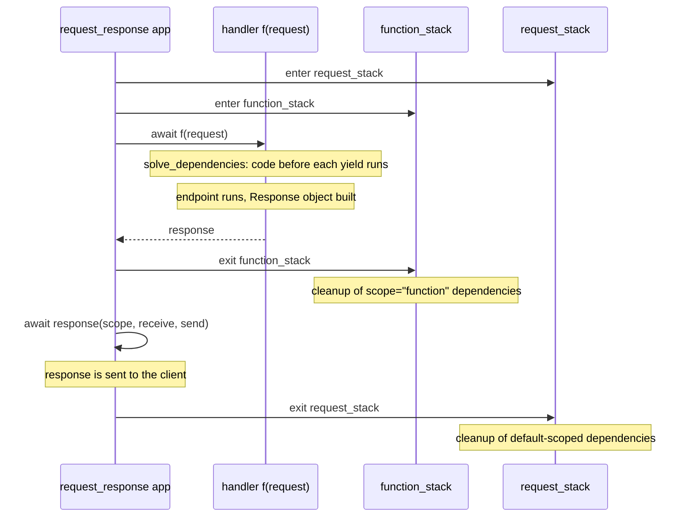

# fastapi-architecture-001: When cleanup after yield runs

**Answer:** option `b`. The function-scoped one runs once the endpoint function has returned and before the response is sent. The default-scoped one runs after the response has been sent.

## The key idea

A `yield` dependency is entered as a context manager on an `AsyncExitStack`. Its cleanup code runs when **that stack** is closed. FastAPI keeps two stacks per request, and they close at different times. So the question becomes: which stack does each scope use, and when does each stack close?

## Step 1: entering the dependency on a stack

`_solve_generator` (`fastapi/dependencies/utils.py:623`) wraps the generator in a context manager and enters it on whatever stack it is given:

```python
# fastapi/dependencies/utils.py:627-631
    if _is_async_gen_callable(dependant.call):
        cm = asynccontextmanager(dependant.call)(**sub_values)
    elif _is_gen_callable(dependant.call):
        cm = contextmanager_in_threadpool(contextmanager(dependant.call)(**sub_values))
    return await stack.enter_async_context(cm)
```

`enter_async_context` runs the code up to `yield` now and registers the rest to run when the stack exits.

## Step 2: choosing the stack

`solve_dependencies` reads both stacks from the request scope (lines 658-665) and picks one per generator dependency:

```python
# fastapi/dependencies/utils.py:722-729
            use_astack = request_astack
            if sub_dependant.scope == "function":
                use_astack = function_astack
            solved = await _solve_generator(
                dependant=use_sub_dependant,
                stack=use_astack,
                sub_values=solved_result.values,
            )
```

The default (`scope` is `None`) and `scope="request"` both use `request_astack`, which comes from `scope["fastapi_inner_astack"]`. Only `scope="function"` uses `function_astack`, from `scope["fastapi_function_astack"]`.

## Step 3: when each stack closes

Both stacks are created in the inner `app` of `request_response` (`fastapi/routing.py:129`), which `APIRoute.__init__` uses to build `self.app` around the handler from `get_route_handler()` (line 1276):

```python
# fastapi/routing.py:147-155
            response_awaited = False
            async with AsyncExitStack() as request_stack:
                scope["fastapi_inner_astack"] = request_stack
                async with AsyncExitStack() as function_stack:
                    scope["fastapi_function_astack"] = function_stack
                    response = await f(request)
                await response(scope, receive, send)
                # Continues customization
                response_awaited = True
```

`f` is the handler from `get_request_handler`. Calling it solves dependencies, runs the endpoint, and builds the `Response` object. It does not send it.



- The inner `async with` (function stack) wraps only `response = await f(request)`. It exits as soon as the handler returns, **before** `await response(...)` sends anything.
- The outer `async with` (request stack) also contains `await response(scope, receive, send)`. It exits only **after** the response has been sent.

That's option `b`.

## Why the other options are wrong

- **a (both after the response is sent).** True for the default scope only. The function stack's `async with` block ends before `await response(...)` on line 153.
- **c (the reverse).** It swaps the stacks. The default scope uses `request_astack`, the outer stack. `function_astack` is the inner one.
- **d (both before the endpoint is called).** The code *before* `yield` runs while dependencies are solved, before the endpoint. The code *after* `yield` runs only when a stack exits, and both exits come after `f(request)` has returned, which includes running the endpoint.

## Why it matters in practice

- **Function scope lets cleanup affect the response.** Because it runs before sending, a function-scoped dependency can, for example, commit or roll back a transaction and have an error turn into an error response. The same code in a default-scoped dependency runs after the client already has a response.
- **Default scope keeps resources alive while streaming.** For a `StreamingResponse`, the body is produced inside `await response(...)`. A default-scoped database session is still open while the stream runs. A function-scoped one is already closed.
- **The `response_awaited` check** (lines 156-163) catches a common bug: a `yield` dependency that swallows an exception with a bare `except`, so no response is ever awaited. FastAPI raises `FastAPIError` with an explanation.

## Takeaways

- Nested `async with` blocks set the lifetime of resources. To know when cleanup runs, find the statement that sits between the inner and outer block exits. Here it's `await response(...)`.
- "Which stack" questions often come down to one `if` that chooses a stack. Find the choice, then find where each stack is created.
- Building a response and sending it are separate steps in ASGI frameworks. Keep them apart when reasoning about timing.
