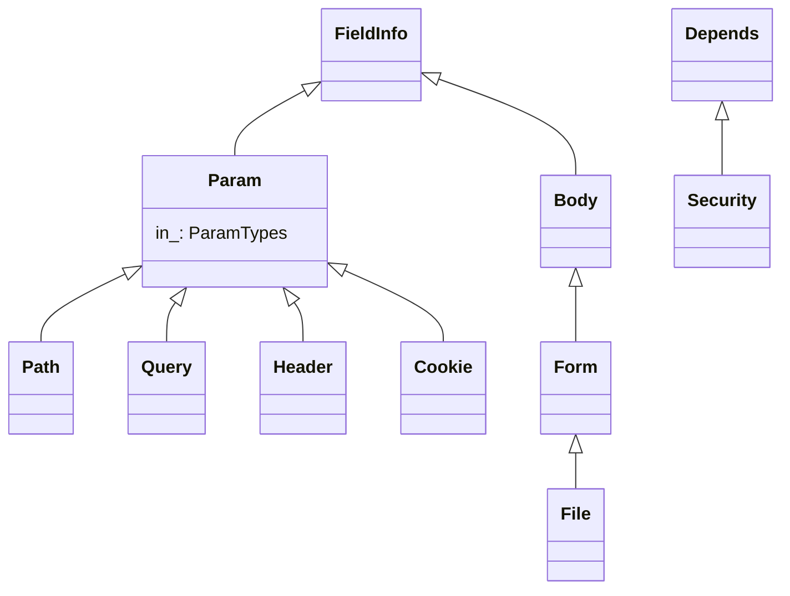

# fastapi-architecture-002: Kinds of request parameters

**Answer:** `fastapi/params.py#Path`, `fastapi/params.py#Query`, `fastapi/params.py#Header`, `fastapi/params.py#Cookie`

## How to navigate there

1. Open `fastapi/params.py` and list its `class` statements. There are only eleven:

| Class | Line | Base | Family |
|---|---|---|---|
| `ParamTypes` | 20 | `Enum` | enum of locations |
| `Param` | 27 | `FieldInfo` | **non-body root** |
| `Path` | 142 | `Param` | non-body |
| `Query` | 232 | `Param` | non-body |
| `Header` | 320 | `Param` | non-body |
| `Cookie` | 410 | `Param` | non-body |
| `Body` | 498 | `FieldInfo` | body root |
| `Form` | 614 | `Body` | body |
| `File` | 702 | `Form` | body |
| `Depends` | 791 | (dataclass) | dependency marker |
| `Security` | 798 | `Depends` | dependency marker |

2. The prompt asks for "a FieldInfo subclass other than `Body`". Only two classes subclass Pydantic's `FieldInfo` directly: `Param` and `Body`. So the base is `Param`.
3. Select the classes whose header names `Param` directly: `Path`, `Query`, `Header`, `Cookie`. That matches "Select all 4".

## The two hierarchies



## How `Param` encodes "where the value comes from"

`Param` declares one class attribute, `in_: ParamTypes` (line 28). Each subclass sets it to a member of the `ParamTypes` enum, whose values are exactly the four non-body locations (lines 20-24):

```python
# fastapi/params.py:142-143
class Path(Param):  # type: ignore[misc]
    in_ = ParamTypes.path
```

`Query`, `Header` and `Cookie` do the same with `ParamTypes.query` (line 233), `.header` (line 321) and `.cookie` (line 411). That attribute is what FastAPI uses to sort parameters at route-build time. In `get_dependant` (`fastapi/dependencies/utils.py:300`), each parameter is first classified by `analyze_param`. Body fields go to `dependant.body_params` (line 371-372), and everything else goes to `add_param_to_fields` (line 607), which switches on `in_`:

```python
# fastapi/dependencies/utils.py:609-620 (abridged)
    field_info_in = getattr(field_info, "in_", None)
    if field_info_in == params.ParamTypes.path:
        dependant.path_params.append(field)
    elif field_info_in == params.ParamTypes.query:
        dependant.query_params.append(field)
    elif field_info_in == params.ParamTypes.header:
        dependant.header_params.append(field)
    else:
        assert field_info_in == params.ParamTypes.cookie, (
        ...
        dependant.cookie_params.append(field)
```

At request time, `solve_dependencies` then reads each list from the matching part of the request (`request.path_params`, `request.query_params`, `request.headers`, `request.cookies`).

## Why the design splits `Param` and `Body`

The two families are validated differently. Non-body parameters are individual values pulled from one place in the request, so one shared base with an `in_` tag is enough. Body parameters may be combined into a single body model, can be embedded, and include form and file uploads, which need their own handling (`Form` and `File` extend `Body`, and checks like `isinstance(..., params.Form)` choose the parser).

## Why the other candidates are wrong

- **`Param`.** It is the base class itself, not a subclass of itself.
- **`Body`.** The prompt names it as the *other* `FieldInfo` root, for body parameters.
- **`Form` and `File`.** Body-side classes: `Form(Body)` and `File(Form)`. `File` is also two levels down, not a direct subclass of anything in the non-body family.
- **`Depends` and `Security`.** Frozen dataclasses (lines 790-799) that mark dependencies. They aren't `FieldInfo` subclasses at all.
- **`ParamTypes`.** An `Enum` of locations, used as the value of `in_`. Not a parameter class.
- **The functions in `fastapi/param_functions.py`.** `Path()`, `Query()`, `Header()` and `Cookie()` as users call them are functions there that return instances of these classes (for example `return params.Path(` at line 340). They aren't classes, and they're in a different file.

## Takeaways

- A class attribute set differently in each subclass (`in_` here) is a common way to tag subclasses. Find the code that switches on it to see what the tag is for.
- When a prompt describes a base by elimination ("a FieldInfo subclass other than Body"), list the direct subclasses of the outer base first. The answer often follows from that list.
- Many Python libraries expose factory functions with class-like names (`Query()`, `Depends()`) that construct the real classes elsewhere. Check whether a name is a `def` or a `class` before you choose it.
