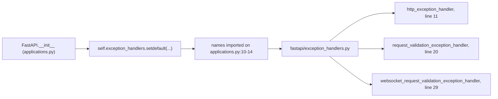

# fastapi-architecture-003: Where the default error responses come from

**Answer:** `fastapi/exception_handlers.py`

## How to navigate there

The hint gives the route: find where the constructor fills in `exception_handlers`, then follow the names.



1. **Find the registration.** Search `fastapi/applications.py` for `exception_handlers`. In `FastAPI.__init__`:

   ```python
   # fastapi/applications.py:997-1009 (comment removed)
           self.exception_handlers: dict[
               Any, Callable[[Request, Any], Response | Awaitable[Response]]
           ] = {} if exception_handlers is None else dict(exception_handlers)
           self.exception_handlers.setdefault(HTTPException, http_exception_handler)
           self.exception_handlers.setdefault(
               RequestValidationError, request_validation_exception_handler
           )

           self.exception_handlers.setdefault(
               WebSocketRequestValidationError,
               websocket_request_validation_exception_handler,  # type: ignore[arg-type]
           )  # ty: ignore[no-matching-overload]
   ```

   `setdefault` is how "unless the user supplied handlers of their own" works: it only inserts the default if the key isn't already in the dict built from the user's `exception_handlers` argument.

2. **Follow the names.** At the top of the same file:

   ```python
   # fastapi/applications.py:10-14
   from fastapi.exception_handlers import (
       http_exception_handler,
       request_validation_exception_handler,
       websocket_request_validation_exception_handler,
   )
   ```

3. **Read the definitions** in `fastapi/exception_handlers.py`. The whole file is about 35 lines:

   ```python
   # fastapi/exception_handlers.py:11-26
   async def http_exception_handler(request: Request, exc: HTTPException) -> Response:
       headers = getattr(exc, "headers", None)
       if not is_body_allowed_for_status_code(exc.status_code):
           return Response(status_code=exc.status_code, headers=headers)
       return JSONResponse(
           {"detail": exc.detail}, status_code=exc.status_code, headers=headers
       )


   async def request_validation_exception_handler(
       request: Request, exc: RequestValidationError
   ) -> JSONResponse:
       return JSONResponse(
           status_code=422,
           content={"detail": jsonable_encoder(exc.errors())},
       )
   ```

   These are the functions that build the familiar `{"detail": ...}` error bodies. The third, `websocket_request_validation_exception_handler` (line 29), closes the WebSocket with code 1008 (policy violation) instead of returning a response.

## A detail about which `HTTPException`

The key registered on line 1000 is Starlette's `HTTPException` (`from starlette.exceptions import HTTPException`, `applications.py:38`), and so is the type in the handler's signature (`exception_handlers.py:5`). FastAPI's own `HTTPException` in `fastapi/exceptions.py` (line 17) subclasses it. Starlette's exception middleware looks handlers up by class through the exception's MRO, so one default handler covers both `fastapi.HTTPException` and Starlette's, including the 404 and 405 errors raised by the router.

## How the handlers are installed

The dict is only data until `FastAPI.build_middleware_stack` (line 1032) splits it: a handler for `500` or `Exception` goes to `ServerErrorMiddleware`, and everything else, including these three defaults, goes to `ExceptionMiddleware` (lines 1039-1056). That middleware is what calls the handler when an exception escapes a route.

## Why the other files are wrong

- **`fastapi/exceptions.py`.** It defines the exception *classes* (`HTTPException`, `RequestValidationError`, `WebSocketRequestValidationError`, `ResponseValidationError` and others). The prompt asks for the functions that turn them into responses. The two file names differ by one word, which makes this the main trap.
- **`fastapi/applications.py`.** It registers the defaults with `setdefault` and wires them into middleware, but only imports the functions.
- **`fastapi/routing.py`.** It *raises* `RequestValidationError` (for example in `get_request_handler`) but contains no handler that builds an error response for it.
- **`fastapi/utils.py`.** Provides `is_body_allowed_for_status_code`, which `http_exception_handler` calls to decide whether to send a body (for example, no body for a 204 or 304). It's a helper, not a handler.
- **`fastapi/encoders.py`.** Provides `jsonable_encoder`, used to make `exc.errors()` JSON-safe. Again a helper.
- **Tests and `docs_src/` examples.** They define functions with similar names as user-side examples, but they're outside the `fastapi/` package.

## Takeaways

- `dict.setdefault` on a user-provided mapping is a compact "default unless overridden" pattern. When you see it, the defaults are whatever names are passed as the second argument. Follow their imports.
- Keep classes and their handlers apart: `exceptions.py` (what can go wrong) and `exception_handlers.py` (what the user sees) is a common split.
- To learn what an error response looks like in a framework, find the default handler. It's usually short and tells you the exact response shape.
