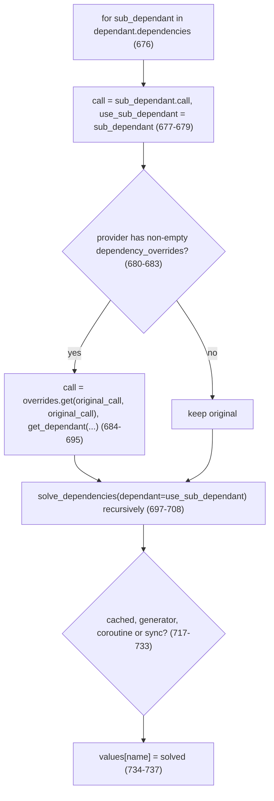

# fastapi-find-003: Swapping a dependency for its override

**Answer:** `fastapi/dependencies/utils.py` lines 680-695, the `if (dependency_overrides_provider and dependency_overrides_provider.dependency_overrides):` statement and its body, inside `solve_dependencies`.

```python
# fastapi/dependencies/utils.py:680-695
        if (
            dependency_overrides_provider
            and dependency_overrides_provider.dependency_overrides
        ):
            original_call = sub_dependant.call
            call = getattr(
                dependency_overrides_provider, "dependency_overrides", {}
            ).get(original_call, original_call)
            use_path: str = sub_dependant.path  # type: ignore
            use_sub_dependant = get_dependant(
                path=use_path,
                call=call,
                name=sub_dependant.name,
                parent_oauth_scopes=_get_oauth_scopes(dependant=sub_dependant),
                scope=sub_dependant.scope,
            )
```

All of lines 680-695 must be selected: the `if` with its three-line condition, through the closing parenthesis of the `get_dependant(...)` call. The selection must stay within lines 676-697, so including the loop header and setup lines above it is fine.

## How to navigate there

1. **Search for `dependency_overrides`.** In `fastapi/dependencies/utils.py` it appears only inside `solve_dependencies` (line 643): its parameter list (line 650), this `if` (lines 681-686), and the recursive call that passes it down (line 703).
2. **Find the loop.** `solve_dependencies` walks `for sub_dependant in dependant.dependencies:` (line 676). The first three lines of the body set up locals, and the `if` comes right after them.
3. **Match the prompt.** The hint says the condition tests "an attribute of the object passed as `dependency_overrides_provider`". That's `.dependency_overrides` on line 682.

## What the loop does for each sub-dependency



Two details are easy to miss:

- **The lookup falls back to the original.** `.get(original_call, original_call)` (line 687) returns the original callable when this particular dependency isn't overridden. So the `if` runs whenever *any* override is registered, and only the overridden callables actually change.
- **A new `Dependant` is built for the replacement.** The override may have a different signature from the original, with its own parameters and sub-dependencies. So `get_dependant(...)` analyzes the override from scratch, keeping the original's `path`, `name`, OAuth scopes and `scope`. Without this, FastAPI would try to call the override with the original's arguments.

## Where the provider comes from

`FastAPI.__init__` creates its router with `dependency_overrides_provider=self` (`fastapi/applications.py:984`), and routes carry the same provider down to `get_request_handler`, which passes it to `solve_dependencies` (`fastapi/routing.py:515`). `app.dependency_overrides` is a plain dict on the app (`applications.py:964`) mapping original callables to replacements. This is what tests use: `app.dependency_overrides[get_db] = get_test_db`.

## Why the nearby code is wrong

- **Lines 676-679** (the `for` header and the setup of `call` and `use_sub_dependant`). They come before the `if` and set the defaults it may overwrite. Allowed in the selection, but not the statement asked for.
- **Lines 684-695 only.** The body without the `if` line and its condition. The prompt asks to include the multi-line condition, which starts on line 680.
- **Lines 697-708** (the recursive `solve_dependencies(...)` call). It *uses* the possibly replaced `use_sub_dependant`, but it doesn't do the swap. It is also outside the window past line 697.
- **Lines 717-733.** These choose how to run the dependency: from cache, as a generator on an exit stack, awaited as a coroutine, or in a threadpool. That happens after the override decision.

## Takeaways

- Dependency-injection containers usually resolve overrides at the point where they look up a dependency, not when it is declared. Search for the override registry's name to find that point.
- `.get(key, key)` is a compact "replace if mapped, otherwise keep" idiom. Seeing it tells you the surrounding `if` is only a fast-path check.
- When a framework swaps a callable, check whether it also re-reads the callable's signature. FastAPI does (`get_dependant`), which is why an override can have completely different parameters.
