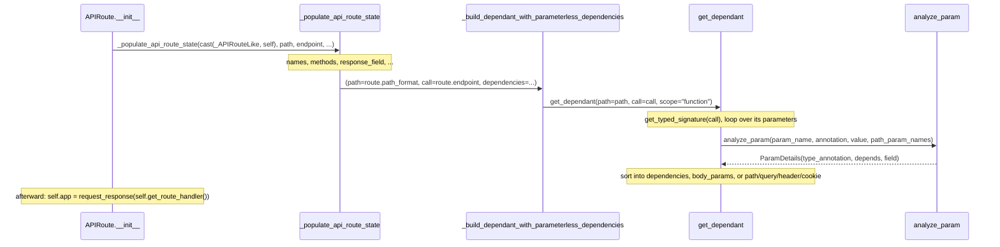

# fastapi-trace-001: How a route's parameters get analyzed

**Answer:** `fastapi/routing.py#APIRoute.__init__` -> `fastapi/routing.py#_populate_api_route_state` -> `fastapi/routing.py#_build_dependant_with_parameterless_dependencies` -> `fastapi/dependencies/utils.py#get_dependant` -> `fastapi/dependencies/utils.py#analyze_param`

## The call sequence

This all happens at **startup**, when the route is registered, not when a request arrives.



## Step by step

1. **`APIRoute.__init__`** (`fastapi/routing.py:1214`). Its body is just two statements. The first, as the hint says, fills in the route's state:

   ```python
   # fastapi/routing.py:1246-1249
           _populate_api_route_state(
               cast(_APIRouteLike, self),
               path,
               endpoint,
   ```

   The second, `self.app = request_response(self.get_route_handler())` (line 1276), builds the ASGI app and comes later. The prompt excludes both of those calls.

2. **`_populate_api_route_state`** (line 1014). A long module-level function that sets attributes on the route (name, path regex, methods, response fields and more). Partway through:

   ```python
   # fastapi/routing.py:1110-1118
       (
           route.dependant,
           body_params,
           route._embed_body_fields,
       ) = _build_dependant_with_parameterless_dependencies(
           path=route.path_format,
           call=route.endpoint,
           dependencies=route.dependencies,
       )
   ```

3. **`_build_dependant_with_parameterless_dependencies`** (line 908). It builds the endpoint's dependency tree, then prepends the decorator-level `dependencies=[...]`:

   ```python
   # fastapi/routing.py:914-919
       dependant = get_dependant(path=path, call=call, scope="function")
       for depends in dependencies[::-1]:
           dependant.dependencies.insert(
               0,
               get_parameterless_sub_dependant(depends=depends, path=path),
           )
   ```

4. **`get_dependant`** (`fastapi/dependencies/utils.py:300`). It reads the endpoint's signature and analyzes each parameter:

   ```python
   # fastapi/dependencies/utils.py:321-329
       endpoint_signature = get_typed_signature(call)
       signature_params = endpoint_signature.parameters
       for param_name, param in signature_params.items():
           param_details = analyze_param(
               param_name=param_name,
               annotation=param.annotation,
               value=param.default,
               path_param_names=path_param_names,
           )
   ```

5. **`analyze_param`** (line 409). The end point. Given a name, an annotation and a default, it decides what the parameter is and returns `ParamDetails` (line 604).

## How `analyze_param` classifies a parameter

| Situation | Result |
|---|---|
| `Depends(...)` as default or inside `Annotated` (lines 448-485) | `depends` set: a sub-dependency |
| `Query()`, `Path()`, `Body()` and so on, as default or in `Annotated` (lines 455-494) | that `FieldInfo` is used |
| annotated as `Request`, `WebSocket`, `Response`, `BackgroundTasks`, `SecurityScopes` (lines 505-518) | special injection, no field |
| plain parameter named in the path (line 526) | `params.Path` |
| plain `UploadFile` annotation (line 530) | `params.File` |
| plain non-scalar annotation, such as a Pydantic model (line 532) | `params.Body` |
| plain scalar annotation (line 534) | `params.Query` |

Back in `get_dependant`, the result is routed: a `depends` becomes a recursive `get_dependant(...)` sub-dependant (line 350), a body field goes to `dependant.body_params` (line 372), and other fields go to `add_param_to_fields` (line 374), which files them by their `in_` location.

## Why the other candidates are wrong

- **`APIRoute.get_route_handler` -> `get_request_handler`.** Request-handling setup. It reads the already-built `route.dependant` but never calls `analyze_param`. The prompt names it as off the chain.
- **`request_response`.** Wraps the handler into an ASGI app. Also excluded.
- **`get_parameterless_sub_dependant`** (`dependencies/utils.py:144`). It also calls `get_dependant`, for each decorator-level dependency, but only *after* the direct `get_dependant` call on line 914, and it would add an extra step to the chain.
- **A recursive `get_dependant` -> `get_dependant` step.** For a parameter with `Depends(...)`, `get_dependant` calls itself (line 350). But it calls `analyze_param` for the first parameter before any recursion, so the direct `get_dependant` -> `analyze_param` edge is reached first.
- **`get_typed_signature`** (line 242). Called by `get_dependant` to resolve the signature's string annotations. It doesn't classify parameters.
- **`add_param_to_fields`** (line 607) and **`add_non_field_param_to_dependency`** (line 378). Called by `get_dependant` *after* `analyze_param` returns, to store the result. `add_param_to_fields` sorts non-body fields by location, but it doesn't take the name, annotation and default the prompt describes, and the body-or-dependency decision is already made.
- **`_get_body_field`** and **`_get_flat_body_params`.** They combine body parameters after the tree is built.
- **`APIRouter.add_api_route`.** It constructs the `APIRoute`, but it is before the start of the trace.

## Takeaways

- Frameworks that use type hints for injection do the expensive analysis once, at route registration. Request time then only fills in a precomputed tree (`route.dependant`). Separate "build time" and "request time" when tracing.
- Constructors that delegate to a module-level "populate" helper are common when several classes share setup logic. Follow the helper, not just the methods on the class.
- When a function is reachable by several paths (direct, recursive, or via a sibling helper), the direct call is the one a "directly calls the next" trace uses.
