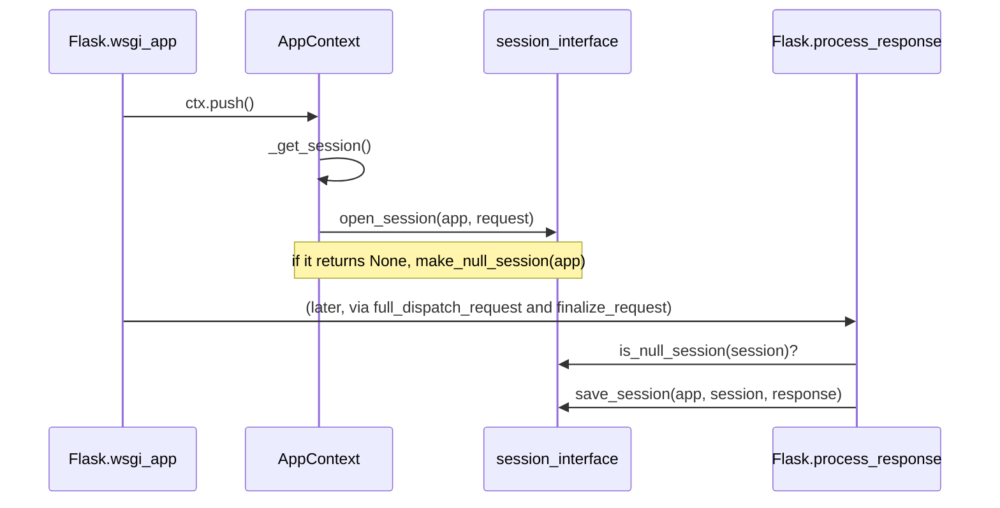

# flask-architecture-001: What a custom session interface must implement

**Answer:** `src/flask/sessions.py#SessionInterface.open_session`, `src/flask/sessions.py#SessionInterface.save_session`

## How to navigate there

1. Open `src/flask/sessions.py` and jump to `class SessionInterface` (line 100).
2. The prompt gives you a mechanical test: the body "only raises `NotImplementedError`". Search the class for `NotImplementedError`. There are exactly two hits, at lines 261 and 270, and they belong to `open_session` and `save_session`.
3. Skim the other methods to confirm they all return something real. They do.

```python
# src/flask/sessions.py:249-270 (docstrings trimmed)
    def open_session(self, app: Flask, request: Request) -> SessionMixin | None:
        ...
        raise NotImplementedError()

    def save_session(
        self, app: Flask, session: SessionMixin, response: Response
    ) -> None:
        ...
        raise NotImplementedError()
```

## Every method on `SessionInterface`

| Method | Line | Default behavior | Must override? |
|---|---|---|---|
| `make_null_session` | 150 | returns `self.null_session_class()` | no |
| `is_null_session` | 162 | `isinstance(obj, self.null_session_class)` | no |
| `get_cookie_name` | 171 | `app.config["SESSION_COOKIE_NAME"]` | no |
| `get_cookie_domain` | 175 | `app.config["SESSION_COOKIE_DOMAIN"]` | no |
| `get_cookie_path` | 187 | `SESSION_COOKIE_PATH` or `APPLICATION_ROOT` | no |
| `get_cookie_httponly` | 195 | `SESSION_COOKIE_HTTPONLY` | no |
| `get_cookie_secure` | 202 | `SESSION_COOKIE_SECURE` | no |
| `get_cookie_samesite` | 208 | `SESSION_COOKIE_SAMESITE` | no |
| `get_cookie_partitioned` | 215 | `SESSION_COOKIE_PARTITIONED` | no |
| `get_expiration_time` | 223 | now + `permanent_session_lifetime` if permanent, else `None` | no |
| `should_set_cookie` | 233 | `session.modified or (session.permanent and SESSION_REFRESH_EACH_REQUEST)` | no |
| **`open_session`** | 249 | `raise NotImplementedError()` | **yes** |
| **`save_session`** | 263 | `raise NotImplementedError()` | **yes** |

## Where Flask calls the two required methods

The hint points at the start and end of a request. You can confirm both call sites:



- **Opening.** `AppContext.push` calls `self._get_session()` as soon as a request context is pushed (`src/flask/ctx.py:439`). `_get_session` calls `si.open_session(self.app, self.request)` and falls back to `make_null_session` if that returns `None` (lines 387-391).
- **Saving.** At the end of `Flask.process_response`:

  ```python
  # src/flask/app.py:1466-1467
          if not self.session_interface.is_null_session(ctx._get_session()):
              self.session_interface.save_session(self, ctx._get_session(), response)
  ```

So a subclass that skips `open_session` fails on **every** request, at context push, before any view runs. One that skips `save_session` fails at the end of every request whose session isn't a null session.

## Why the design looks like this

The storage backend is the only part that genuinely differs between session implementations: where the data lives (a signed cookie, Redis, a database) and how it is loaded and written. Cookie attributes, expiry and "should we write a cookie at all" are policy that depends only on app config, so the base class can implement them once. The default `SecureCookieSessionInterface` (line 284) proves the split: it overrides `open_session` (line 323) and `save_session` (line 337) and adds `get_signing_serializer`, while inheriting every `get_cookie_*` helper.

## Why the other candidates are wrong

- **`make_null_session` / `is_null_session`.** Both have one-line implementations based on `null_session_class` (lines 160 and 169). Flask calls them, but you don't have to provide them.
- **`should_set_cookie` and `get_expiration_time`.** These contain real logic, which can make them look "important", but they are optional helpers that backends may use. They are not abstract.
- **The `get_cookie_*` helpers.** Each reads one config key. Optional.
- **`SecureCookieSessionInterface.open_session` / `save_session`.** These are the concrete implementations in the default subclass. The prompt asks for the methods of `SessionInterface` itself, the base class.
- **`SecureCookieSessionInterface.get_signing_serializer`.** Defined only on the subclass and specific to cookie signing.
- **`SessionMixin.permanent`** and other members of `SessionMixin` / `NullSession`. They live on the session object, not on the interface. `NullSession._fail` raises `RuntimeError`, not `NotImplementedError`, and is on a different class.

## Takeaways

- Python has no mandatory `abstract` keyword, so "methods you must implement" usually show up as `raise NotImplementedError()`. Searching for that string inside a class is a fast way to find its abstract surface.
- Confirm the requirement by finding the call sites. If the framework calls a method unconditionally on every request, its implementation is effectively mandatory.
- A table of "default vs. must override" is a good habit when you study any plug-in base class. It tells you what a minimal implementation needs.
