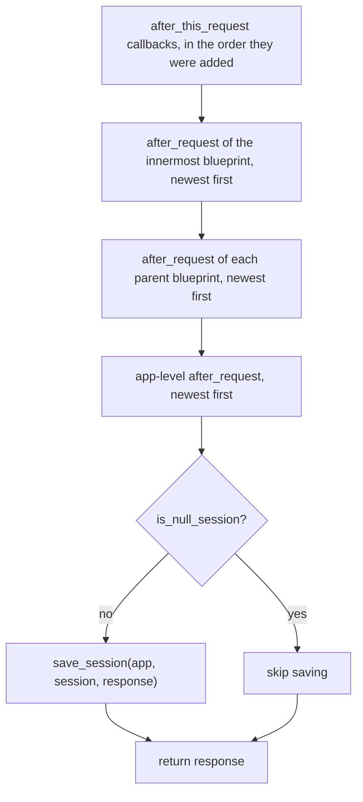

# flask-architecture-002: Order of response postprocessing

**Answer:** option `c`. Context callbacks first, then the registered `after_request` functions, then the session is saved.

## Read it top to bottom

`Flask.process_response` is short, and its three steps are three consecutive blocks:

```python
# src/flask/app.py:1458-1469
        for func in ctx._after_request_functions:
            response = self.ensure_sync(func)(response)

        for name in chain(ctx.request.blueprints, (None,)):
            if name in self.after_request_funcs:
                for func in reversed(self.after_request_funcs[name]):
                    response = self.ensure_sync(func)(response)

        if not self.session_interface.is_null_session(ctx._get_session()):
            self.session_interface.save_session(self, ctx._get_session(), response)

        return response
```

1. **Lines 1458-1459: context callbacks.** `ctx._after_request_functions` is a plain list on the `AppContext` (created at `src/flask/ctx.py:323`). The only thing that appends to it is `after_this_request` (`src/flask/ctx.py:147`). These are the per-request callbacks.
2. **Lines 1461-1464: registered functions.** `self.after_request_funcs` is the dict that `@app.after_request` and `@blueprint.after_request` fill, keyed by blueprint name, with `None` for the app itself.
3. **Lines 1466-1467: session save.** Unless the session is a null session, the session interface writes it out, typically by setting a cookie on `response`.

## How to navigate there

- Open `src/flask/app.py` and jump to `process_response` (line 1441), as the prompt says.
- To tell which loop is which, follow the names. Search for `_after_request_functions` and you land in `ctx.py` next to `after_this_request`. Search for `after_request_funcs` and you land in `src/flask/sansio/scaffold.py`, where the `after_request` decorator (line 495) registers functions.
- The method is called from `Flask.finalize_request` (line 1080), right after `make_response` turns the view's return value into a `Response`.

## The order inside each group

The question is about the three groups, but the order inside each group is the detail people usually get wrong:



- **Context callbacks run in registration order.** The loop on line 1458 iterates the list as-is, with no `reversed`.
- **Registered functions run newest first.** Line 1463 uses `reversed(...)`, and the docstring notes "Functions are called in reverse order of registration" (since 0.5).
- **Blueprints before the app, innermost first.** `ctx.request.blueprints` lists the current blueprint and then its parents (`_split_blueprint_path` in `src/flask/helpers.py:645` turns `"parent.child"` into `["parent.child", "parent"]`). `chain(..., (None,))` adds the app's own key last.

### Worked example

The app registers `@app.after_request` functions `A` then `B`. Blueprint `bp` registers `C`. The view, served by `bp`, calls `after_this_request` with `X` and then `Y`. The response passes through:

```text
X -> Y -> C -> B -> A -> save_session
```

This is the reverse of how the request-side hooks are walked (`names = (None, *reversed(req.blueprints))`: app first, then outer to inner). Request hooks go outside-in, response hooks go inside-out, like nested middleware.

## Why the session is saved last

Every callback before the save can still change the session, and those changes are persisted because `save_session` runs after all of them. If the save came first, an `after_request` function that set `session["x"] = ...` would modify an object that had already been written out, and the change would be lost. Saving last also means the session cookie is set on the final response object, after any callback has replaced or wrapped it.

## Why the other options are wrong

- **a (registered functions first, then context callbacks).** The two `for` loops are in the opposite order. `ctx._after_request_functions` is looped over first, on line 1458.
- **b (session first).** The session block is the last statement before `return response`, on lines 1466-1467.
- **d (interleaved in registration order).** The two groups are separate loops over separate data structures, one list on the context and one dict on the app. Nothing merges them or sorts them by registration time. The registered functions aren't even in registration order, because of `reversed`.

## Related behavior worth knowing

- `process_response` also runs for error responses. `handle_exception` ends with `self.finalize_request(ctx, server_error, from_error_handler=True)` (line 971), which calls `process_response`. With `from_error_handler=True`, an exception raised in postprocessing is logged instead of raised (lines 1084-1089).
- `teardown_request` functions are a different mechanism. They run when the context is popped (`ctx.pop(error)` in `wsgi_app`, line 1677), after the response has been produced, and they can't change it.

## Takeaways

- For "what order does X happen in" questions, read the method body top to bottom before reading any docs. Sequential blocks are the order.
- Then check the order *within* each loop: look for `reversed(...)`, `chain(...)` and how the keys are ordered. That's where the subtle behavior lives.
- Compare a framework's request-side and response-side hooks. They are usually mirror images, and spotting the symmetry helps you remember both.
