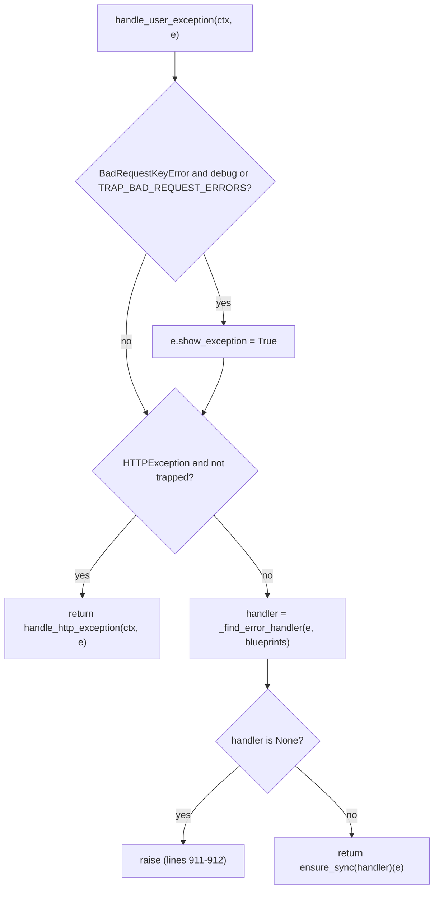

# flask-find-002: Re-raising when no handler matches

**Answer:** `src/flask/app.py` lines 911-912, the `if handler is None:` statement and its bare `raise` inside `Flask.handle_user_exception`.

```python
# src/flask/app.py:906-914
        if isinstance(e, HTTPException) and not self.trap_http_exception(e):
            return self.handle_http_exception(ctx, e)

        handler = self._find_error_handler(e, ctx.request.blueprints)

        if handler is None:
            raise

        return self.ensure_sync(handler)(e)  # type: ignore[no-any-return]
```

Both lines 911 and 912 must be selected. The selection may extend as far as lines 906-914, so including the lookup on line 909 is fine.

## How to navigate there

1. Jump to `Flask.handle_user_exception` in `src/flask/app.py` (line 880). It is short: after the docstring there are only four statements.
2. The prompt describes the method's stages in order: an HTTPException branch, then a lookup "in the registered error handlers", then a re-raise when nothing was found. Find the lookup (`self._find_error_handler(...)`, line 909) and look at the next statement.
3. The hint says the re-raise is "a bare statement with no exception argument". Line 912 is exactly `raise`.

## The method as a decision tree



## Why a bare `raise` works here

`handle_user_exception` is called from inside an `except` block in `full_dispatch_request`:

```python
# src/flask/app.py:1052-1053
        except Exception as e:
            rv = self.handle_user_exception(ctx, e)
```

While that `except` block is running, `e` is Python's "currently handled" exception, so a bare `raise` in a function called from it re-raises that same exception with its original traceback. Writing `raise e` would also work but would add an extra frame to the traceback. The docstring describes this: the method will "reraise the exception with the same traceback".

## Where the exception goes next

The re-raised exception leaves `full_dispatch_request` and is caught one level up in `wsgi_app`:

```python
# src/flask/app.py:1659-1661
            except Exception as e:
                error = e
                response = self.handle_exception(ctx, e)
```

`handle_exception` (line 916) is the last resort. If `PROPAGATE_EXCEPTIONS` is on (by default in testing or debug mode) it re-raises so the debugger or test runner sees the original error. Otherwise it logs it and returns a 500 `InternalServerError`, using a registered 500 handler if there is one.

So the two methods split the work: `handle_user_exception` tries user-registered handlers for the specific exception, and `handle_exception` turns anything still unhandled into a 500.

## Why the nearby code is wrong

- **Lines 906-907** (`if isinstance(e, HTTPException) and not self.trap_http_exception(e):`). This is the HTTPException branch the prompt says was *not* taken. It returns the result of `handle_http_exception` and never re-raises.
- **Line 909** (`handler = self._find_error_handler(...)`). The lookup itself. It is allowed inside the selection, but on its own it doesn't cover the anchor.
- **Line 914** (`return self.ensure_sync(handler)(e)`). The opposite case: a handler *was* found and is called.
- **Lines 901-904** (the `BadRequestKeyError` block). It sets `e.show_exception = True` for better debug output and falls through. No re-raise.
- **Lines 876-877** (`if handler is None: return e`), in another error-handling method just above. Structurally almost identical, but it is a different method and it *returns* the HTTP exception (which werkzeug can render as a response) instead of re-raising.
- **`handle_exception`**, lines 958-961 (`raise` / `raise e`). Different method, different condition (`propagate`).
- **`src/flask/sansio/app.py` lines 911-912.** Same line numbers, different file: they are `if self.config["TRAP_HTTP_EXCEPTIONS"]: return True` inside `trap_http_exception`. The answer must be in `src/flask/app.py`.

## Takeaways

- A bare `raise` only makes sense while an exception is being handled. When you see one in a helper, find the `except` block that calls the helper to understand which exception it re-raises.
- Error handling in web frameworks is usually layered: a "try user handlers" layer and a "last resort 500" layer. Find both before reasoning about what a user sees.
- Two methods with the same shape can differ in one crucial word, `return e` versus `raise`. Read the exact statement, not the pattern.
