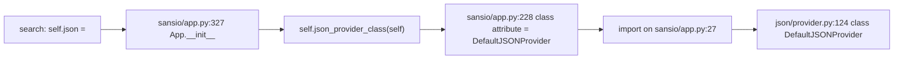

# flask-find-003: Default JSON provider

**Answer:** `src/flask/json/provider.py`

## How a strong engineer would get there

The hint gives the method: find where the app builds its `json` attribute, then follow the class it instantiates. That is three jumps.



1. **Find the assignment.** `Flask` itself (`src/flask/app.py`) doesn't set `json`. Its base class `App` in `src/flask/sansio/app.py` does, in `__init__`:

   ```python
   # src/flask/sansio/app.py:327
           self.json: JSONProvider = self.json_provider_class(self)
   ```

   The app looks up the class through `self.json_provider_class` rather than naming it directly. That is what lets a subclass "override the class used", as the prompt says.

2. **Find the default class.** `json_provider_class` is a class attribute on `App`:

   ```python
   # src/flask/sansio/app.py:228
       json_provider_class: type[JSONProvider] = DefaultJSONProvider
   ```

3. **Follow the import.** At the top of the same file, `from ..json.provider import DefaultJSONProvider` (line 27). "Go to definition" lands on `class DefaultJSONProvider(JSONProvider):` at `src/flask/json/provider.py:124`.

4. **Confirm the standard-library part.** `provider.py` has `import json` on line 5, and the class's `dumps` and `loads` call it directly:

   ```python
   # src/flask/json/provider.py:176-187
           kwargs.setdefault("default", self.default)
           kwargs.setdefault("ensure_ascii", self.ensure_ascii)
           kwargs.setdefault("sort_keys", self.sort_keys)
           return json.dumps(obj, **kwargs)

       def loads(self, s: str | bytes, **kwargs: t.Any) -> t.Any:
           """Deserialize data as JSON from a string or bytes.

           :param s: Text or UTF-8 bytes.
           :param kwargs: Passed to :func:`json.loads`.
           """
           return json.loads(s, **kwargs)
   ```

## What lives in `provider.py`

| Name | Line | Role |
|---|---|---|
| `JSONProvider` | 19 | Base class. `dumps` and `loads` raise `NotImplementedError` (lines 47, 65); `dump`, `load` and `response` have defaults built on them. |
| `_default` | 108 | The fallback for types `json.dumps` can't handle (dates, UUIDs, dataclasses, objects with `__html__`). |
| `DefaultJSONProvider` | 124 | The default implementation: stdlib `json`, plus `ensure_ascii`, `sort_keys`, `compact` and `mimetype` settings. |

The base class and the default implementation share the file, so the answer is the same whichever one you consider "the provider". The prompt asks for the file of the class "as it is used by default", which is `DefaultJSONProvider`.

## Why the other files are wrong

- **`src/flask/sansio/app.py`.** It creates the provider and names the default class, but it only imports it. It neither defines the class nor calls `json.dumps`. This is the file you pass *through*, so it's the most tempting wrong answer.
- **`src/flask/app.py`.** `Flask` subclasses `App` and *uses* the provider: `self.json.dumps` is plugged into Jinja's `json.dumps_function` policy (line 504), and `make_response` calls `self.json.response(rv)` for dict and list return values (line 1369). It doesn't define a provider.
- **`src/flask/json/__init__.py`.** It holds the module-level `dumps`, `dump`, `loads`, `load` and `jsonify` helpers. Each one forwards to `current_app.json` (for example line 41, `return current_app.json.dumps(obj, **kwargs)`). They are a front end to whatever provider the app has.
- **`src/flask/json/tag.py`.** `TaggedJSONSerializer` and the `JSONTag` classes encode extra types for the session cookie. It's a separate mechanism, used by `SecureCookieSessionInterface` through `session_json_serializer` in `src/flask/sessions.py` (line 273), not the app's `json` attribute.
- **`src/flask/wrappers.py`.** `Request` and `Response` set `json_module = json` (lines 31 and 242), meaning the `flask.json` package, so that werkzeug's `get_json` goes through Flask's helpers. They don't define a provider.

## Background: why a provider object?

The provider API was added in Flask 2.2 (`JSONProvider` is marked `versionadded:: 2.2`, line 35). It gathers all JSON behaviour (serialization, parsing and building JSON responses) behind one instance per app. Swapping in another JSON library means writing a subclass that implements `dumps` and `loads`, then either setting `json_provider_class` on a `Flask` subclass or assigning `app.json` directly. `JSONProvider`'s docstring describes both options (lines 28-30). The provider holds the app through `weakref.proxy` (line 39) so it doesn't create a reference cycle with the app.

## Takeaways

- When an attribute is built from `self.<something>_class(...)`, the class attribute is the extension point and its default value is the default implementation. This "factory class attribute" pattern is common across Flask (`request_class`, `response_class`, `session_interface`).
- Follow imports to the defining file. The file that mentions a class most visibly is often only the one that wires it up.
- Distinguish a *facade* (module-level helpers that forward to `current_app.json`) from the *implementation* behind it.
