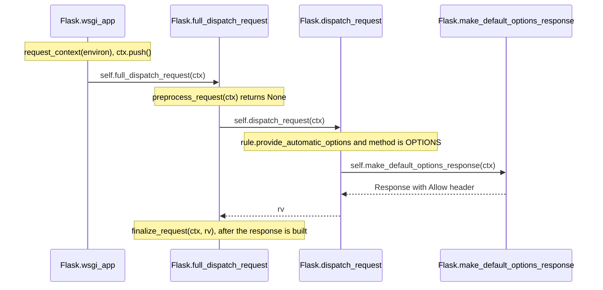

# flask-trace-001: The automatic OPTIONS response

**Answer:** `src/flask/app.py#Flask.wsgi_app` -> `src/flask/app.py#Flask.full_dispatch_request` -> `src/flask/app.py#Flask.dispatch_request` -> `src/flask/app.py#Flask.make_default_options_response`

## The call sequence

Calls that happen but are not part of the chain are shown as notes.



## Step by step

1. **`Flask.wsgi_app`** (`src/flask/app.py:1627`). It builds the context, pushes it, and hands off:

   ```python
   # src/flask/app.py:1653-1658
           ctx = self.request_context(environ)
           error: BaseException | None = None
           try:
               try:
                   ctx.push()
                   response = self.full_dispatch_request(ctx)
   ```

   `request_context` is a Flask method, but it only creates the `AppContext` and returns. It doesn't call onward toward the response. `ctx.push()` is an `AppContext` method (it opens the session and matches the URL), not a Flask method.

2. **`Flask.full_dispatch_request`** (line 1023). It runs preprocessing first, and calls dispatch only if that returned `None`:

   ```python
   # src/flask/app.py:1049-1051
               rv = self.preprocess_request(ctx)
               if rv is None:
                   rv = self.dispatch_request(ctx)
   ```

   The prompt guarantees no `before_request` callback returns a value, so `rv is None` and dispatch runs.

3. **`Flask.dispatch_request`** (line 993). This is where the decision is made, just before the view would be called:

   ```python
   # src/flask/app.py:1014-1018
           if (
               getattr(rule, "provide_automatic_options", False)
               and req.method == "OPTIONS"
           ):
               return self.make_default_options_response(ctx)
   ```

   The view function lookup on line 1021 is never reached.

4. **`Flask.make_default_options_response`** (line 1092). It builds the response from the URL adapter's allowed methods:

   ```python
   # src/flask/app.py:1103-1106
           methods = ctx.url_adapter.allowed_methods()  # type: ignore[union-attr]
           rv = self.response_class()
           rv.allow.update(methods)
           return rv
   ```

   `allowed_methods()` is werkzeug (third-party) and `self.response_class()` is a constructor, so the chain ends here.

## Where `provide_automatic_options` comes from

The flag is set at registration time, in `App.add_url_rule` (`src/flask/sansio/app.py:634-652`). If you don't pass it, Flask checks the view function for a `provide_automatic_options` attribute, and otherwise turns it on when `"OPTIONS"` isn't in the route's methods and the `PROVIDE_AUTOMATIC_OPTIONS` config is true. When it is on, `"OPTIONS"` is added to the rule's methods (line 646), and the flag is stored on the werkzeug `Rule` object (line 652). That is why `dispatch_request` reads it with `getattr(rule, ...)`: it isn't a standard `Rule` attribute.

## How to navigate it quickly

- Start at `wsgi_app` and look only for `self.<method>(...)` calls, since the prompt wants Flask methods.
- The hint says the decision is "just before the view function would be called". The view is called in `dispatch_request` (`self.view_functions[rule.endpoint]`), so the branch that skips it must be right above that line.
- Search for `OPTIONS` in `app.py`. Besides the config default (line 234) and a check in `raise_routing_exception` (line 586), the hits are the branch in `dispatch_request` (lines 1013-1016) and the docstring of `make_default_options_response` (line 1093). That leads straight to the end of the chain.

## Why the other candidates are wrong

- **`Flask.preprocess_request`.** Called by `full_dispatch_request`, but it returns `None` and the chain continues from `full_dispatch_request`, not from inside it. It is a sibling of `dispatch_request`, not a step before it.
- **`Flask.request_context`.** Called by `wsgi_app` before `full_dispatch_request`, but it only builds and returns the context.
- **`AppContext.push` / `AppContext.match_request`.** Not Flask methods. They do the routing that fills `req.url_rule`, but they live in `src/flask/ctx.py`.
- **`Flask.raise_routing_exception`.** Only called if `req.routing_exception` is set. The URL matched a rule, so it isn't.
- **`Flask.finalize_request`, `Flask.make_response`, `Flask.process_response`.** These run after `dispatch_request` returns, to turn `rv` into the final response and run `after_request` hooks. The prompt ends at the method that *builds* the OPTIONS response.
- **`Flask.handle_user_exception` / `Flask.handle_exception`.** Only reached if something raises. The prompt says nothing does.
- **`Flask.ensure_sync`.** It wraps the view or callbacks to call them. The prompt says to skip it, and on this path the view is never called anyway.
- **`Flask.__call__`.** It calls `wsgi_app`, but the trace starts at `wsgi_app`.
- **`App.add_url_rule`.** It sets the flag at startup. It isn't called during the request.

## Takeaways

- In a trace, a function that is called and returns without leading to the end condition (`preprocess_request`, `request_context`) is a sibling, not a step. Each step must be the caller of the next one.
- Framework "automatic" behavior is usually decided by a flag set at registration and checked at dispatch. Finding both ends explains why the behavior happens and how to turn it off (`provide_automatic_options=False` on the route).
- `make_default_options_response` is documented as an override point ("This can be changed through subclassing"). Methods like that are good anchors when you search a framework for where a default response is built.
