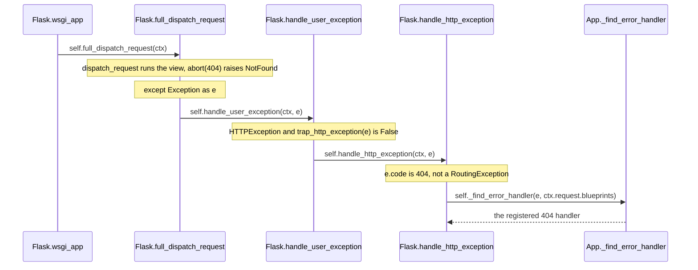

# flask-trace-002: Finding the handler for an aborted request

**Answer:** `src/flask/app.py#Flask.wsgi_app` -> `src/flask/app.py#Flask.full_dispatch_request` -> `src/flask/app.py#Flask.handle_user_exception` -> `src/flask/app.py#Flask.handle_http_exception` -> `src/flask/sansio/app.py#App._find_error_handler`

## Start from the end

The hint gives the best strategy: find every caller of the lookup and work out which one this exception actually reaches. Searching `src/flask/` for `_find_error_handler(` finds the definition and exactly three call sites:

| Caller | Line | When it runs |
|---|---|---|
| `Flask.handle_http_exception` | `app.py:875` | an `HTTPException` with a code that isn't a `RoutingException` |
| `Flask.handle_user_exception` | `app.py:909` | an exception that is *not* an untrapped `HTTPException` |
| `Flask.handle_exception` | `app.py:966` | an exception that escaped `full_dispatch_request`; it looks up a handler for an `InternalServerError` |

The definition is not on `Flask`. It is on the base class `App`, in `src/flask/sansio/app.py:869`. That is why the last ID in the answer is in a different file.

## The path, forwards



1. **`wsgi_app`** (`app.py:1627`) pushes the context and calls `self.full_dispatch_request(ctx)` (line 1658) inside a `try`.
2. **`full_dispatch_request`** (line 1023) calls `preprocess_request`, which returns `None`, then `dispatch_request`, which calls the view. The view's `abort(404)` raises `NotFound`. That exception unwinds out of `dispatch_request` and is caught here:

   ```python
   # src/flask/app.py:1052-1053
           except Exception as e:
               rv = self.handle_user_exception(ctx, e)
   ```

3. **`handle_user_exception`** (line 880):

   ```python
   # src/flask/app.py:906-907
           if isinstance(e, HTTPException) and not self.trap_http_exception(e):
               return self.handle_http_exception(ctx, e)
   ```

   `NotFound` is a werkzeug `HTTPException`. With the default configuration, `trap_http_exception` (`sansio/app.py:894`) returns `False`: `TRAP_HTTP_EXCEPTIONS` is unset, and the `TRAP_BAD_REQUEST_ERRORS` checks only apply to `BadRequestKeyError`/`BadRequest`, which `NotFound` isn't. So this branch is taken.

4. **`handle_http_exception`** (line 841) has two early returns, neither of which applies:

   ```python
   # src/flask/app.py:866-875
           if e.code is None:
               return e
           ...
           if isinstance(e, RoutingException):
               return e

           handler = self._find_error_handler(e, ctx.request.blueprints)
   ```

   `NotFound` has code 404, and it was raised by the view, not by routing.

5. **`App._find_error_handler`** (`sansio/app.py:869`) is the end point. It does what the prompt describes:

   ```python
   # src/flask/sansio/app.py:877-892
           exc_class, code = self._get_exc_class_and_code(type(e))
           names = (*blueprints, None)

           for c in (code, None) if code is not None else (None,):
               for name in names:
                   handler_map = self.error_handler_spec[name][c]

                   if not handler_map:
                       continue

                   for cls in exc_class.__mro__:
                       handler = handler_map.get(cls)

                       if handler is not None:
                           return handler
           return None
   ```

   Status code first (`404`, then `None` meaning "by class only"), blueprints before the app (`None` last in `names`), and each exception class in the MRO.

## Why the other paths are wrong

- **`wsgi_app` -> `handle_exception` -> `_find_error_handler`.** The shortest path in the call graph, which is why this puzzle has a validator override. `wsgi_app` only calls `handle_exception` from its own `except Exception` (lines 1659-1661), and the `NotFound` never gets there because `full_dispatch_request` already caught it. Even if it did, `handle_exception` looks up a handler for a new `InternalServerError` (line 965), not for the 404.
- **`... -> handle_user_exception -> _find_error_handler`** (skipping `handle_http_exception`). That direct call on line 909 is the branch for exceptions that are not `HTTPException`s, or are trapped. With `NotFound` and the default config, line 907 returns first.
- **Including `dispatch_request`.** It raises the exception (through the view) but it doesn't call `handle_user_exception`. A raise unwinds back to the caller's `except`, so the next call is made by `full_dispatch_request`.
- **Including `preprocess_request` or the view function.** Called by `full_dispatch_request` (directly or through `dispatch_request`), but neither calls onward to the handler lookup.
- **Including `trap_http_exception`.** It's called inside the `if` on line 906, returns `False`, and doesn't lead anywhere. A sibling, not a step. The same goes for `ensure_sync`, which the prompt excludes.
- **`Scaffold._get_exc_class_and_code`** (`sansio/scaffold.py:665`). Called by `_find_error_handler`, so it is past the end of the chain.
- **`Flask._find_error_handler`.** There is no such symbol: `Flask` inherits the method from `App`. Choose the definition in `src/flask/sansio/app.py`.

## Where the handler map comes from

`@app.errorhandler(404)` goes through `Scaffold.errorhandler` (`sansio/scaffold.py:606`), which stores the function at `self.error_handler_spec[None][code][exc_class]` (line 662). `None` is the app's key. Blueprint handlers are copied in under the blueprint's name when it is registered (`sansio/blueprints.py:397`). That nesting, name then code then class, is exactly the order `_find_error_handler` walks.

## Takeaways

- For a trace that ends at a widely used helper, list every caller of the helper first. Then rule callers out with the prompt's conditions (exception type, configuration). This is faster than tracing forward blindly.
- A raised exception returns control to the nearest enclosing `except`, not to the function that raised it. In a trace of direct calls, the next step is called from that `except` block.
- When "go to definition" jumps to a base class in another file (`sansio/app.py`), use that definition's ID. Inherited methods aren't defined on the subclass.
