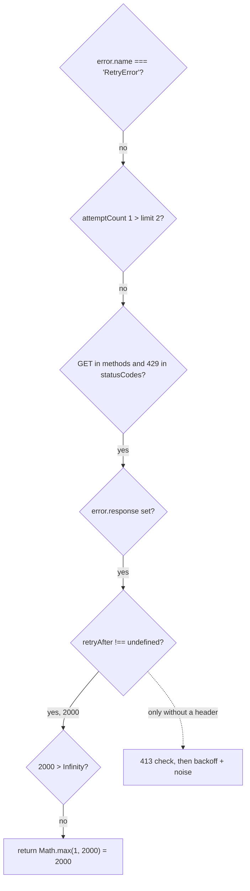

# got-architecture-001: Retry-After versus backoff

**Answer:** option c, 2000 ms.

## Where the inputs come from

`calculateRetryDelay` is a pure function of its arguments, so first work out what the caller passes. The only caller is `Request._beforeError` in `source/core/index.ts`.

**`retryAfter`.** The header is parsed into milliseconds (`source/core/index.ts:576-579`):

```ts
if (response && 'retry-after' in response.headers) {
	const retryAfterHeader = response.headers['retry-after']!;
	if (/^\d+$/v.test(retryAfterHeader)) {
		retryAfter = Number(retryAfterHeader) * 1000;
```

`"2"` matches `^\d+$`, so `retryAfter = 2000`.

**`computedValue`.** The caller passes a cap, not a delay (`index.ts:601`):

```ts
computedValue: retryOptions.maxRetryAfter ?? options.timeout.request ?? Infinity,
```

In the defaults (`source/core/options.ts`), `retry.maxRetryAfter` is `undefined` (line 1400) and `timeout.request` is `undefined` (line 1325). Both `??` fall through, so `computedValue` is `Infinity`.

**`attemptCount`** is `this.retryCount + 1` (`index.ts:538`), which is 1 on the first failure.

## Walking `calculateRetryDelay`



Each check, with the line in `source/core/calculate-retry-delay.ts`:

| Line | Check | Value here | Effect |
|---|---|---|---|
| 12 | `error.name === 'RetryError'` | `HTTPError` | continue |
| 16 | `attemptCount > retryOptions.limit` | `1 > 2` is false | continue |
| 20-25 | method and status code allowed | `GET` is in `methods`, `429` is in `statusCodes` | continue |
| 27-28 | `error.response` and `retryAfter !== undefined` | both true | enter the Retry-After branch |
| 31 | `retryAfter > computedValue ? 0 : Math.max(1, retryAfter)` | `2000 > Infinity` is false | **return 2000** |

The exponential backoff on line 41 is never reached.

## Why the other options are wrong

- **a, 1 ms.** The `1` values come from two places: `return 1` for a `RetryError` (line 13), and the `Math.max(1, ...)` floors on lines 31 and 41. The error here is an `HTTPError`, and `Math.max(1, 2000)` is 2000.
- **b, at least 1000 and below 1100 ms.** That is line 41 for attempt 1: `Math.min(2 ** 0 * 1000, backoffLimit) + noise`, with `noise` below the default 100. It only runs when there is no usable `Retry-After` (and the status is not 413). Here the function returns on line 31 first.
- **d, 0 because the header exceeds the maximum.** That branch needs `retryAfter > computedValue`. With no `maxRetryAfter` and no `timeout.request`, the maximum is `Infinity`. If you had set `retry.maxRetryAfter: 1000`, then `2000 > 1000` would return 0 and, with `enforceRetryRules` on, got would not retry at all.

## What happens with the value

`_beforeError` then calls `retryOptions.calculateDelay({..., computedValue})` (line 611). The default is `({computedValue}) => computedValue` (`options.ts:1401`), so it passes 2000 through, and got waits with `setTimeout(resolve, backoff)` before retrying.

## Design notes

- The server's `Retry-After` takes priority over got's own backoff, which is why the header branch returns before the backoff formula. The header parsing in `_beforeError` follows RFC 9110 closely: invalid values are ignored (line 587 cites the RFC), and dates in the past become 0.
- The name `computedValue` is reused for two meanings. Going *into* `calculateRetryDelay` it carries the cap. Coming *out* it is the computed delay handed to the user's `calculateDelay`. The comment on line 29 calls this out. When reading code like this, check which call you are looking at.

## Takeaways

- For "what does this return" questions, pin down every argument from the caller before reading the function body. Here the surprising value (`Infinity`) is decided by the caller.
- Chained `??` with all-`undefined` defaults ends at the last fallback. Check the defaults object rather than assuming an option has a value.
