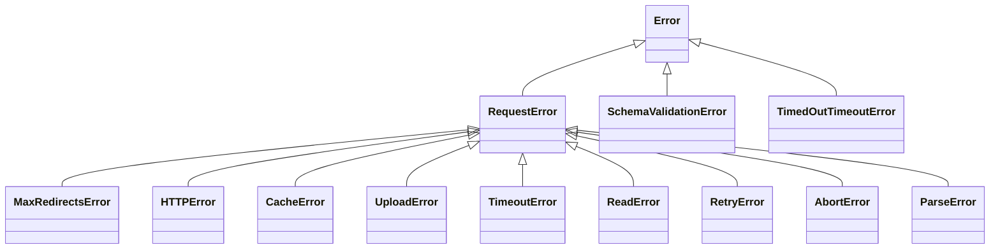

# got-architecture-002: Direct subclasses of RequestError

**Answer:**

- `source/core/errors.ts#MaxRedirectsError`
- `source/core/errors.ts#HTTPError`
- `source/core/errors.ts#CacheError`
- `source/core/errors.ts#UploadError`
- `source/core/errors.ts#TimeoutError`
- `source/core/errors.ts#ReadError`
- `source/core/errors.ts#RetryError`
- `source/core/errors.ts#AbortError`
- `source/core/response.ts#ParseError`

## How a strong engineer would find them

1. Jump to the base class. `RequestError` is declared in `source/core/errors.ts:49` as `export class RequestError<T = unknown> extends Error`.
2. Search all of `source/` for the literal `extends RequestError`. Searching only `errors.ts` is the trap the hint warns about. The search returns nine hits:

| Class | File:line | Thrown when (from its doc comment) |
|---|---|---|
| `MaxRedirectsError` | `errors.ts:148` | the server redirects more than `maxRedirects` times |
| `HTTPError` | `errors.ts:164` | the status is not 2xx or 3xx (with redirects followed), except 304 |
| `CacheError` | `errors.ts:179` | a cache method fails |
| `UploadError` | `errors.ts:192` | reading a stream request body fails |
| `TimeoutError` | `errors.ts:206` | the request is aborted due to a timeout |
| `ReadError` | `errors.ts:224` | reading the response stream fails |
| `RetryError` | `errors.ts:242` | thrown on purpose to force a retry |
| `AbortError` | `errors.ts:254` | the request is aborted by an `AbortController` |
| `ParseError` | `response.ts:170` | the status is 2xx but parsing the body fails |

3. Check each heritage clause. `HTTPError` is written `extends RequestError<T>` with a type argument, which still matches the search and is still a direct subclass. None of the nine extends another subclass.

## The hierarchy

`TimedOutTimeoutError` in the diagram is the `TimeoutError` declared in `source/core/timed-out.ts:35`. `index.ts` imports it under that alias to tell the two apart.

## Why other classes are wrong

- **`RequestError`** itself extends `Error`. It is the base class, not a subclass of itself.
- **`SchemaValidationError`** (`errors.ts:290`) extends `Error` only. Its doc comment says it "intentionally does not extend `RequestError`, because the request succeeded": the response arrived, but the user's schema rejected the data.
- **`TimeoutError` in `source/core/timed-out.ts`** extends `Error`. It is a low-level error raised by the per-phase timers. When it reaches `Request._beforeError`, the check `error instanceof TimedOutTimeoutError` converts it with `this._createTimeoutError(error)` into the `errors.ts` `TimeoutError`, which does extend `RequestError` (`index.ts:542-543`). Same name, different symbol.
- **`CustomAPIError`** in `source/core/options.ts:376` extends `Error`, and it is inside a documentation code example, not real code.
- **`Request`** (`source/core/index.ts:336`) extends `Duplex`. It is the request stream that errors refer to, not an error.
- **`Http2Agent`, `Http2ClientRequest`, `Http2IncomingMessage`** in `source/core/utils/http2-client.ts` extend `EventEmitter`, `Writable` and `Readable`. **`Options`**, **`DnsCache`** and **`WeakableMap`** extend nothing.

## Why one subclass lives in another file

`ParseError` sits in `response.ts`, next to the body-parsing code that throws it (`parseBody`), rather than in `errors.ts`. It is still re-exported publicly, so users import it from `got` like the others. When you are listing subclasses, the file layout is not a reliable guide. Search the whole source tree.

## Why got has a common base class

All request-related failures share fields that `RequestError` defines: `code`, `options`, `request`, `response` and `timings`. That lets user code write one `instanceof RequestError` check and still read the request details, and lets got's own retry logic treat them uniformly. In `_beforeError`, any non-`RequestError` is wrapped with `new RequestError(error.message, error, this)` (`index.ts:544-545`).

## Takeaways

- For "direct subclass" questions, search for `extends Base` across the whole source tree, and make sure generic forms like `extends Base<T>` are matched too.
- Name collisions between modules (two `TimeoutError`s here) are common. The import alias in the consuming file usually tells you how the authors distinguish them.
