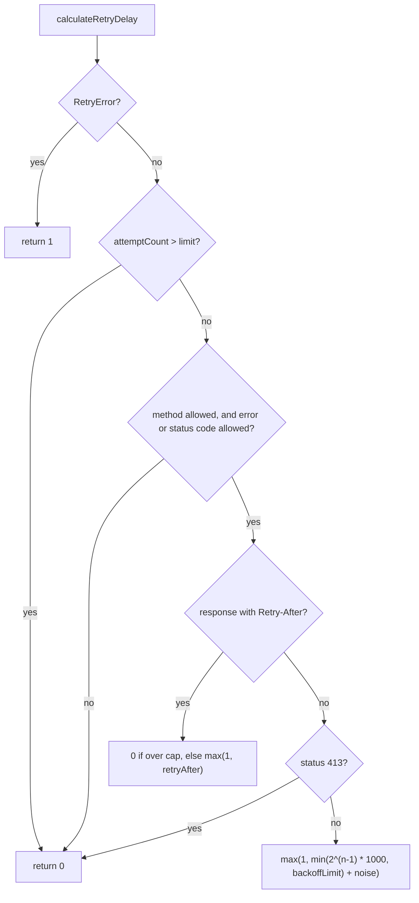

# got-find-001: Exponential retry backoff

**Answer:** `source/core/calculate-retry-delay.ts#calculateRetryDelay`

## How a strong engineer would navigate there

The prompt gives a distinctive option name, `backoffLimit`. Search `source/core/` for it:

| Hit | What it is |
|---|---|
| `options.ts:633` and `:3140` | doc comments describing the formula |
| `options.ts:664` | the `backoffLimit: number` field of the `RetryOptions` type |
| `options.ts:1402` | the default, `backoffLimit: Infinity` |
| `options.ts:3183` | validation in the `retry` setter |
| `calculate-retry-delay.ts:41` | **the only place the value is used in a computation** |

Line 41 is the formula from the prompt:

```ts
// source/core/calculate-retry-delay.ts:39-41
const noise = Math.random() * retryOptions.noise;
// Zero disables retries, so represent an immediate retry with the minimum timer delay.
return Math.max(1, Math.min(((2 ** (attemptCount - 1)) * 1000), retryOptions.backoffLimit) + noise);
```

`2 ** (attemptCount - 1) * 1000` doubles with each attempt (1 s, 2 s, 4 s, ...), `Math.min(..., backoffLimit)` caps it, and `noise` adds up to `retryOptions.noise` milliseconds of jitter (100 by default). The enclosing function is the arrow function assigned to `const calculateRetryDelay` on line 5, the file's default export.

To confirm, use Find References. The only call site is `Request._beforeError` in `source/core/index.ts:596`, which matches the hint: it then passes the result as `computedValue` to the user-facing `retryOptions.calculateDelay` (line 611).

## The shape of the function



Every "not allowed" outcome returns `0`. That is the signal the caller uses for "don't retry": with `enforceRetryRules` (default `true`), a `0` skips the user's `calculateDelay` entirely (`index.ts:608-609`), and later `if (backoff && ...)` (line 625) is false, so no retry is scheduled. That is also why the code uses `Math.max(1, ...)` for a real retry: a computed delay of 0 would be confused with "no retry".

## Why other candidates are wrong

- **The default `calculateDelay`**, `({computedValue}) => computedValue` in the defaults object (`options.ts:1401`), only passes the computed value through. It does no backoff math. It is an inline arrow function, not a selectable top-level symbol.
- **`Request._beforeError`** (`index.ts:531`) parses `Retry-After`, calls `calculateRetryDelay`, then calls `calculateDelay` and waits with `setTimeout`. It decides how to act on the delay but delegates computing it.
- **The `retry` setter in `Options`** (`options.ts:3169`) validates user-supplied retry settings with `assertAny`. It computes nothing.
- **`RetryFunction`** (`options.ts:628`) is the type of the function, not an implementation.
- **The `calculateRetryDelay` re-export** in `source/index.ts:25` makes the function part of the public API, but the definition is in `source/core/`.

## Takeaways

- A distinctive option name is the fastest way into a feature. Most hits will be types, defaults, docs and validation. Look for the one hit that does arithmetic with it.
- When `0` means "don't", code that wants "as soon as possible" has to use a minimum such as `1`. Watch for `Math.max(1, ...)` as the tell.
