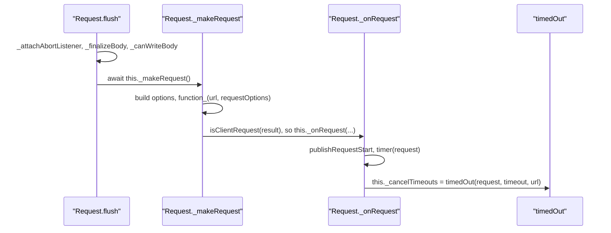

# got-trace-001: From flush to timeout timers

**Answer (in order):**

1. `source/core/index.ts#Request.flush`
2. `source/core/index.ts#Request._makeRequest`
3. `source/core/index.ts#Request._onRequest`
4. `source/core/timed-out.ts#timedOut`

## How a strong engineer would approach it

`source/core/index.ts` is over 3,000 lines, so don't read it top to bottom. Work from both ends:

- **From the end.** `source/core/timed-out.ts` has one default export, `export default function timedOut(request: ClientRequest, delays: Delays, options: TimedOutOptions)` (line 55). In `index.ts` it is imported on line 25 and called exactly once, on line 1785, inside `_onRequest`.
- **From the start.** `flush` (line 488) calls `await this._makeRequest()` on line 510.
- **Join them.** Does `_makeRequest` call `_onRequest`? Yes, on line 2903. That closes the chain.

## The call sequence



## Step by step

**`flush` → `_makeRequest`.** After setting up the abort listener and preparing the body, `flush` issues the request (`source/core/index.ts:502-510`):

```ts
await this._finalizeBody();
...
this._hasWritableBody = this._canWriteBody();

await this._makeRequest();
```

**`_makeRequest` → `_onRequest`.** With no cache, `function_` is the plain request function (line 2877: `const function_ = useCache ? this._createCacheableRequest : request;`). Its result is checked:

```ts
// source/core/index.ts:2902-2905
if (isClientRequest(requestOrResponse!)) {
	this._onRequest(requestOrResponse, useCache);
} else if (this.writableEnded) {
	void this._onResponse(requestOrResponse as IncomingMessageWithTimings);
```

The prompt says the request function returns a `ClientRequest`, so the first branch runs.

**`_onRequest` → `timedOut`.**

```ts
// source/core/index.ts:1781-1785
timer(request);

// `timeout.socket` is the inactivity timeout. The HTTP/2 request maps it onto the
// stream, so a stalled response body still times out.
this._cancelTimeouts = timedOut(request, timeout, url as URL);
```

`timedOut` arms the per-phase timers (`socket`, `lookup`, `connect`, `secureConnect`, `send`, `response` and `read`, each only if set) on the `ClientRequest` and returns a function that cancels them, which `Request` keeps as `_cancelTimeouts`.

## Why other sequences are wrong

- **Including `_finalizeBody`, `_attachAbortListener` or `_canWriteBody`.** `flush` calls them before `_makeRequest`, but none of them leads to `timedOut`. They are side branches.
- **Going through `_checkRequestTimeout`.** `_makeRequest` calls it (for example on line 2884), and its name sounds right, but it arms the single overall `timeout.request` budget with its own `setTimeout` (lines 2507-2535) and does not call `timedOut`.
- **Including `isClientRequest`.** It is called inside the `if` condition in `_makeRequest`, but it is a type check that returns a boolean. The next link, `_onRequest`, is called by `_makeRequest`, not by `isClientRequest`.
- **Including `timer` or `publishRequestStart`.** Both are called from `_onRequest` just before `timedOut`. `timer` (`source/core/utils/timer.ts`) records timing events. `publishRequestStart` publishes a diagnostics-channel event. Neither calls `timedOut`.
- **Going through `_onResponse`.** That branch of `_makeRequest` runs only when the request function returns a response rather than a `ClientRequest`, which the prompt rules out. `_onResponse` doesn't call `timedOut` either.
- **Going through `_createCacheableRequest`.** That is the request function used when the cache is on. The prompt says no cache.
- **Including `_beforeError`.** `flush` calls it from its `catch` block, which only runs on an error.
- **Leaving out `Request.flush`.** The prompt says to include the start function.

## Background

got arms timeouts per phase because a single overall timer can't tell you *where* a request stalled. Attaching them in `_onRequest`, the moment a `ClientRequest` exists, means the DNS lookup and connect phases are covered from the start. A redirect calls `_makeRequest` again (`index.ts:1609`), which goes back through `_onRequest`, so the timers are re-armed for each new `ClientRequest`.

## Takeaways

- In a very large file, find the end function's single call site first, then connect back to the start. It is far faster than reading forward.
- Functions with names that sound relevant (`_checkRequestTimeout` here) are not necessarily on the path. Confirm each link by finding the literal call.
