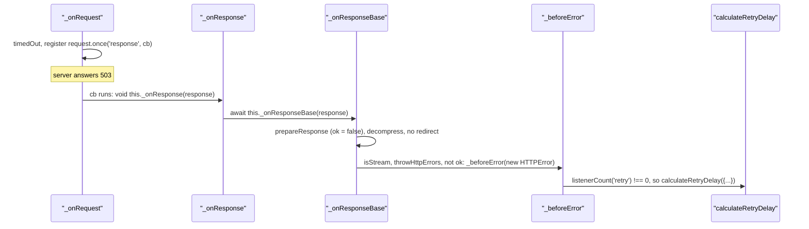

# got-trace-002: From a 503 in stream mode to the retry delay

**Answer (in order):**

1. `source/core/index.ts#Request._onRequest`
2. `source/core/index.ts#Request._onResponse`
3. `source/core/index.ts#Request._onResponseBase`
4. `source/core/index.ts#Request._beforeError`
5. `source/core/calculate-retry-delay.ts#calculateRetryDelay`

## How a strong engineer would approach it

Start from the end and work back, because `calculateRetryDelay` has exactly one call site: `Request._beforeError` at `source/core/index.ts:596`. So the real question is *which* call to `_beforeError` fires for a 503 in stream mode. Search `index.ts` for `_beforeError(` and you'll find many callers. Most of them are error handlers, and the prompt rules those out ("No error is thrown or emitted anywhere ... other than the error that got itself creates for the 503 status").

The hint narrows it further: in stream mode there's no promise wrapper to turn a bad status into an error. Search for `new HTTPError` in `index.ts`, and there is one hit:

```ts
// source/core/index.ts:1622-1625
if (options.isStream && options.throwHttpErrors && !isResponseOk(typedResponse)) {
	this._beforeError(new HTTPError(typedResponse));
	return;
}
```

That is inside `_onResponseBase`. Then connect `_onRequest` to `_onResponseBase`.

## The call sequence



## Step by step

**`_onRequest` → `_onResponse`.** With no cache, `responseEventName` is `'response'` (line 1788), and the listener is an inline callback:

```ts
// source/core/index.ts:1790-1792
request.once(responseEventName, (response: IncomingMessageWithTimings) => {
	void this._onResponse(response);
});
```

The prompt says a call inside an inline callback counts as part of the enclosing function, so this is a direct call from `_onRequest`.

**`_onResponse` → `_onResponseBase`.** `_onResponse` is a thin wrapper (lines 1760-1767): `await this._onResponseBase(response)` inside `try`, with `this._beforeError(error)` only in the `catch`.

**`_onResponseBase` → `_beforeError`.** For a 503:

- `prepareResponse` sets `response.ok = isResponseOk(response)` (line 1201). 503 is not 2xx or 304, so `ok` is `false`.
- `isRedirect` needs a `Location` header (line 1169). There is none, so `shouldFollowRedirect` is `false` and the redirect block starting at line 1378 is skipped.
- `got.stream` sets `options.isStream`, and `throwHttpErrors` defaults to `true` (`options.ts:1353`). The `if` on line 1622 is true, so it calls `this._beforeError(new HTTPError(typedResponse))` and returns.

**`_beforeError` → `calculateRetryDelay`.** `_beforeError` normalises the error (an `HTTPError` is already a `RequestError`), then inside its async IIFE checks `if (this.listenerCount('retry') !== 0)` (line 571). The caller attached a `retry` listener, so it parses `Retry-After` (none here) and calls `calculateRetryDelay` (line 596). That is the end.

## Why other paths are wrong

| Tempting path | Why it doesn't run here |
|---|---|
| `_onRequest` → `_beforeError` | The calls are in the request's `error` listener (through `emitRequestError`, line 1801) and its `close` listener (line 1844). They fire only if the request itself fails, which the prompt rules out. |
| `_onRequest` → `_sendBody` → ... → `_beforeError` | `_sendBody`, `_onBodyError` and `_writeBodyInChunks` call `_beforeError` only when writing the request body fails. A `got.stream` GET sends no body. |
| `_onResponse` → `_beforeError` | That call is in `_onResponse`'s `catch`, which runs only if `_onResponseBase` throws. Here `_onResponseBase` calls `_beforeError` itself and returns normally. |
| `asPromise` → `request._beforeError` | In the promise API the status check lives in `source/as-promise/index.ts` (`request._beforeError(new HTTPError(response))`, line 192). A stream request has no promise wrapper, so this code never runs. |
| other `_beforeError` calls in `_onResponseBase` | For example the cookie-jar `catch` (line 1368) or the response `error` listener. They handle failures that the prompt excludes. |

Other entries that don't belong in the chain:

- **`HTTPError`** is a constructor, which the prompt says to skip.
- **`isResponseOk`** is called from `_onResponseBase` (in `prepareResponse` and in the `if` condition) but returns a boolean. It doesn't call `_beforeError`.
- **`timedOut`**, **`timer`** and **`publishRequestStart`** are called from `_onRequest` before the response arrives. They are side branches.
- **`calculateDelay`** (the user option) is called *after* `calculateRetryDelay`, past the end condition.

## Why the stream branch exists

In the promise API, `as-promise/index.ts` buffers the body and only then decides whether the status is an error. A stream has no such wrapper, so `_onResponseBase` has to make the decision itself, as soon as the status is known and before the `readable` handler (line 1640) starts pushing body data to the caller.

The comment above the `if` (lines 1618-1621) explains why the check also requires `throwHttpErrors`. An `HTTPError` always has `error.response.body` defined. If `throwHttpErrors` were false, the last attempt would have to hand the body to the caller, but it would already have been read into `error.response.body`. So stream mode only turns bad statuses into errors (and therefore retries) when `throwHttpErrors` is true.

## Takeaways

- When the end function has one call site, the trace is really "which caller of that call site runs". List the callers and eliminate them with the prompt's runtime conditions.
- The same feature (turning bad statuses into errors) can live in different layers for different APIs. Here it is `as-promise/` for promises and `core/index.ts` for streams. Check which layer your runtime path actually uses.
