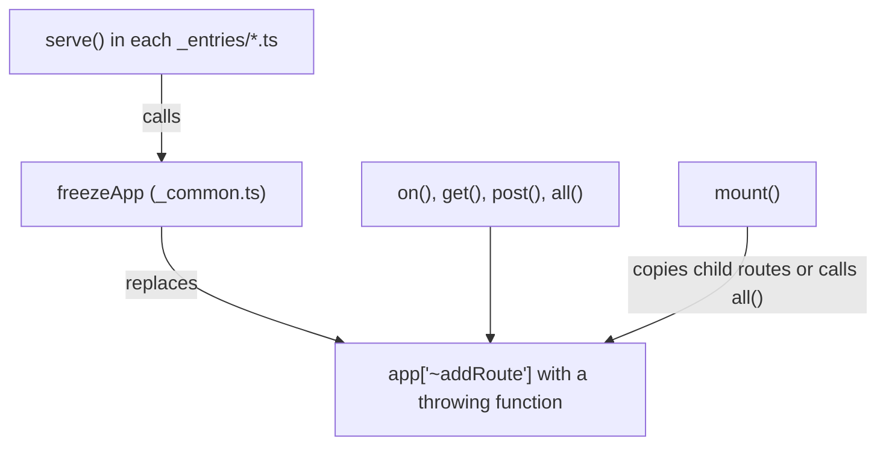

# h3-architecture-001: Locking the app on serve

**Answer:** `src/_entries/_common.ts`

## How a strong engineer would navigate there

1. Find `serve`. h3 doesn't have a single `serve`. Each runtime entry point in `src/_entries/` exports its own: `bun.ts`, `cloudflare.ts`, `deno.ts`, `generic.ts`, `node.ts` and `service-worker.ts`. The `exports` map in `package.json` picks one per runtime (`"node": "./dist/_entries/node.mjs"`, `"bun": ...`, `"default": "./dist/_entries/generic.mjs"`, and so on).
2. Open any of them. The Node one is typical:

```ts
// src/_entries/node.ts:15-18
export function serve(app: H3, options?: Omit<ServerOptions, "fetch">): Server {
  freezeApp(app);
  return srvxServe({ fetch: app.fetch, ...options });
}
```

3. Jump to the definition of `freezeApp`. Every entry imports it with `import { freezeApp } from "./_common.ts";`, so it is defined in `src/_entries/_common.ts`:

```ts
// src/_entries/_common.ts:3-10
export function freezeApp(app: H3): void {
  // @ts-expect-error
  app.config = Object.freeze(app.config);

  app["~addRoute"] = () => {
    throw new Error("Cannot add routes after the server init.");
  };
}
```

## How the lock works



`freezeApp` doesn't touch the public methods. It replaces one internal method on the instance, `"~addRoute"`. That works because every way of adding a route in `src/h3.ts` ends up there:

- `on()` builds an `H3Route` and calls `this["~addRoute"](...)` (line 239).
- `get()`, `post()` and the other method helpers are installed on the prototype in a loop and call `this.on(method, ...)` (lines 290-299). `all()` calls `this.on("", ...)` (line 250).
- `mount()` either copies each child route with `this["~addRoute"](...)` (line 214) or, for a plain fetch handler, calls `this.all(...)` (line 221).

Because the replacement is an own property on the instance, it shadows both `H3Core.prototype["~addRoute"]` and the `H3` override, which is what would otherwise register the route with the rou3 router.

Note what is *not* blocked: `use()` pushes to `this["~middleware"]` (line 283) without going through `"~addRoute"`, so middleware can still be added after `serve`. The prompt only talks about routes.

## Why other files are wrong

- **`src/_entries/node.ts`, `bun.ts`, `deno.ts`, `cloudflare.ts`, `generic.ts`, `service-worker.ts`** each call `freezeApp(app)` inside `serve`. The prompt asks for the file that defines it.
- **`src/h3.ts`** defines the original `"~addRoute"`, both in `H3Core` (line 104, which pushes to `"~routes"`) and in the `H3` override (line 263, which also calls rou3's `addRoute`). That is the method being replaced, not the code that installs the restriction.
- **`src/index.ts`** is the shared public API that every entry re-exports (`export * from "../index.ts"`). It has no `serve` and no `freezeApp`.
- **`srvx`** is the third-party server library that `serve` hands `app.fetch` to. It knows nothing about routes, and it is outside `src/`.

## Why h3 does this

The code itself only gives the error message, not a reason. The effect is that the route table is fixed once the app is serving, so a route registered late (for example from inside a request handler) fails loudly instead of silently changing a live server. Freezing `app.config` in the same helper points the same way: configuration and routes are settled before the first request. Putting the lock in a shared helper means all six runtime entry points behave identically.

## Takeaways

- When the same function name is exported from several entry points, look for a shared helper they all import. The `_common.ts` naming is a strong hint.
- Replacing one internal method on an instance is a cheap way to "freeze" behaviour, as long as every public path goes through that method. Verify that by checking each public method's body.
