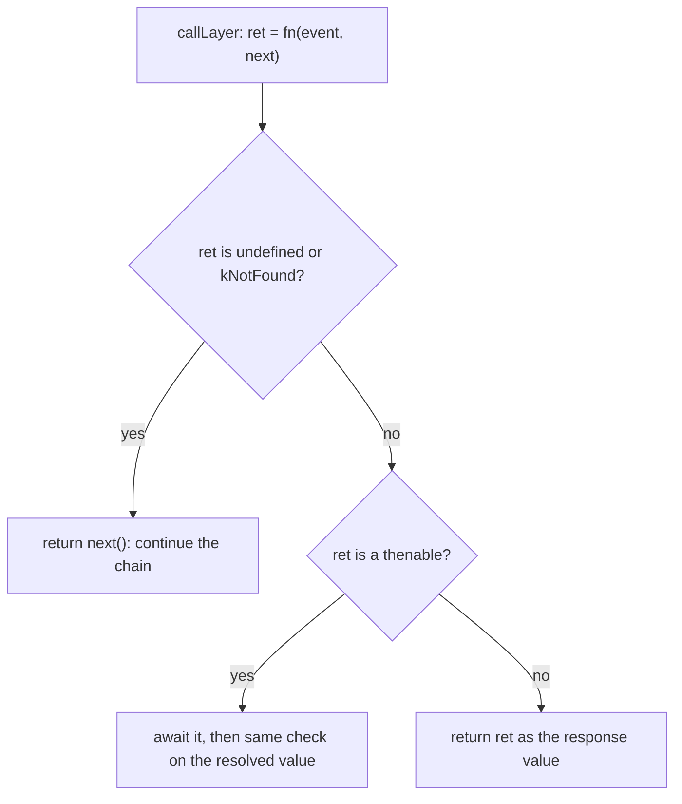

# h3-architecture-002: Middleware that returns undefined

**Answer:** option b. The framework calls `next()` on the middleware's behalf, so the following layer or route handler runs.

## How a strong engineer would navigate there

1. Start at registration. `use()` in `src/h3.ts` (line 268) pushes `normalizeMiddleware(fn, { ...opts, route })` onto `this["~middleware"]` and clears the cached dispatcher (line 283-284).
2. Check what `normalizeMiddleware` does to *this* middleware. It has no route, method or `match` filter, so `createMatcher` returns `undefined`. It takes two parameters, so `input.length > 1` is true. That hits the fast path and the function is stored unchanged:

```ts
// src/middleware.ts:18-21
const matcher = createMatcher(opts);
if (!matcher && (input.length > 1 || input.constructor?.name === "AsyncFunction")) {
  return input; // Fast path: async or with explicit next() and no matcher filters
}
```

So the wrapper further down in `normalizeMiddleware` (which also turns `undefined` into `next()`) is *not* what saves this middleware. The prompt points to `callLayer` for that reason.

3. Follow the request. `H3Core.handler` calls `createDispatcher(this)` once and caches it (line 70). With one middleware and the default `~getMiddleware`, the dispatcher is `composed(event, routeHandler(route))`, where `composed = composeMiddleware(middleware)` (lines 130-131). `composeMiddleware` wraps each layer in `callLayer` (`src/middleware.ts:96`).

4. Read `callLayer`:

```ts
// src/middleware.ts:143-150
const ret = fn(event, next);
return isUnhandledResponse(ret)
  ? next()
  : typeof (ret as PromiseLike<unknown>)?.then === "function"
    ? (ret as PromiseLike<unknown>).then((resolved) =>
        isUnhandledResponse(resolved) ? next() : resolved,
      )
    : ret;
```

```ts
// src/middleware.ts:153-155
function isUnhandledResponse(val: unknown) {
  return val === undefined || val === kNotFound;
}
```

The middleware returns `undefined`, so `isUnhandledResponse(ret)` is `true` and `callLayer` calls `next()` itself. `next` runs `inner(event, handler)`, which is the rest of the chain, ending at the route handler.

## The decision in `callLayer`



`next` is memoized with `nextCalled` and `nextResult` (lines 131-141). If the middleware had called `next()` and then also returned `undefined`, the second call returns the stored result instead of running the chain twice.

## Why the other options are wrong

- **a, a 500 because `next()` was never called.** Nothing in `callLayer` or `composeMiddleware` checks whether the middleware called `next`. There is no error path for it. The memoized `next` makes calling it late (by the framework) safe.
- **c, a 404 because the middleware did not handle it.** A 404 comes from the chain ending at `NoHandler` (returned by `routeHandler` when no route matched, `src/h3.ts:136-137`), whose `kNotFound` result `prepareResponse` turns into an `HTTPError` with status 404. Returning `undefined` from a middleware just continues the chain. If a route matches, its handler runs.
- **d, the chain stops with an empty 200.** `callLayer` never treats `undefined` as a final value. An empty response only happens later, in `src/response.ts`, if the value at the *end* of the whole chain is empty. That is a property of the route handler's return value, not of this middleware.

## Why h3 is designed this way

In h3, a middleware's return value *is* its decision. Returning a value short-circuits and becomes the response. Returning nothing means "I'm done, carry on". That makes observe-only middleware (logging, setting headers, timing) a one-liner, without having to remember `return next()`. The same rule appears in both places a middleware can be wrapped: in `callLayer` for every layer, and in the `normalizeMiddleware` wrapper for filtered or one-parameter middleware (line 27). `kNotFound` is treated the same as `undefined`, so a mounted app or handler that doesn't match also lets the chain continue.

## Takeaways

- For "what happens when X returns Y" questions, find the code that receives the return value. The name of the function that was called matters less than the caller's handling of the result.
- Check fast paths. Here `normalizeMiddleware` returns the input unchanged, so the behavior comes from `callLayer`, one layer further in.
