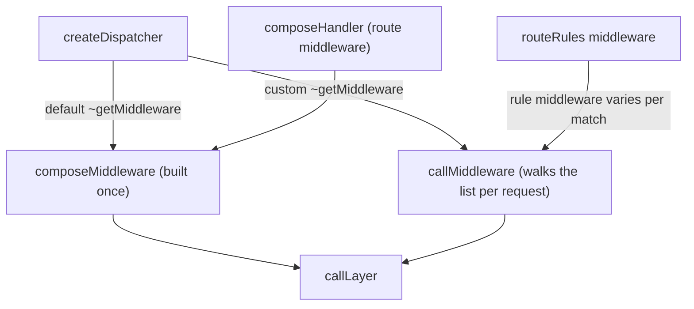

# h3-architecture-003: Callers of callMiddleware

**Answer:**

- `src/h3.ts#createDispatcher`
- `src/rules/middleware.ts#routeRules`

## How a strong engineer would find them

1. Jump to `callMiddleware` in `src/middleware.ts` (line 112) and run Find All References, or search `src/` for `callMiddleware`.
2. Classify every hit:

| Hit | Kind | Counts? |
|---|---|---|
| `src/h3.ts:6` | import | no |
| `src/h3.ts:124` | call inside `createDispatcher` | **yes** |
| `src/index.ts:60` | re-export in `export { ... }` | no |
| `src/middleware.ts:87` | `{@link callMiddleware}` in a doc comment | no |
| `src/middleware.ts:112` | the definition | no |
| `src/middleware.ts:121` | recursive call inside itself | no, same file |
| `src/rules/middleware.ts:1` | import | no |
| `src/rules/middleware.ts:60` | call inside `routeRules` | **yes** |

Two calls remain, and both sit inside a closure that the enclosing function returns. The prompt says that counts.

## The two call sites

**`createDispatcher`**, in the compatibility branch for apps that override `"~getMiddleware"`:

```ts
// src/h3.ts:120-125
if (app["~getMiddleware"] !== H3Core.prototype["~getMiddleware"]) {
  // Compat: a custom `~getMiddleware` (subclass or instance override)
  // can return per-event middleware, which cannot be precomposed.
  return (event, route) =>
    callMiddleware(event, app["~getMiddleware"](event, route || undefined), routeHandler(route));
}
```

**`routeRules`**, inside the `routeRulesMiddleware` function it returns:

```ts
// src/rules/middleware.ts:59-61
return routeRuleMiddleware.length > 0
  ? callMiddleware(event, routeRuleMiddleware, () => next())
  : next();
```

Neither inner closure is a separate symbol in the index. `routeRulesMiddleware` is a named function expression, but the selectable symbol is the enclosing `routeRules`.

## Two ways to run a middleware chain

`src/middleware.ts` has two strategies, and the puzzle is really about which code uses which:



- **`composeMiddleware`** builds a chain of closures once. Its doc comment says "per-layer dispatch cost is paid once at build time instead of on every request" (line 87-88). It is the fast path.
- **`callMiddleware`** walks the array by index on every call, recursing with `index + 1` (lines 118-122). It is slower, but it works for a list that is only known at request time.

Both callers use `callMiddleware` for the same reason: their middleware list depends on the request. A custom `"~getMiddleware"` "can return per-event middleware, which cannot be precomposed" (comment in `createDispatcher`). In `routeRules`, the list is `matched.routeRuleMiddleware`, which depends on which rules matched this request's method and path.

## Why other functions are wrong

- **`callMiddleware` itself** calls `callMiddleware` recursively, but it is in `src/middleware.ts`, which the prompt excludes.
- **`composeMiddleware`, `composeHandler` and `callLayer`** are also in `src/middleware.ts`, and they don't call `callMiddleware` anyway.
- **`H3Core.handler`** calls the dispatcher returned by `createDispatcher` (line 70). The `callMiddleware` call is in `createDispatcher`'s body, so `handler` has no call of its own.
- **`routeHandler`** (`src/h3.ts:134`) is called alongside `callMiddleware` on line 124, as an argument. It uses `composeHandler` for route middleware, not `callMiddleware`.
- **`H3.mount`** composes the child app's middleware with `composeMiddleware` (line 195), not `callMiddleware`.
- **`liftPreflightCors`** in `src/rules/middleware.ts` only adjusts the match result for CORS preflights.
- **The re-export in `src/index.ts`** makes the function public but is not a call. The import lines are not calls either.

## Takeaways

- Find All References returns imports, re-exports, doc links, definitions and calls together. Sort them before counting.
- When a codebase has both a "precompiled" and an "interpreted" version of the same operation, the callers of the slower one usually have a reason. Here it is a list that changes per request.
