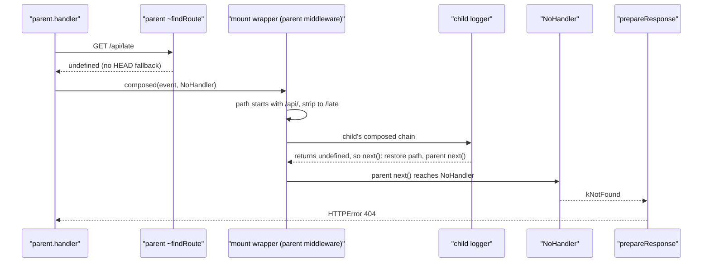

# h3-architecture-004: A route added after mount

**Answer:** option a. The child's logging middleware runs, then the response is a 404, because the parent's router never received the `/late` route.

## The key idea

`mount` treats an `H3` child as a *source of data to copy*, not as something to forward to. At the moment `mount` runs it copies the child's routes into the parent's router, and it adds one wrapper middleware that runs the child's middleware. The child's middleware list is read lazily at request time, but its routes are not. So a route added afterward exists only in the child.

## Timeline

```text
child.use(logger)          child ~middleware = [logger]
child.get("/early")        child router: GET /early
parent.mount("/api", child)
   -> parent ~middleware = [mountWrapper]       (wrapper reads child's middleware later)
   -> parent router:       GET /api/early       (copied now, once)
child.get("/late")         child router: GET /early, GET /late
                           parent router: unchanged
GET /api/late -> parent.fetch
```

## Following `mount`

`mount` in `src/h3.ts` (line 170) branches on the input type:

```ts
// src/h3.ts:174
if ("handler" in input) {
```

An `H3` instance has `handler` (defined on `H3Core` and bound as an own property in its constructor, line 57), so the child takes this branch. The `else` branch (lines 219-227), which registers a `${base}/**` catch-all that calls the child's `fetch`, is only for plain fetch functions and objects with a `fetch` method.

Inside the first branch:

1. **Middleware wrapper (lines 175-212).** `child["~middleware"]` is not empty (it holds the logger), so the parent pushes one middleware of its own. On each request it checks the path prefix, strips `/api` from `event.url.pathname`, runs the child's composed middleware (`input["~composed"] ??= composeMiddleware(input["~middleware"])`, line 195), and finishes that chain by restoring the path and calling the parent's `next()`.
2. **Route copy (lines 213-218).**

```ts
// src/h3.ts:213-218
for (const r of input["~routes"]) {
  this["~addRoute"]({
    ...r,
    route: base + r.route,
  });
}
```

At this point `input["~routes"]` contains only `/early`. The parent's `"~addRoute"` registers `/api/early` in the parent's rou3 router.

Then `child.get("/late", ...)` calls `child.on(...)` → `child["~addRoute"]`, which updates only the child's own router and `~routes` array (lines 263-266 and 104-106). There is no link back to the parent.

## Following the request



1. `parent.fetch` → `"~request"` → `H3Core.handler`. `"~findRoute"` asks the parent's router for `GET /api/late` and gets `undefined`. The HEAD fallback in `"~findRoute"` doesn't apply to a GET.
2. `createDispatcher` sees one parent middleware and builds `composed(event, routeHandler(route))`. With no route, `routeHandler` returns `NoHandler` (line 137), which is `() => kNotFound` (line 39).
3. The wrapper checks the prefix (`/api/late` starts with `/api` and the next character is `/`), and `hasEmptySegmentAfterBase` is false. It sets the pathname to `/late` and runs the child's chain.
4. The logger takes one parameter, so `normalizeMiddleware` wrapped it when `child.use` ran (`src/middleware.ts:22-28`). It logs `/late` (the stripped path), returns `undefined`, and the wrapper calls `next()`. That reaches the terminal function the mount wrapper passed in, which restores the path and calls the parent's `next()`, which runs `NoHandler`. The result is `kNotFound`.
5. `kNotFound` travels back up through `callLayer`, which treats it as unhandled and returns the memoized `next()` result, still `kNotFound`. In `src/response.ts`, `prepareResponse` turns it into an `HTTPError` with status 404 (lines 139-144).

## Why the other options are wrong

- **b, the parent forwards everything under `/api` to the child's `fetch`.** That is the `else` branch of `mount`, used only when the input has no `handler` property. An `H3` app takes the copy-routes branch.
- **c, a 404 without the logger running.** The wrapper the parent adds only checks the path prefix. It doesn't look at whether a route matched, so it runs for every request under `/api`, and the child's logger runs.
- **d, the parent re-reads the child's `~routes` on every request.** `mount` reads `input["~routes"]` once, in the copy loop. Routing at request time uses only the parent's own rou3 router.

## Takeaways

- When composition copies data, the copy is a snapshot. Look for whether the composing code keeps a reference (lazy) or iterates once (eager). Here middleware is lazy (`input["~composed"]` is read per request, and `child.use` clears it), while routes are eager. One catch: the wrapper is only added if the child already had middleware when it was mounted (line 175).
- A 404 in a middleware-based framework can still run middleware. Unmatched requests flow through the whole chain before reaching the not-found handler.
