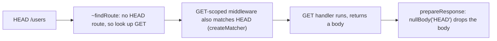

# h3-find-001: HEAD falls back to GET

**Answer:** lines 255-259 of `src/h3.ts`, the `if (match === undefined && _event.req.method === "HEAD") { ... }` block inside the `H3` class's `"~findRoute"` override.

## How a strong engineer would navigate there

1. In `src/h3.ts`, find where a request is matched to a route. `H3Core.handler` (line 64) starts with `const route = this["~findRoute"](event);`.
2. Jump to `"~findRoute"`. On `H3Core` it is an empty hook (line 102): `"~findRoute"(_event: H3Event): MatchedRoute<H3Route> | void {}`. `H3Core` has no router of its own.
3. The prompt says "the H3 app class", and the hint says the lookup is overridden. Scroll to the `H3` class (it starts at line 147, inside an IIFE assigned to `export const H3`) and find `override "~findRoute"` on line 253:

```ts
// src/h3.ts:253-261
override "~findRoute"(_event: H3Event): MatchedRoute<H3Route> | void {
  const match = findRoute<H3Route>(this["~rou3"], _event.req.method, _event.url.pathname);
  if (match === undefined && _event.req.method === "HEAD") {
    // Fall back to the matching GET route (RFC 9110). The method stays "HEAD"
    // so the response body is stripped by nullBody() in prepareResponse.
    return findRoute(this["~rou3"], "GET", _event.url.pathname);
  }
  return match;
}
```

Select from the `if` line (255) through its closing brace (259). The grader requires all of 255-259, and the window is only 253-262.

## Where HEAD is handled across the request

The fallback is one of three places that make HEAD behave like GET without a body:



| Concern | Where | What it does |
|---|---|---|
| Routing | `src/h3.ts:255-259` | If no HEAD route matches, reuse the GET route |
| Middleware scoping | `src/middleware.ts:48-49` | A middleware registered for GET also runs for HEAD |
| Response | `src/response.ts:350-355` and `:234-240` | `nullBody` returns true for `"HEAD"`, so the body is replaced with `null` |

The comment in the `if` block explains the split: the method stays `"HEAD"` on the event, so the response layer knows to strip the body. HTTP (RFC 9110) requires a HEAD response to carry the same headers as GET but no body, and this design gets that without a separate handler.

Note that an explicit HEAD route wins. The fallback only runs when `match === undefined`.

## Why other selections are wrong

- **Line 254 alone**, the first `findRoute` call, is the primary lookup with the request's own method. It is not the fallback.
- **Line 258 alone**, the `return findRoute(..., "GET", ...)`, performs the second lookup but leaves out the condition. The anchor requires the whole block, lines 255-259.
- **Selections that start before line 253 or end after line 262**, such as the whole `H3` class or the `"~addRoute"` override that follows, run past the window.
- **`H3Core."~findRoute"` (line 102)** is the empty base hook. It has no router and no HEAD logic.
- **`nullBody` in `src/response.ts`** strips the HEAD response body. That is a later step, not the route lookup, and it is in a different file.
- **`_middlewareMatcher` in `src/middleware.ts`** has its own HEAD-to-GET rule for middleware scoping. It decides whether a middleware runs, not which route matches.

## Takeaways

- An empty method on a base class is a hook. The real logic is in an override, often in the same file.
- Protocol rules like "HEAD behaves like GET" are rarely in one place. Expect to find them in routing, middleware filtering and response writing, each handling one part.
