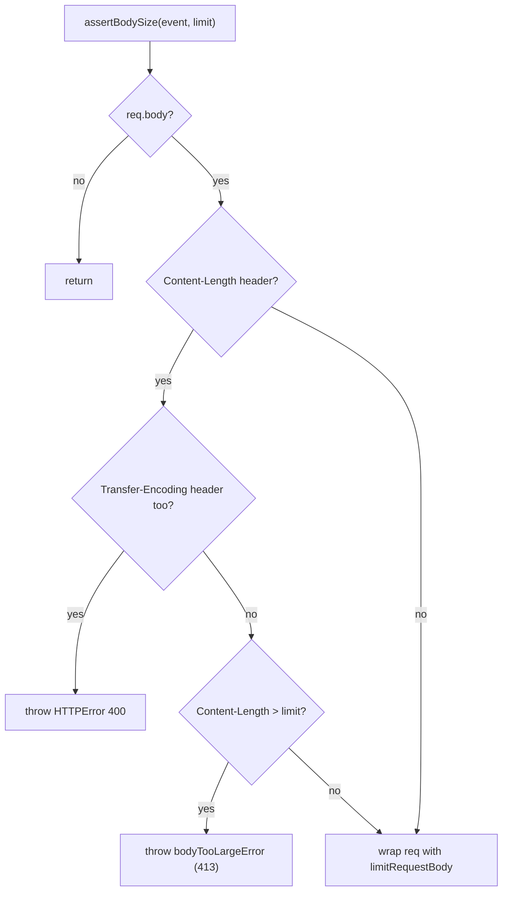

# h3-find-002: Request smuggling guard

**Answer:** `src/utils/body.ts#assertBodySize`

## How a strong engineer would navigate there

The hint says to search for the header that isn't `Content-Length`. Search `src/utils/` for `transfer-encoding`, case-insensitive:

| File | Line(s) | What it is |
|---|---|---|
| `src/utils/body.ts` | 198 | doc comment: "rejected with a `400` (request smuggling, RFC 7230)" |
| `src/utils/body.ts` | 221, **224** | comment and **the check** |
| `src/utils/internal/proxy.ts` | 4, 34, 65 | entries in hop-by-hop header lists |
| `src/utils/proxy.ts` | 32, 499 | doc comment and a code comment about hop-by-hop headers |

Only `body.ts:224` reads the header from an incoming request and throws. It is inside `assertBodySize`:

```ts
// src/utils/body.ts:219-226
const contentLength = req.headers.get("content-length");
if (contentLength) {
  // A message carrying both `Content-Length` and `Transfer-Encoding` is a
  // request smuggling vector and must be rejected.
  // https://datatracker.ietf.org/doc/html/rfc7230#section-3.3.2
  if (req.headers.get("transfer-encoding")) {
    throw new HTTPError({ status: 400 });
  }
```

Note the nesting. The `Transfer-Encoding` check runs only inside the `Content-Length` branch, so it fires exactly when both headers are present. It also runs only when there is a body: the function returns early on `if (!req.body)` (line 215).

## What `assertBodySize` does overall



The function is a body-size guard first. The smuggling check is a precondition: if the two headers disagree about how the body is framed, the `Content-Length` value can't be trusted for the size check either, so the request is rejected before anything else. After the up-front checks, `req` is swapped for srvx's `limitRequestBody` proxy, which counts bytes as the body is read and throws a 413 if it goes over.

## Why both headers together is dangerous

`Content-Length` and `Transfer-Encoding: chunked` are two different ways to say where a request body ends. If a front-end proxy uses one and the back-end server uses the other, they disagree about where one request stops and the next begins. An attacker can then hide a second request inside the first one's body. RFC 7230 section 3.3.2, linked in the code comment, says a message with both should be treated as an error. h3 answers with 400.

## Why other candidates are wrong

- **`bodyLimit`** (`src/utils/middleware.ts:77`) is the middleware form. It calls `assertBodySize(event, limit)` and then `next()`. The check is in the function it calls, not in its own body.
- **`bodyTooLargeError`** (`src/utils/body.ts:243`) builds the 413 error for an oversized body. It is a helper `assertBodySize` calls, and it never looks at headers. The prompt says "not a helper it calls".
- **`readBody`** in the same file parses the body. It doesn't call `assertBodySize` or check `Transfer-Encoding`.
- **`limitRequestBody`** is imported from srvx, a third-party package. It enforces the byte limit while the body streams, and it isn't in `src/utils/`.
- **The proxy helpers** in `src/utils/proxy.ts` and `src/utils/internal/proxy.ts` mention `transfer-encoding` only in lists of hop-by-hop headers that must not be forwarded. They strip the header; they don't reject the request.

## Takeaways

- A rare header name is a precise search term. Sort the hits into "mentions" (lists, comments) and "reads from the request", and only the second kind can enforce anything.
- Security checks are often a few lines inside a broader function. Read the enclosing function to see when the check actually runs (here: only with a body and a `Content-Length`).
