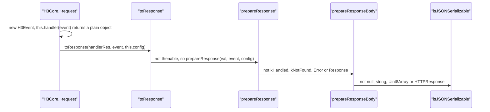

# h3-trace-001: From request to JSON body

**Answer (in order):**

1. `src/h3.ts#H3Core."~request"`
2. `src/response.ts#toResponse`
3. `src/response.ts#prepareResponse`
4. `src/response.ts#prepareResponseBody`
5. `src/utils/internal/object.ts#isJSONSerializable`

## The call sequence



## Step by step

**`"~request"` → `toResponse`.** `H3Core."~request"` (`src/h3.ts:73`) creates the event, runs the handler, and always ends the same way:

```ts
// src/h3.ts:98-99
// Prepare response
return toResponse(handlerRes, event, this.config);
```

The prompt rules out a malformed request, so the `HTTPError` on line 83 isn't thrown. The `onRequest` hook isn't configured by default, so `handlerRes = this.handler(event)` (line 92).

**`toResponse` → `prepareResponse`.** `toResponse` (`src/response.ts:13`) first checks for a thenable (line 18). A plain object isn't one, so it falls through to the synchronous branch:

```ts
// src/response.ts:25-27
let response: Response | Promise<Response>;
try {
  response = prepareResponse(val, event, config);
```

**`prepareResponse` → `prepareResponseBody`.** `prepareResponse` (line 129) handles special values in order: `kHandled` (line 135), `kNotFound` (line 139), then `Error` instances (line 146). A plain object is none of these. It then checks whether the value is already a `Response`:

```ts
// src/response.ts:188-189
if (!(val instanceof Response)) {
  const res = prepareResponseBody(val, event, config);
```

**`prepareResponseBody` → `isJSONSerializable`.** `prepareResponseBody` (line 274) tries each body type in turn:

| Line | Check | Plain object? |
|---|---|---|
| 280 | `null` or `undefined` → empty body | no |
| 287 | `string` → text body | no |
| 294 | `Uint8Array` → binary body | no |
| 304 | `HTTPResponse` (by class or brand) → partial response | no |
| 309 | `isJSONSerializable(val, valType)` → JSON | **called here** |

That call is the end condition. For a plain object, `isJSONSerializable` (`src/utils/internal/object.ts:17`) returns true because its prototype is `Object.prototype` (lines 47-48), and `prepareResponseBody` returns `JSON.stringify(val, ...)` with JSON headers.

## Why other sequences are wrong

- **Including `H3Core.handler`.** `"~request"` does call it, but it returns the handler's value. The next link, `toResponse`, is called by `"~request"`, not by `handler`. It is a side branch.
- **Including `H3Event.<constructor>` or `HTTPError.<constructor>`.** Both appear in `"~request"`. The event is setup, and the `HTTPError` is the malformed-URL guard that the prompt rules out. Neither leads to `isJSONSerializable`.
- **Starting at `H3Core.fetch` or `H3.request`.** Both call `"~request"`, but the prompt names `"~request"` as the start.
- **Including `toError`.** `toResponse` calls it only in the rejection handler and the `catch`, and `prepareResponse` only for an `onError` hook failure. The prompt says the handler returned a plain object synchronously, so none of these run.
- **`toResponse` → `toResponse` → `prepareResponse`.** `toResponse` calls itself for thenables (line 20) and when `prepareResponse` returns a promise (line 32). Neither applies to a synchronous plain object.
- **Skipping `prepareResponse`.** `toResponse` never calls `prepareResponseBody` directly. Each link is a literal call in the previous function's body.
- **Including `nullBody`, `sanitizeStatusCode` or `mergeHeaders`.** They are called from `prepareResponse` *after* `prepareResponseBody` returns, to build the final `FastResponse`. They come after the end condition.
- **Ending at `JSON.stringify`.** It is a standard-library call, which the prompt says to skip, and it runs after `isJSONSerializable`.

## Design notes

h3 lets handlers return almost anything: a string, bytes, a `Response`, a partial `HTTPResponse`, an `Error`, or a plain value to be sent as JSON. `prepareResponse` handles control values (sentinels, errors, real `Response` objects), and `prepareResponseBody` converts body-like values. The JSON check is near the end of the list because cheaper, more specific types (strings, bytes) must win first. A `Uint8Array` is an object too, and the "should be before JSON" comment on line 293 says exactly that.

## Takeaways

- Response-building code is usually a ladder of type checks. When tracing to one rung, list the earlier rungs and confirm your value skips each one.
- A function that calls itself for the async case (`toResponse` here) creates tempting longer paths. The prompt's runtime assumptions decide whether they run.
