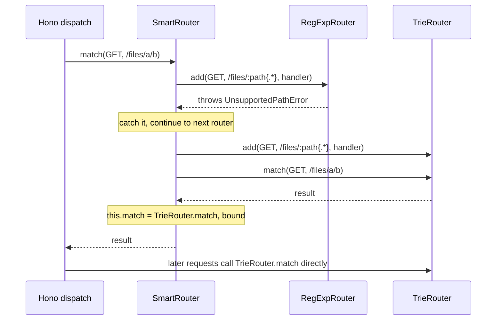

# hono-architecture-001: Where the default app ends up after a fallback

**Answer:** d, `TrieRouter`

## The short version

The default `Hono` class hands `SmartRouter` two candidates, `RegExpRouter` then `TrieRouter`. `SmartRouter` does not decide anything until the first `match` call. At that point it replays every registered route into the first candidate. `RegExpRouter` refuses the pattern `:path{.*}` by throwing `UnsupportedPathError`, so `SmartRouter` moves on to `TrieRouter`, which accepts it. `SmartRouter` then overwrites its own `match` with `TrieRouter`'s bound `match`, so every later request goes straight to `TrieRouter.match`.

## How to navigate there

1. **Start at the class the prompt names.** `src/hono.ts` is tiny. The constructor picks the router:

   ```ts
   // src/hono.ts:28-32
   this.router =
     options.router ??
     new SmartRouter({
       routers: [new RegExpRouter(), new TrieRouter()],
     })
   ```

   With no options, `options.router` is `undefined`, so the app gets a `SmartRouter` with two candidates in that order.

2. **Read `SmartRouter` end to end.** `src/router/smart-router/router.ts` is about 70 lines. Two things stand out:
   - `add` does not touch the candidates. It only pushes `[method, path, handler]` onto `#routes`. So nothing can fail at registration time.
   - `match` is where the real work happens.

   ```ts
   // src/router/smart-router/router.ts:32-50
   for (; i < len; i++) {
     const router = routers[i]
     try {
       for (let i = 0, len = routes.length; i < len; i++) {
         router.add(...routes[i])
       }
       res = router.match(method, path)
     } catch (e) {
       if (e instanceof UnsupportedPathError) {
         continue
       }
       throw e
     }

     this.match = router.match.bind(router)
     this.#routers = [router]
     this.#routes = undefined
     break
   }
   ```

   Line 46 is the key line for this puzzle. `this.match = ...` assigns an own property on the instance, which shadows the class method `SmartRouter.match`. After the first successful match, `app.router.match(...)` never enters `SmartRouter`'s loop again.

3. **Ask the question for candidate 0.** Does `RegExpRouter.add` accept `/files/:path{.*}`? Jump to `RegExpRouter.add` in `src/router/reg-exp-router/router.ts`. The path does not end in `*` (it ends in `}`), and it has no trailing `?`, so it goes to the normal branch, which calls `#insertPath`:

   ```ts
   // src/router/reg-exp-router/router.ts:60-66
   #insertPath(method: string, path: string) {
     try {
       this.#tries![method].insert(path, !/\*|\/:/.test(path))
     } catch (e) {
       throw e === PATH_ERROR ? new UnsupportedPathError(path) : e
     }
   }
   ```

   The path contains `/:`, so `isStatic` is `false`.

4. **Follow the insert into the trie.** `Trie.insert` in `src/router/reg-exp-router/trie.ts` temporarily replaces `{.*}` with a mark, splits the path into tokens, and then puts `{.*}` back. The result is the character tokens of `/files/` followed by one token, `:path{.*}`. Each token goes to `Node.insert` in `src/router/reg-exp-router/node.ts`:

   ```ts
   // src/router/reg-exp-router/node.ts:77-81
   const name = pattern[1]
   let regexpStr = pattern[2] || LABEL_REG_EXP_STR
   if (name && pattern[2]) {
     if (regexpStr === '.*') {
       throw PATH_ERROR
     }
   ```

   For `:path{.*}`, `name` is `path` and the custom pattern is exactly `.*`, so it throws `PATH_ERROR`. `#insertPath` turns that into `UnsupportedPathError`.

5. **Ask the same question for candidate 1.** `TrieRouter.add` (`src/router/trie-router/router.ts:9-13`) just calls `this.#node.insert(...)` for each expanded path. There is no `throw` anywhere in `src/router/trie-router/router.ts` or `src/router/trie-router/node.ts`. So `TrieRouter` accepts the route, `match` succeeds, and line 46 binds `TrieRouter.match`.

## What happens on the first request



## Why the other candidates are wrong

| Option | Why it is wrong |
|---|---|
| a, `RegExpRouter` | It is tried first, but `Node.insert` throws `PATH_ERROR` for a named parameter whose pattern is exactly `.*`. `RegExpRouter` never finishes `add`, so it is never bound. |
| b, `SmartRouter`'s own `match` | It runs only once. Line 46 replaces `this.match` with the winner's bound method, and line 48 sets `#routes` to `undefined`, so the retry loop is gone for good. |
| c, `LinearRouter` | It is not in the default list. It is used by `src/preset/quick.ts`, which builds `SmartRouter` with `[new LinearRouter(), new TrieRouter()]`. |
| e, `PatternRouter` | Also not in the default list. `src/preset/tiny.ts` uses it directly as `this.router = new PatternRouter()`, without `SmartRouter` at all. |

A tempting mistake is to assume `RegExpRouter` wins because it is first and is the "fast" router. That is true for most apps, which is exactly why this route is interesting: one path pattern is enough to change which router serves the whole app.

## Why it is designed this way

`RegExpRouter` compiles the routes of each method into one combined regular expression (`Trie.buildRegExp` in `src/router/reg-exp-router/trie.ts`). That makes matching fast, but not every route can be merged into a single expression. `Node.insert` lists the shapes it refuses with `throw PATH_ERROR`: a named parameter whose pattern is exactly `.*`, a pattern with a capturing group, a single-character metacharacter pattern such as `:x{.}`, a pattern that would sit next to a conflicting sibling in the trie, and a duplicate terminal. Instead of matching wrongly, `RegExpRouter` refuses the route.

`SmartRouter` turns that refusal into a fallback. It delays the choice until the first request, when the full route table is known, then commits to one router and removes itself from the hot path. You can see the result with `getRouterName` in `src/helper/dev/index.ts`, which calls `app.router.match('GET', '/')` and then reads `app.router.name`. For this app it would be `SmartRouter + TrieRouter`.

## Takeaways

- When a class looks like a dispatcher, check whether it reassigns its own methods. `this.match = other.match.bind(other)` is a common "self-replacing" pattern for lazy initialization.
- Registration and matching can be separate phases. Here `add` is just a queue, so the real failure happens on the first request, not when the route is declared.
- Look for internal sentinel errors (`PATH_ERROR`, a `Symbol`) that get translated into public errors at a boundary (`#insertPath`). The translation point is usually where the contract between components is defined.
