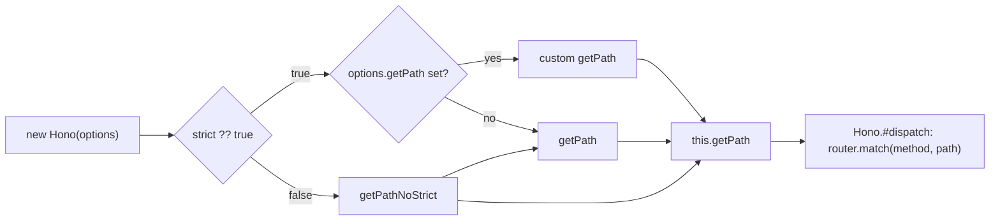

# hono-find-001: The strict-routing switch

**Answer:** `src/utils/url.ts#getPathNoStrict`

## How to navigate there

The prompt tells you which file the answer is in, but `src/utils/url.ts` has many small helpers, and two of them look almost the same. The reliable route is to start where the `strict` option is read, then follow the value.

1. **Find where `strict` is consumed.** The option is declared on `HonoOptions` in `src/hono-base.ts`. Search the constructor for `strict`. Its last two statements are:

   ```ts
   // src/hono-base.ts:188-190
   const { strict, ...optionsWithoutStrict } = options
   Object.assign(this, optionsWithoutStrict)
   this.getPath = (strict ?? true) ? (options.getPath ?? getPath) : getPathNoStrict
   ```

2. **Read the ternary.** `strict ?? true` means strict mode is on by default. Only an explicit `strict: false` takes the right-hand branch, which assigns `getPathNoStrict`. That is the function the prompt describes.

3. **Confirm by reading its body.** Jump to the definition:

   ```ts
   // src/utils/url.ts:154-159
   export const getPathNoStrict = (request: Request): string => {
     const result = getPath(request)

     // if strict routing is false => `/hello/hey/` and `/hello/hey` are treated the same
     return result.length > 1 && result.at(-1) === '/' ? result.slice(0, -1) : result
   }
   ```

   It reuses the strict `getPath`, then removes exactly one trailing `/` when the path is longer than one character. The `length > 1` guard keeps the root path `/` intact.

4. **Confirm that it affects routing.** `this.getPath` is read in `Hono.#dispatch` just before the router is asked for a match:

   ```ts
   // src/hono-base.ts:437-438
   const path = this.getPath(request, { env })
   const matchResult = this.router.match(method, path)
   ```

   So with `strict: false`, a request for `/users/` reaches the router as `/users`, and it matches a route registered as `/users`.

## How the pieces connect



## Why the other candidates are wrong

| Candidate | What it does | Why it is not the answer |
|---|---|---|
| `getPath` (`src/utils/url.ts:106`) | Extracts the path from `request.url`, stopping at `?` or `#`, and decodes it when it sees `%`. | It keeps the trailing slash. It is the default used in strict mode. `getPathNoStrict` calls it, but does not replace it. |
| `mergePath` (`src/utils/url.ts:171`) | Joins a base path and a sub path, as in `mergePath('/api', '/users')`. | It runs when routes and base paths are set up (`Hono.#addRoute`, `basePath`, `mount`) and when `Hono.request` builds a URL, not when the request path is read for matching. |
| `checkOptionalParameter` (`src/utils/url.ts:184`) | Expands `/a/:b?` into two route paths. | It works on route definitions, not request paths. |
| The `Hono` constructor in `src/hono-base.ts` | Chooses which function becomes `this.getPath`. | The prompt asks for a function in `src/utils/url.ts`. The constructor is where the switch is flipped, but it does not drop the slash itself. |
| `trimTrailingSlash` in `src/middleware/trailing-slash/index.ts` | A middleware that answers with a 301 redirect to the path without the slash. | It is in a different file, and it redirects instead of changing how the router sees the path. It is not tied to the `strict` option. |

## Design notes

- **The choice is made once, at construction.** Hono does not check a flag on every request. It picks a function up front and stores it in `this.getPath`. The hot path in `#dispatch` just calls it. This is a common way to keep options out of per-request code.
- **The type system blocks a confusing combination.** `HonoOptions` is a union. One branch allows `strict?: true` with an optional `getPath`. The other has `strict: false` with `getPath?: never`. So TypeScript rejects `{ strict: false, getPath: ... }`, which matches the runtime: with `strict: false`, a custom `getPath` would be ignored.
- **Non-strict mode only normalizes one slash.** `/users//` becomes `/users/`, not `/users`, because `slice(0, -1)` removes a single character.

## Takeaways

- To find the function behind an option, search for where the option is *read*, not where it is declared. Declarations tell you the type. Reads tell you the behavior.
- When two functions differ only by a suffix (`getPath` and `getPathNoStrict`), read both bodies. Often one wraps the other.
