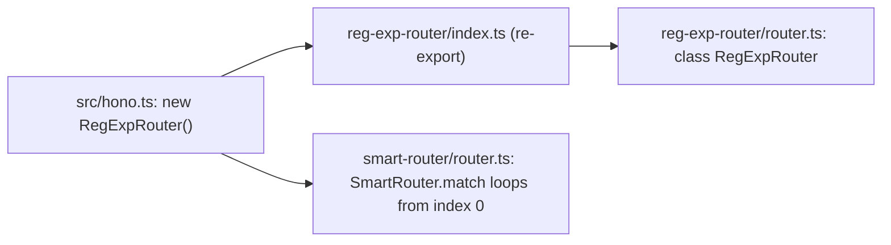

# hono-find-003: First router tried by the default app

**Answer:** `src/router/reg-exp-router/router.ts` (defines `RegExpRouter`)

## How to navigate there

This puzzle has two parts: work out *which* router is tried first, then find *where its class is defined*. Each part has a trap.

### Part 1: which candidate goes first

1. **Open `src/hono.ts`.** The constructor is four lines:

   ```ts
   // src/hono.ts:28-32
   this.router =
     options.router ??
     new SmartRouter({
       routers: [new RegExpRouter(), new TrieRouter()],
     })
   ```

   The array order is `RegExpRouter`, then `TrieRouter`. But array order only matters if `SmartRouter` walks the array from the start, so check that.

2. **Open `SmartRouter.match`** in `src/router/smart-router/router.ts`. The constructor stores the array as-is (`this.#routers = init.routers`, line 10), and `match` walks it from index 0:

   ```ts
   // src/router/smart-router/router.ts:30-33
   let i = 0
   let res
   for (; i < len; i++) {
     const router = routers[i]
   ```

   Nothing sorts or reverses the list, so index 0, `RegExpRouter`, is tried first. `TrieRouter` is only tried if `RegExpRouter` throws `UnsupportedPathError`.

### Part 2: where `RegExpRouter` is defined

3. **Follow the import, then keep going.** `src/hono.ts` imports from the directory, not the file:

   ```ts
   // src/hono.ts:3
   import { RegExpRouter } from './router/reg-exp-router'
   ```

   That resolves to `src/router/reg-exp-router/index.ts`, which only re-exports:

   ```ts
   // src/router/reg-exp-router/index.ts
   export { RegExpRouter } from './router'
   export { PreparedRegExpRouter, buildInitParams, serializeInitParams } from './prepared-router'
   ```

   One more "go to definition" lands on `export class RegExpRouter<T> implements Router<T>` at `src/router/reg-exp-router/router.ts:48`.



## Why the other candidates are wrong

| Candidate | Why it is wrong |
|---|---|
| `src/router/reg-exp-router/index.ts` | It only re-exports `RegExpRouter`. The prompt asks for the file with the class definition. It is the file your editor opens first if you follow the import path by hand, which makes it the most common wrong answer. |
| `src/router/trie-router/router.ts` | Defines `TrieRouter`, the second candidate. It is used only after `RegExpRouter` refuses a route. |
| `src/router/smart-router/router.ts` | Defines the wrapper that does the trying. It is not one of the two candidates. |
| `src/router/reg-exp-router/prepared-router.ts` | Defines `PreparedRegExpRouter`, a different class for prebuilt matchers. `src/hono.ts` never constructs it. |
| `src/router/reg-exp-router/matcher.ts` | Holds the `match` function that `RegExpRouter` assigns to its `match` field (`match: typeof match<Router<T>, T> = match`, line 129). It is part of the router, but not where the class is defined. |
| `src/router/reg-exp-router/trie.ts`, `node.ts` | Internal data structures that `RegExpRouter` uses to build its regex. |
| `src/preset/quick.ts` | Builds a different `SmartRouter` with `LinearRouter` first. The prompt fixes the class from `src/hono.ts`. |
| `src/router/linear-router/router.ts` | First in the `quick` preset, not in the default app. |

## Background: why RegExpRouter goes first

`RegExpRouter` turns all routes for a method into one regular expression, so a match is either a lookup in a table of static paths or one `RegExp` execution (see `match` in `src/router/reg-exp-router/matcher.ts:14-29`). That is the fastest option when it works. It cannot represent some patterns, so it can refuse a route with `UnsupportedPathError`. `TrieRouter` is slower but accepts any pattern, which makes it a safe fallback. Putting the fast-but-picky router first and the general router second gets the best case for most apps and still works for the rest.

## Takeaways

- An array of strategies is only an ordered list if the consumer iterates it in order. Always check the loop.
- Barrel files (`index.ts` re-exports) are common in TypeScript libraries. "Go to definition" on an import may land on the barrel. Jump once more to reach the real declaration.
- Presets (`src/preset/`) are an easy way to get the wrong answer. Pin down which entry point the prompt is about before reading.
