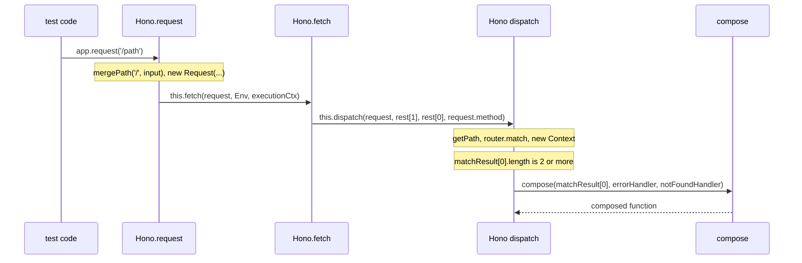

# hono-trace-001: From app.request to the middleware chain

**Answer:** `Hono.request` -> `Hono.fetch` -> `Hono.#dispatch` -> `compose`

- `src/hono-base.ts#Hono.request`
- `src/hono-base.ts#Hono.fetch`
- `src/hono-base.ts#Hono.#dispatch`
- `src/compose.ts#compose`

## The call chain



(The diagram writes `dispatch` without the `#` prefix. In the code it is the private method `#dispatch`.)

## How to navigate there

1. **Start at `Hono.request`** in `src/hono-base.ts` (line 518). Note that it is an arrow function stored in a class field, not a method, so search for `request = (` rather than `request(`. With a string input, the `instanceof Request` branch is skipped:

   ```ts
   // src/hono-base.ts:527-535
   input = input.toString()
   return this.fetch(
     new Request(
       /^https?:\/\//.test(input) ? input : `http://localhost${mergePath('/', input)}`,
       requestInit
     ),
     Env,
     executionCtx
   )
   ```

   Three things are called here: `mergePath`, the platform `Request` constructor, and `this.fetch`. Only `this.fetch` leads further toward `compose`.

2. **`Hono.fetch`** (line 498) is also a field holding an arrow function. Its body is one line:

   ```ts
   // src/hono-base.ts:503
   return this.#dispatch(request, rest[1], rest[0], request.method)
   ```

   Note the argument swap: `fetch(request, env, executionCtx)` becomes `#dispatch(request, executionCtx, env, method)`.

3. **`Hono.#dispatch`** (line 425) does the real work. For a GET request it calls `this.getPath`, then `this.router.match`, then `new Context(...)`. Then it tests the handler count:

   ```ts
   // src/hono-base.ts:448-449
   // Do not `compose` if it has only one handler
   if (matchResult[0].length === 1) {
   ```

   The prompt fixes the runtime path: the match returns two or more handlers, so this branch is skipped and execution reaches line 469:

   ```ts
   // src/hono-base.ts:469
   const composed = compose(matchResult[0], this.errorHandler, this.#notFoundHandler)
   ```

4. **`compose`** in `src/compose.ts` (line 15) is the end condition. It takes the handler list and returns one function `(context, next) => Promise<Context>` that runs the handlers in order through an inner `dispatch(i)`.

## Why the prompt's details matter

| Detail in the prompt | What it rules out |
|---|---|
| "called with a URL string" | The `input instanceof Request` branch. Both branches call `this.fetch`, so the answer is the same, but fixing it removes doubt. |
| "two or more handlers" | The single-handler fast path at line 449, which returns before `compose` is ever called. With one handler, the chain would never reach the end condition. |
| "each entry must be called from the body of the one before it" | Listing `getPath` or `Router.match` as steps. They are called from `#dispatch`, but `compose` is not called from them. |
| "Skip constructors, built-ins and third-party or platform calls" | `new Request(...)`, `new Context(...)`, `RegExp.test`, and `toString`. |

## Why other candidates are wrong

- **`mergePath`** (`src/utils/url.ts`) is called directly from `Hono.request`, but it only builds the URL string. It returns to `request` and never leads to `compose`.
- **`Router.match`** is called from `#dispatch`, but it is an interface method on `this.router`, and the chain does not pass through it. `compose` is called by `#dispatch` itself.
- **`getPath`** is called through `this.getPath`, also from `#dispatch`, and also returns before `compose`.
- **`Context`'s constructor** is a constructor, which the prompt excludes. It also does not call `compose`.
- **`Hono.#handleError`** is only reached if a handler throws. It is not on the path to `compose`.
- **`Hono.route`** also references `compose`, inside a wrapper handler it builds for sub-apps that have a custom error handler (line 243). It is not reachable from `Hono.request`.
- **`dispatch` inside `src/compose.ts`** is the inner function of the composed chain. The trace stops at `compose`, the function that builds the chain, not the function that runs it.
- **Skipping `Hono.fetch`** and going straight from `request` to `#dispatch` is wrong. `request` never calls `#dispatch` itself, it always goes through `this.fetch`.

## Design notes

- `request` exists for tests. It lets you write `app.request('/hello')` instead of building a full `Request` with an absolute URL. It is a thin adapter over the real entry point, `fetch(request, env, executionCtx)`, which is what a server adapter calls for each incoming request.
- `#dispatch` is private and takes `method` as a separate argument. That is what allows the HEAD branch to call `this.#dispatch(request, executionCtx, env, 'GET')` with the same request object.
- `compose` is based on `koa-compose`, as its doc comment says. Building the chain only when needed is why the single-handler fast path exists.

## Takeaways

- In TypeScript classes, "methods" are often arrow-function fields (`fetch = (...) => {}`). Search for `name =` as well as `name(` when looking for definitions.
- When the prompt fixes a runtime condition ("two or more handlers"), find the branch that condition controls. It usually decides whether the trace reaches the end at all.
- A direct-call chain is not every function called along the way. It is only the functions that hand control to the next step.
