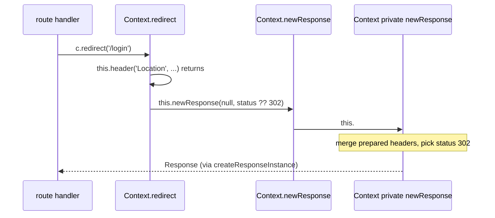

# hono-trace-002: From c.redirect to the response builder

**Answer:** `Context.redirect` -> `Context.newResponse` -> `Context.#newResponse`

- `src/context.ts#Context.redirect`
- `src/context.ts#Context.newResponse`
- `src/context.ts#Context.#newResponse`

## The call chain



## How to navigate there

1. **Find `redirect` in `src/context.ts`.** Like most of `Context`'s public API, it is an arrow function stored in a class field, so search for `redirect =`:

   ```ts
   // src/context.ts:768-780
   redirect = <T extends RedirectStatusCode = 302>(
     location: string | URL,
     status?: T
   ): Response & TypedResponse<undefined, T, 'redirect'> => {
     const locationString = String(location)
     this.header(
       'Location',
       // Multibytes should be encoded
       // eslint-disable-next-line no-control-regex
       !/[^\x00-\xFF]/.test(locationString) ? locationString : encodeURI(locationString)
     )
     return this.newResponse(null, status ?? 302) as any
   }
   ```

   There are two calls on `this`, as the hint says. `this.header(...)` records the header and returns `void`. `this.newResponse(...)` builds the value that `redirect` returns. Only the second one can lead to the response builder.

2. **Jump to `newResponse`.** It is a one-line public wrapper:

   ```ts
   // src/context.ts:659
   newResponse: NewResponse = (...args) => this.#newResponse(...(args as Parameters<NewResponse>))
   ```

3. **Jump to `#newResponse`** (line 609). This is the private method the prompt describes. It starts from the headers prepared so far:

   ```ts
   // src/context.ts:614
   let responseHeaders = this.#res ? new Headers(this.#res.headers) : this.#preparedHeaders
   ```

   It merges any headers from `arg` and the `headers` argument (neither is used by `redirect`), picks the status, and creates the `Response`:

   ```ts
   // src/context.ts:652-656
   const status = typeof arg === 'number' ? arg : (arg?.status ?? this.#status)
   return createResponseInstance(data, {
     status,
     headers: responseHeaders ?? (headers as Record<string, string> | undefined),
   })
   ```

   For `redirect('/login')`, `arg` is the number `302`, so `status` is 302, and `responseHeaders` is the `#preparedHeaders` object that `header` just wrote `Location` into.

## How the Location header gets into the response

`header` and `#newResponse` never call each other. They communicate through a private field:

```text
redirect
 ├─ header('Location', url)
 │    headers = this.#res ? this.#res.headers : (this.#preparedHeaders ??= new Headers())
 │    headers.set('Location', url)                         ← writes the field
 └─ newResponse(null, 302)
      └─ #newResponse(null, 302)
           responseHeaders = this.#res ? new Headers(this.#res.headers) : this.#preparedHeaders
                                                            ← reads the field
           createResponseInstance(null, { status: 302, headers: responseHeaders })
```

That is why `header` is called but is not part of the chain. It returns before `newResponse` is called, and nothing it calls reaches `#newResponse`.

## Why other candidates are wrong

| Candidate | Why it is wrong |
|---|---|
| `Context.header` | Called from `redirect`, but it only sets the header on `#res` or `#preparedHeaders` and returns. It never calls `#newResponse`. |
| `redirect` -> `#newResponse` directly | Skips a step. `redirect` calls the public `newResponse` field, and that wrapper calls the private method. Every entry must be called from the body of the previous one. |
| `createResponseInstance` (line 288) | The module-level helper `#newResponse` calls to run `new Response(body, init)`. It is not a `Context` method, and the chain ends at the private method. |
| `Context.body`, `Context.text`, `Context.json`, `Context.html` | These also call `#newResponse` directly, but `redirect` never calls them. |
| `Context.status` | Sets `#status`, which `#newResponse` falls back to when no status is passed. `redirect` always passes one (`status ?? 302`) and never calls `status`. |
| `encodeURI`, `String`, `RegExp.test` | Built-ins, which the prompt skips. |

## Design notes

- **Public wrapper, private implementation.** `newResponse` is part of the public API. `#newResponse` is the shared builder that `body`, `text`, `json`, `html` and `newResponse` all use. Keeping the builder private means its parameter handling can change without changing the public surface.
- **Prepared headers.** Before a response exists, headers are collected in `#preparedHeaders`. The response is built once, at the end, with those headers. This avoids creating a `Response` early and then copying it.
- **Default status.** `redirect` passes `status ?? 302`, so a redirect without a status is always a 302, even if `c.status(...)` was called earlier.
- **Non-Latin-1 locations are encoded.** The regex `/[^\x00-\xFF]/` checks for characters outside Latin-1, and only then calls `encodeURI`, since header values cannot hold those characters as-is.

## Takeaways

- Two components can be linked by shared state instead of calls. When a method writes a field and returns, look for who reads that field.
- Public one-line wrappers around private methods are common in TypeScript classes with `#private` members. A direct-call trace must include the wrapper.
- In Hono's `Context`, almost everything is an arrow-function field (`name = (...) => {}`), not a method. Search for `name =` to find definitions.
