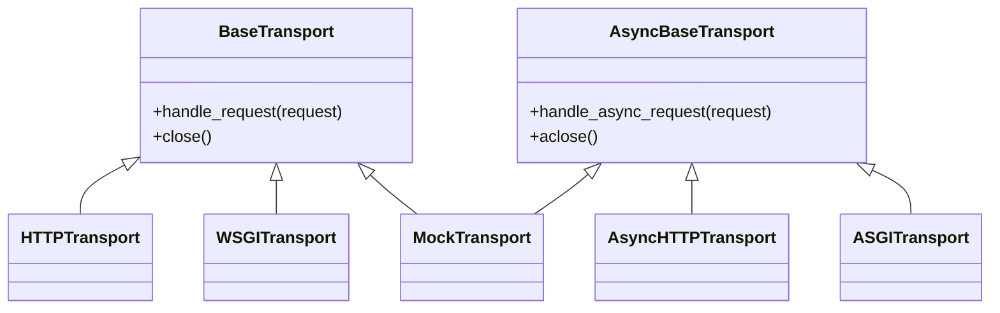

# httpx-architecture-001: Synchronous transport implementations

**Answer:** `httpx/_transports/default.py#HTTPTransport`, `httpx/_transports/wsgi.py#WSGITransport`, `httpx/_transports/mock.py#MockTransport`

## How to navigate there

1. **List the directory.** `httpx/_transports/` has five modules: `asgi.py`, `base.py`, `default.py`, `mock.py`, `wsgi.py`, plus an `__init__.py` that re-exports everything.
2. **Read the base classes.** `base.py` defines `BaseTransport` (line 14) and `AsyncBaseTransport` (line 65). The sync one has a single method that matters, `handle_request`, which raises `NotImplementedError` (lines 57-59), plus `close` and context-manager support.
3. **List every class header in the other four files.** There are only nine, so a grep for `^class ` is enough:

| File | Class | Line | Bases | Kind |
|---|---|---|---|---|
| `default.py` | `ResponseStream` | 121 | `SyncByteStream` | stream helper |
| `default.py` | **`HTTPTransport`** | 135 | **`BaseTransport`** | sync transport |
| `default.py` | `AsyncResponseStream` | 265 | `AsyncByteStream` | stream helper |
| `default.py` | `AsyncHTTPTransport` | 279 | `AsyncBaseTransport` | async transport |
| `wsgi.py` | `WSGIByteStream` | 30 | `SyncByteStream` | stream helper |
| `wsgi.py` | **`WSGITransport`** | 44 | **`BaseTransport`** | sync transport |
| `asgi.py` | `ASGIResponseStream` | 55 | `AsyncByteStream` | stream helper |
| `asgi.py` | `ASGITransport` | 63 | `AsyncBaseTransport` | async transport |
| `mock.py` | **`MockTransport`** | 15 | `AsyncBaseTransport`, **`BaseTransport`** | both |

The three with `BaseTransport` among their bases are the answer.

## The shape of the hierarchy



## The one that is both

`MockTransport` is the class the hint refers to. Its header lists the async base first, which makes it easy to misread as async-only:

```python
# httpx/_transports/mock.py:15-27
class MockTransport(AsyncBaseTransport, BaseTransport):
    def __init__(self, handler: SyncHandler | AsyncHandler) -> None:
        self.handler = handler

    def handle_request(
        self,
        request: Request,
    ) -> Response:
        request.read()
        response = self.handler(request)
        if not isinstance(response, Response):  # pragma: no cover
            raise TypeError("Cannot use an async handler in a sync Client")
        return response
```

It implements both `handle_request` and `handle_async_request` (line 29), so one mock can be passed to either `Client` or `AsyncClient`. The sync path rejects an async handler, while the async path awaits the handler's result only if it isn't already a `Response` (lines 40-41).

## Why the design pairs sync and async classes

A sync `Client` calls `transport.handle_request(...)`, and an `AsyncClient` awaits `transport.handle_async_request(...)`. Python can't make one method serve both, so httpx defines two parallel interfaces and, for each real backend, two classes: `HTTPTransport`/`AsyncHTTPTransport` over httpcore. The in-process transports follow the protocol they adapt: WSGI is a synchronous protocol (`WSGITransport`), ASGI is asynchronous (`ASGITransport`). `Client.__init__` types its transports as `BaseTransport` (for example `httpx/_client.py:659` and the default from `_init_transport`, which returns `HTTPTransport`, line 731).

## Why the other candidates are wrong

- **`AsyncHTTPTransport` and `ASGITransport`.** Their only base is `AsyncBaseTransport`. They have no `handle_request`.
- **`BaseTransport` itself.** It is the base the prompt measures against, not a concrete transport. It raises `NotImplementedError` in `handle_request`.
- **`ResponseStream` and `WSGIByteStream`.** Sync classes in the same files, but they derive from `SyncByteStream`. They wrap response bodies and are the "stream or response helper classes" the prompt excludes. The same applies to `AsyncResponseStream` and `ASGIResponseStream` on the async side.
- **Anything outside `httpx/_transports/`.** For example, user code or tests that subclass `BaseTransport`. The prompt limits the search to this directory.

## Takeaways

- For "which classes implement interface X" questions, list every class header in the scope and read all bases, not just the first. Mixins and multi-interface classes often put the base you care about second.
- Sync/async libraries in Python commonly mirror each interface and each implementation. When you find one class, look for its `Async` twin, and for any class that implements both.
- Stream and body wrappers often live next to the transports that produce them. Check each class's base to tell transports from helpers.
